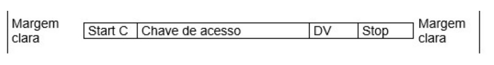
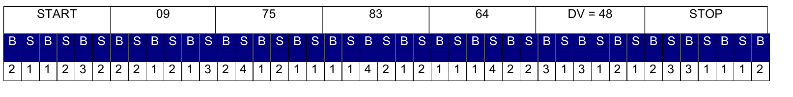

<!-- p.12 -->

# 2.17. Código de Barras

O padrão de código de barras a ser impresso no DACTE é o CODE-128C. O código de barras deverá representar a chave de acesso do CT-e em emissão normal ou contingência.

A impressão do código de barras no DACTE tem a finalidade de facilitar e agilizar a captura de dados para consulta nos portais estaduais e da Receita Federal do Brasil. Com a chave de acesso é possível realizar a consulta integral ou resumida de um CT-e e sua situação, bem como visualizar a autorização de uso do mesmo.

O conjunto de caracteres representativos do Código de Barras CODE-128C segue ao final deste manual.
O código de barras deverá representar apenas a chave de acesso do CT-e de 44 posições. Para a impressão do mesmo será considerada a seguinte estrutura de simbolização:

**Margem Clara:** Espaço claro, que não contém nenhuma marca legível por máquina, existente à esquerda e à direita do código para evitar interferência na decodificação da simbologia. A margem clara também é chamada de "área livre", "zona de silêncio" ou "margem de silêncio".

**Start C:** inicia a codificação dos dados CODE-128C de acordo com o conjunto de caracteres. O Start C não representa nenhum caractere.

**Chave de acesso do CT-e:** representa conjunto de 44 caracteres da chave de acesso do CT-e.  
**DV:** dígito verificador da simbologia.  
**Stop:** caractere de parada, indica o final do código ao leitor óptico.

O código de barras deverá ser impresso com resolução mínima de 300 dpi, devendo ser observada a área reservada no DACTE de 3 x 9 cm.  
Altura da barra: no intuito de propiciar melhor área de leitura, a altura da barra não poderá ser inferior a 1,5 cm e nem superior a 2,5 cm.  
Largura da barra: considerando que para cada símbolo da barra são codificados dois caracteres, então teremos:

- Tamanho do campo chave de acesso = 44 (caracteres) / 2 = 22 (símbolos)
- <!-- p.13 -->Considerando que cada símbolo possui 11 (módulos) * 22 (símbolos) = 242 posições
- Margem clara = deve ter no mínimo a dimensão de 10 (módulos) * 2 = 20 posições
- Start C = 11 (módulos) = 11 posições
- DV = 11 (módulos) = 11 posições
- Stop = 13 (módulos) = 13 posições
- Tamanho total da simbologia = 242 + 20 + 11 + 11 + 13 = 297 (posições)
- Largura máxima de cada módulo da barra = 9 cm / 297 (posições) = 0,03 cm

## 2.17.1. Cálculo do dígito verificador do CODE-128C

O dígito verificador é baseado em um cálculo do módulo 103 considerando a soma ponderada dos valores de cada um dos dígitos na mensagem que está sendo codificada, incluindo o valor do caractere de início (start).

Exemplo: consideremos que a chave de acesso fosse apenas de oito caracteres e contivesse o seguinte número: 09758364

| Chave de acesso | | START | 09 | 75 | 83 | 64 |
|---|---|---|---|---|---|---|
| Sequência | A | | 1 | 2 | 3 | 4 |
| Valor do caractere | B | 105 | 9 | 75 | 83 | 64 |
| Valor Ponderado (A X B) | C | 105 | 9 | 150 | 249 | 256 |

- Na linha valor do caractere foi incluso o valor 105 que corresponde ao valor do caractere de início (start) para o padrão Code C.
- Excetuando o caractere de start, os demais valores dos caracteres coincidem com os valores da chave de acesso, isto porque estamos utilizando o padrão Code C de codificação que é exclusivamente numérico.
- O dígito verificador do código será o resto da divisão da somatória dos valores ponderados dividido por 103 (módulo 103).

Assim o dígito verificador será:

- Valor da soma ponderada = (1x105) +(1x9) +(2x75) +(3x83) +(4x64) = 769
- 769/103 = 7 resta 48, assim o DV é 48

## 2.17.2. Representação simbólica do código

B = barra preta  
S = espaço ou barra branca  
A numeração acima indica quantas vezes a barra deverá ser impressa no símbolo.
