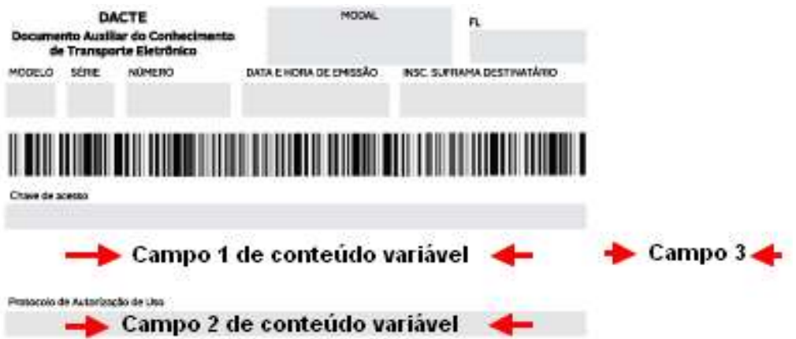
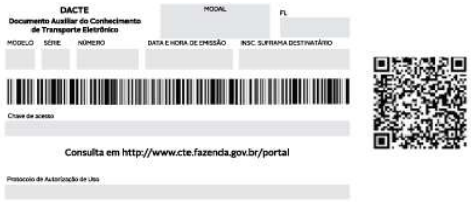
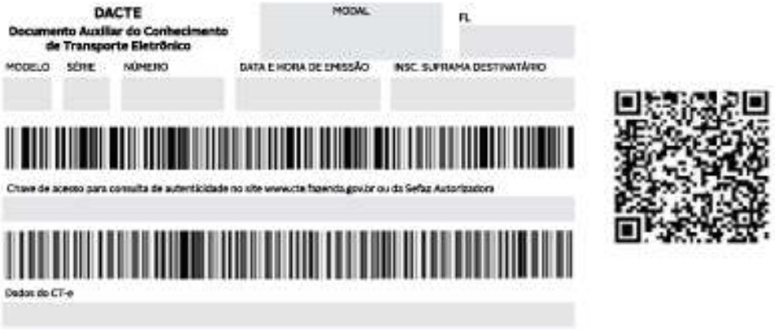

# 2.19. Campos de Conteúdo Variável

O leiaute de geração/impressão do DACTE prevê três campos de conteúdo variável logo abaixo do local onde é impressa a chave de acesso, de acordo com a seguinte disposição:

<!-- p.15 -->

## 2.19.1. CT-e emissão Normal

A emissão de CT-e normal é forma conclusiva de emissão do CT-e, contendo a autorização de uso para o CT-e. Nesse caso, após a obtenção da autorização de uso do CT-e o emissor poderá imprimir o DACTE em papel comum ou gerar o DACTE em meio eletrônico, informando:

- No campo 1: informará a URL onde pode ser consultada a autenticidade do CT-e a partir do valor da chave de acesso;
- No campo 2: informará o número do protocolo de autorização de uso, a data e a hora de autorização;
- No campo 3: informará o QR Code, conforme definido no MOC para a emissão Normal.

## 2.19.2. CT-e emissão em contingência – FS-DA

O uso do formulário de segurança FS-DA, para impressão do DACTE, é a forma de contingência mais simples. Os CT-e devem ser transmitidos posteriormente para a SEFAZ quando cessados os problemas técnicos que impediam a transmissão.

Nesse caso, o emissor deverá gerar o Código de Barras Adicional no Campo 1 e a representação numérica desse Código de Barras Adicional no Campo 2.

<!-- p.16 -->

No campo 3 deverá gerar o QR Code conforme as regras do MOC para geração de QR Code em contingência.

**Observação:** O DACTE emitido em contingência na modalidade de impressão em FS-DA deverá conter impresso o Código de Barras Adicional dos Dados do CT-e e será formado pelo seguinte conteúdo, em um total de 36 caracteres:

| | cUF | tpEmis | CNPJ | vCT | ICMSp | ICMSs | DD | DV |
|---|---|---|---|---|---|---|---|---|
| Quantidade de caracteres | 02 | 01 | 14 | 14 | 01 | 01 | 02 | 01 |

cUF = Código da UF do destinatário ou remetente do Documento Fiscal, informar 99 quando a operação for de comércio exterior;

tpEmis = Forma de Emissão do CT-e, informar 5-Contingência FS-DA;

CNPJ = CNPJ do destinatário ou do remetente, informar zeros no caso de operação com o exterior ou o CPF caso o destinatário ou remetente seja pessoa física;

vCT = Valor Total da CT-e (sem ponto decimal, informar sempre os centavos), correspondendo à tag vTPrest, de vPrest;

ICMSp = Destaque de ICMS próprio no CT-e no seguinte formato:

- 1 = há destaque de ICMS próprio. Este caso ocorre quando se tiver a tag vICMS, a qual aparece quando esta é tag de:
  - ICMS00 (Prestação sujeito à tributação normal do ICMS), ou;
  - ICMS20 (Prestação sujeito à tributação com redução de BC do ICMS), ou ;
  - ICMS90 (ICMS Outros)
- 2 = não há destaque de ICMS próprio. Esse caso ocorre quando não se tiver a tag vICMS, o que acontece quando se tem tag de:
  - ICMSOutraUF (ICMS devido à UF de origem da prestação, quando diferente da UF do emitente), ou;
  - ICMS45 (ICMS Isento, não Tributado ou diferido), ou;
  - ICMSSN (Simples Nacional) e demais casos em que não haja destaque do ICMS próprio.

<!-- p.17 -->

ICMSs = Destaque de ICMS por substituição tributária no CT-e, no seguinte formato:

- 1 = há destaque de ICMS por substituição tributária. Neste caso se terá a tag vICMSSTRet, de ICMS60 (Tributação pelo ICMS60 – ICMS cobrado por substituição tributária. Responsabilidade do recolhimento do ICMS atribuído ao tomador ou 3º por ST);
- 2 = não há destaque de ICMS por substituição tributária. Nos demais casos, que não se tenha ICMS60;

DD = Dia da emissão do CT-e;

DV = Dígito Verificador, calculado de forma igual ao DV da Chave de Acesso.

**Observação:** Todos os campos que formam o código de barras devem ser preenchidos com alinhamento à direita, sem formatação e com os zeros não significativos necessários para alcançar o tamanho do campo.
