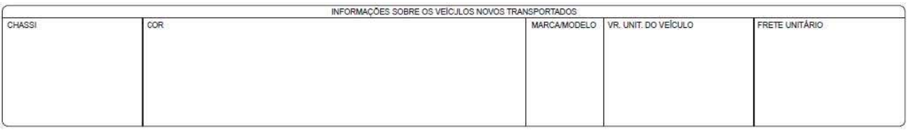
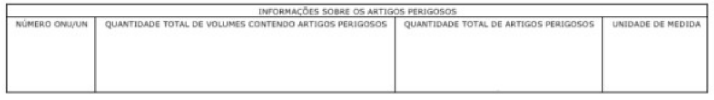
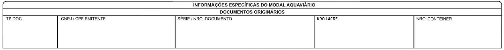

# 2.21. Outros

## 2.21.1. Marca d’Água

O formulário poderá conter marca d’água desde que não prejudique a legibilidade dos dados impressos.

## 2.21.2. Impressão do Número da Folha

O número de ordem e o número total de folhas deverão ser impressos na parte superior de cada uma das folhas do DACTE, inclusive na primeira, mesmo que se utilize uma única folha.

## 2.21.3. Código de Barras

É permitida a impressão de código de barras de informações existentes no CT-e de interesse do emissor no quadro observações, no rodapé ou no verso do DACTE.

<!-- p.18 -->

## 2.21.4. Casos Específicos

Os casos específicos complementam informações sobre o transporte e/ou mercadoria transportada devendo ser informados no verso ou na continuação das folhas em diminuição ou substituição ao campo de documentação originária, nesse último caso, quando a documentação originária já tiver sido informada em páginas anteriores, conforme abaixo e os DACTE a seguir apresentados nos quais foram inseridos a título de exemplo.

No caso de veículos novos transportados, informar com os campos, conforme exemplo abaixo.

No caso de produto perigoso, informar com os campos, conforme exemplo abaixo.

No caso de modal aquaviário, fica dispensada a geração/impressão do quadro DOCUMENTOS ORIGINÁRIOS, no que se refere às informações advindas do grupo infNF – informações das NF ou, infNFe – informações das NF-e ou, infOutros – informações dos demais documentos, desde que, em sua substituição, seja impresso na parte do DACTE que trata especificamente do modal aquaviário o conteúdo das informações requeridas no grupo detCont – Grupo de informações de detalhamento dos contêiner, conforme quadro exemplificativo abaixo.

<!-- p.19 -->

## 2.21.5. Canhoto

O canhoto não é obrigatório e poderá ser gerado/impresso nas extremidades da folha, observado o leiaute dos modelos de DACTE presentes neste Manual.

Devem ser feitos os ajustes necessários para que não existam campos impressos no verso do DACTE na região do canhoto.

O leiaute das informações geradas/impressas no canhoto é de livre escolha e disposição da empresa, sendo que os modelos apresentados neste Anexo são a título de exemplo.
