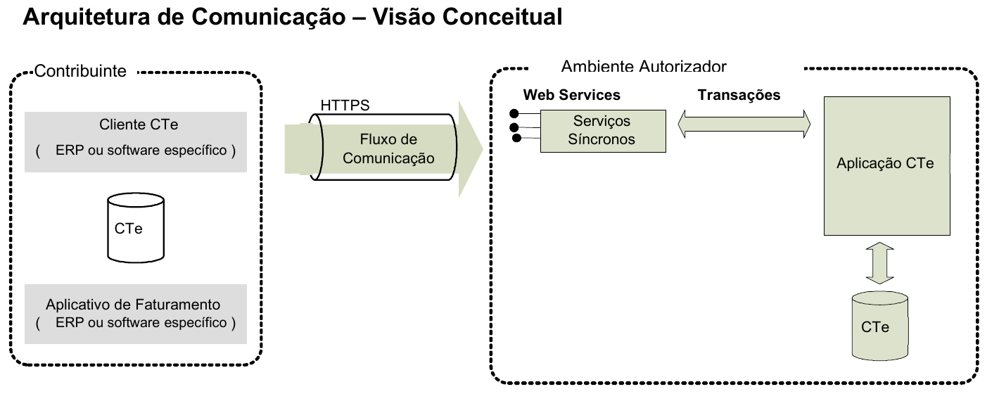

<!-- p.13 -->

# 3.1. Modelo Conceitual

O ambiente autorizador de CTe irá disponibilizar os seguintes serviços:

- a) Recepção de CTe (Modelo 57);
- b) Recepção de CTe Outros Serviços (Modelo 67);
- c) Recepção de GTVe (modelo 64);
- d) Consulta da Situação Atual do CTe;
- e) Consulta do status do serviço;
- f) Registro de Eventos.

Para cada serviço oferecido existirá um Web Service específico. O fluxo de comunicação é sempre iniciado pelo aplicativo do contribuinte através do envio de uma mensagem ao Web Service com a solicitação do serviço desejado.

O Web Service sempre devolve uma mensagem de resposta confirmando o recebimento da solicitação de serviço ao aplicativo do contribuinte na mesma conexão.

Os serviços seguem o modelo síncrono de processamento, onde o processamento da solicitação de serviço é concluído na mesma conexão, com a devolução de uma mensagem contendo o resultado do processamento do serviço solicitado.

