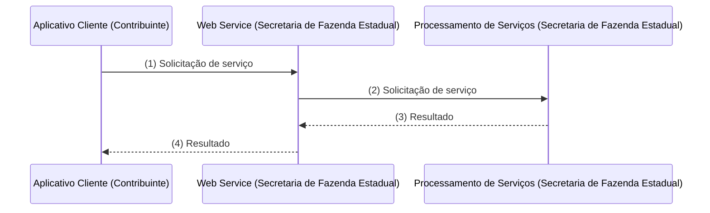

<!-- p.20 -->

# 3.3. Modelo Operacional

A forma de processamento das solicitações de serviços no CTe será síncrona, com o atendimento da solicitação de serviço realizado na mesma conexão.

A seguir, o fluxo simplificado de funcionamento:

Etapas do processo ideal:

- (1) O aplicativo do contribuinte inicia a conexão enviando uma mensagem de solicitação de serviço para o Web Service;
- (2) O Web Service recebe a mensagem de solicitação de serviço e encaminha ao aplicativo do CTe que irá processar o serviço solicitado;
- (3) O aplicativo do CTe recebe a mensagem de solicitação de serviço e realiza o processamento, devolvendo uma mensagem de resultado do processamento ao Web Service;
- (4) O Web Service recebe a mensagem de resultado do processamento e o encaminha ao aplicativo do contribuinte;
- (5) O aplicativo do contribuinte recebe a mensagem de resultado do processamento e, caso não exista outra mensagem, encerra a conexão;
- (1) O Web Service “Consulta Recibo” recebe a mensagem de consulta recibo e localiza o resultado de processamento da solicitação de serviço;
- (2) O Web Service “Consulta Recibo (CTeRetRecepcao)” devolve o resultado do processamento ao aplicativo contribuinte;
- (3) O aplicativo do contribuinte recebe a mensagem de resultado do processamento e, caso não exista outra mensagem, encerra a conexão.

## 3.3.1 Filas e Mensagens
