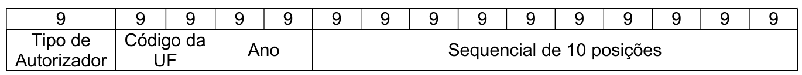

# 7.5. Número do protocolo

O número do protocolo é gerado pelo Portal da Secretaria da Fazenda para identificar univocamente as transações realizadas de autorização de uso e registro de eventos do CTe.

A regra de formação do número do protocolo é:

- 1 posição com o Tipo de Autorizador (1=SEFAZ normal, 2=SITE ALTERNATIVO DO AUTORIZADOR, 3=SEFAZ VIRTUAL-RS, 5=SEFAZ VIRTUAL-SP; 7 = SVC-RS; 8 = SVC-SP);
- 2 posições para o código da UF do IBGE;
- 2 posições para o ano;
- 10 posições numéricas sequenciais no ano.

A geração do número de protocolo deverá ser única, sendo utilizada por todos os *Web Services* que precisam atribuir um número de protocolo para o resultado do processamento, independente do modelo de CTe ser de transporte de carga (57) ou de outros serviços (67).

Juntamente ao protocolo, no DACTE aparecerá a data (DD/MM/AAAA) e hora (hh:mm:ss).
