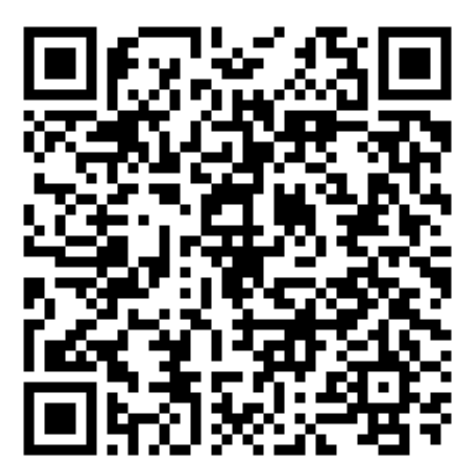

# 9.2. Imagem do QR Code para CTe

A imagem do QR Code, que será impressa no DACTE conterá uma URL composta com as seguintes informações:

## 9.2.1. Para CTe com tipo de emissão Normal:

1ª parte - Endereço do site da Portal da SEFAZ autorizadora do CTe, seguido do caractere “?”; exemplo: http://dfe-portal.svrs.rs.gov.br/cte/QRCode

Os endereços de consulta a serem utilizados no QR Code em ambiente de produção e ambiente de homologação estão disponíveis no Portal da SVRS do CTe (http://dfe-portal.svrs.rs.gov.br/cte/Servicos).

**Observação:** a critério da Unidade Federada poderá ser utilizado o mesmo endereço para consulta no ambiente de produção e ambiente de homologação. Neste caso, a distinção entre os ambientes de consulta será feita diretamente pela aplicação da UF, a partir do conteúdo do parâmetro de identificação do ambiente (tpAmb), constante do QR Code.

2ª parte – Parâmetros para consultar a chave de acesso de CTe separados pelo caractere “&”;

- chCTe: chave de acesso do CTe (44 caracteres)
- tpAmb: Identificação do ambiente (1 – Produção; 2 – Homologação)

Exemplo:

```text
http://dfe-portal.svrs.rs.gov.br/cte/QRCode?chCTe=43181203527568000153570010002211211062211212&tpAmb=1
```

## 9.2.2. Para CTe com tipo de emissão Contingência:

Documentos emitidos em contingência FS-DA ou EPEC demandam um conjunto de informações adicionais às informadas no CTe normal para garantia de autoria do documento fiscal que pode não ter sido transmitido para a base da SEFAZ. Neste caso, o QR Code deverá conter:

<!-- p.84 -->
1ª parte - URL para acessar o CTe, seguido do caractere “?”

2ª parte - parâmetros chCTe e tpAmb da mesma forma como na forma de emissão normal separados pelo caractere “&”;

3ª parte – sign assinatura digital no padrão RSA SHA-1 (Base64) do valor do parâmetro chCTe (chave de acesso com 44 caracteres) a partir do certificado digital que assina o CTe, este parâmetro deve ser adicionado aos demais usando um caractere “&” como separador.

| Partes | Conteúdo |
|---|---|
| 1ª parte: URL | http://dfe-portal.svrs.rs.gov.br/cte/QRCode |
| 2ª parte: parâmetros | chCTe=43181203527568000153570010002211211062211212&tpAmb=1 |
| 3ª parte: assinatura | &sign=ZZSKiypy7fkg22MUv6TUh71EI+wLYWr/fUHJy3PyWnL7d5mzEqtxu6bVbhE7AeNiDTirh1u9gVfC2Hw+Lsno2XNL5FRUc5NcuMTT2hA6E9HYC9gryvtWAIgiCZUNG5cWWLCh0G62QdnNe8iSrlSooQu9Z5g1vbGaTFMxaugzzvo= |

Gerar o QR Code com as concatenações das três partes (URL + parâmetros + assinatura):


