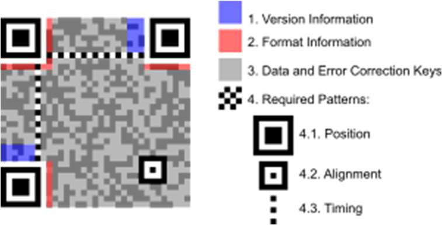
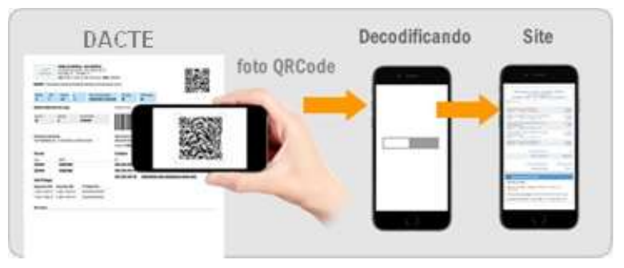

<!-- p.82 -->

# 9. QR Code

O QR Code é um código de barras bidimensional que foi criado em 1994 pela empresa japonesa Denso-Wave. QR significa "quick response" devido à capacidade de ser interpretado rapidamente.

Esse tipo de codificação permite que possa ser armazenada uma quantidade significativa de caracteres:

**Numéricos:** 7.089

**Alfanumérico:** 4.296

**Binário (8 bits):** 2.953

O QR Code a ser impresso no CTe seguirá o padrão internacional ISO/IEC 18004.

O QR Code deverá existir no DACTE relativo à emissão em operação normal ou em contingência, seja ele impresso ou virtual (DACTE em meio eletrônico).

A impressão do QR Code no DACTE tem a finalidade de facilitar a consulta dos dados do documento fiscal eletrônico pela fiscalização e demais atores do processo, mediante leitura com o uso de aplicativo leitor de QR Code, instalado em smartphones ou tablets. Atualmente existem no mercado, inúmeros aplicativos gratuitos para smartphones que possibilitam a leitura de QR Code.

Esta tecnologia tem sido amplamente difundida e é de crescente utilização como forma de comunicação.

As subseções deste capítulo estão em:

- [9.1. Licença](09-01-licenca.md)
- [9.2. Imagem do QR Code para CTe](09-02-imagem-do-qr-code-para-cte.md)
- [9.3. Configurações para QR Code](09-03-configuracoes-para-qr-code.md)
- [9.4. URL da Consulta do CTe via QR Code no XML](09-04-url-da-consulta-do-cte-via-qr-code-no-xml.md)
