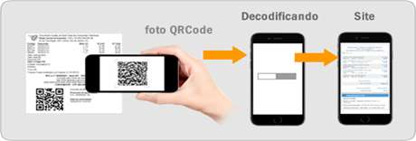

# 10.2. Consulta Pública Resumida de CTe via QR Code

A aplicação de consulta pública resumida de CTe via QR Code será disponibilizada pelo Portal das Secretarias de Fazenda e efetuará validações do conteúdo de informações constantes do QR Code versus o conteúdo do respectivo CTe.

<!-- p.87 -->

Nesta hipótese, o usuário deverá apontar o seu dispositivo móvel (smartphone ou tablet) para a imagem do QR Code gerada na tela ou impressa no DACTE. O leitor de QR Code se encarregará de interpretar a imagem e efetuar a consulta do CTe da URL recuperada no Portal da SEFAZ da Unidade Federada da emissão do documento.

*Figura 7: Processo de leitura do QR Code*

Como resultado da consulta QR Code, deverá ser apresentado ao usuário do serviço na tela do dispositivo móvel o CTe resumido.

Eventuais divergências encontradas entre as informações do CTe constantes dos parâmetros do QR Code deverão ser informadas em área de mensagem a ser disponibilizada na tela de resposta da consulta pública sem, todavia, um detalhamento excessivo do erro identificado, que será de pouco interesse e apenas poderá acabar por gerar dúvidas e inseguranças.

Assim, será apresentado na tela ao usuário o código do erro e uma mensagem de aviso mais genérica.
