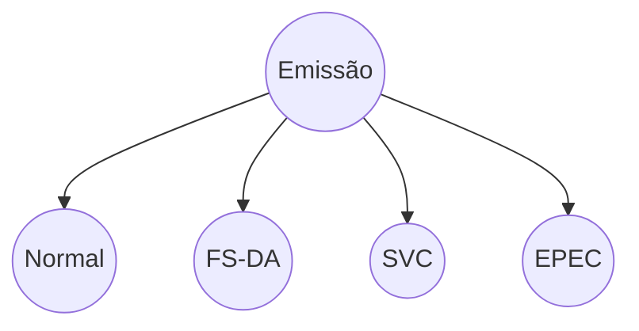

# 11.2. Modelo Operacional de Emissão do Conhecimento de Transporte Eletrônico - CTe

O Projeto do CTe é baseado no conceito de documento fiscal eletrônico: um arquivo eletrônico com as informações fiscais da prestação de serviço de transporte que tenha a assinatura digital do emissor.

A validade de um CTe e do respectivo DACTE está condicionada à existência de uma autorização de uso do CTe concedida pela Secretaria de Fazenda de localização do emissor ou pelo órgão por ela designado para autorizar o CTe em seu nome, como são os casos da SEFAZ Virtual dos Estados do Rio Grande do Sul e de São Paulo ou do Sistema Virtual de Contingência do Ambiente dos Estados - SVC.

A obtenção da autorização de uso do CTe é um processo que envolve diversos recursos de infraestrutura, hardware e software. O mau funcionamento ou a indisponibilidade de qualquer um destes recursos pode prejudicar o processo de autorização do CTe, com reflexos nos negócios do emissor do CTe, que ficará impossibilitado de obter a prévia autorização de uso do CTe exigido na legislação para a emissão do DACTE para acompanhar a Prestação de Serviço de Transporte.

A alta disponibilidade é uma das premissas básicas do sistema do CTe e os sistemas de recepção de CTe das UF foram construídos para funcionar em regime de 24x7, contudo, existem diversos outros componentes do sistema que podem apresentar falhas e comprometer a disponibilidade dos serviços, exigindo alternativas de emissão do CTe em contingência.

<!-- p.90 -->

Atualmente existem as seguintes modalidades de emissão de CTe:

**a) Normal** – é o procedimento padrão de emissão do CTe com transmissão do CTe para a SEFAZ Autorizadora do emissor para obter a autorização de uso. O DACTE poderá ser impresso em papel comum após o recebimento da autorização de uso do CTe;

Aplicável a todos modelos de CTe.

**b) FS-DA - Contingência com uso do Formulário de Segurança para Impressão de Documento Auxiliar do Documento Fiscal eletrônico – FS-DA** – é um modelo operacional similar ao modelo operacional da contingência com uso de Formulário de Segurança – FS. O FS-DA foi criado para aumentar a capilaridade dos pontos de venda do Formulário de Segurança com a criação da figura do estabelecimento distribuidor do FS-DA que poderá adquirir FS-DA dos fabricantes para distribuir para os emissores do CTe de sua região;

Aplicável aos modelos 57 e 67.

**c) SVC – Sistema Virtual de Contingência do Ambiente das Unidades Federadas** – é a alternativa de emissão do CTe em contingência com transmissão do CTe para o Sistema de Contingência Virtual (SVC). Nesta modalidade de contingência o DACTE pode ser impresso em papel comum e não existe necessidade de transmissão do CTe para SEFAZ de origem quando cessarem os problemas técnicos que impediam a transmissão. O objetivo da SEFAZ VIRTUAL DE CONTINGÊNCIA (SVC) é permitir que os contribuintes possam obter a autorização de emissão do Conhecimento de Transporte Eletrônico em um ambiente de autorização alternativo, a ser utilizado sempre que o ambiente de autorização da sua circunscrição estiver indisponível, ou apresentando um alto tempo de resposta, sem a necessidade de alteração da Série do Conhecimento de Transporte. O SVC depende de ativação da SEFAZ de origem, o que significa dizer que o SVC só <!-- p.91 -->entra em operação quando a SEFAZ de origem estiver com problemas técnicos que impossibilitam a recepção do CTe;

Aplicável a todos modelos de CTe.

**d) EPEC – Evento Prévio Emissão em Contingência -** quando o problema ocorre na empresa emissora de CTe, seja por falha nos seus sistemas ou por problemas na conexão com a internet (rota de rede ou capacidade de transmissão), a empresa poderá optar pelo FS-DA ou gerar um Evento do tipo EPEC (Evento Prévio de Emissão em Contingência), onde pode emitir uma solicitação de registro de evento de CTe anterior à autorização do documento em si com um layout mínimo de informações. Esse evento deve ser enviado para a SEFAZ Virtual de Contingência que atende a UF do emissor do documento, uma vez autorizado o EPEC, a empresa poderá prestar o serviço imprimindo o DACTE (modelo Contingência) em papel comum. Ao retomar seu sistema, o emitente deverá enviar o CTe normal para a sua SEFAZ Autorizadora.

Aplicável ao modelo 57.
