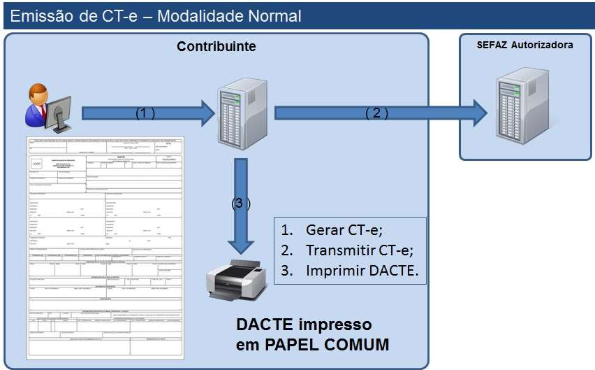
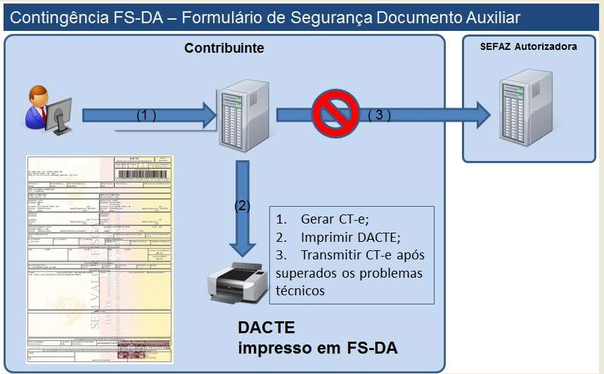
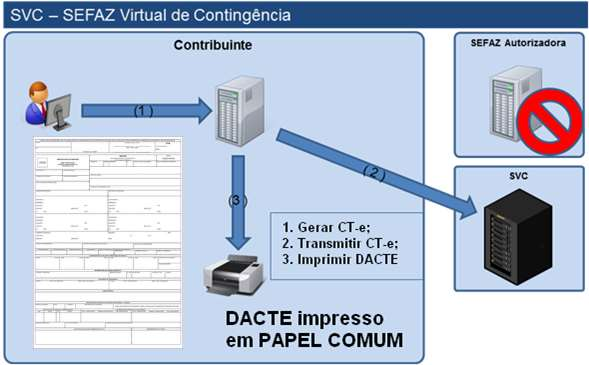
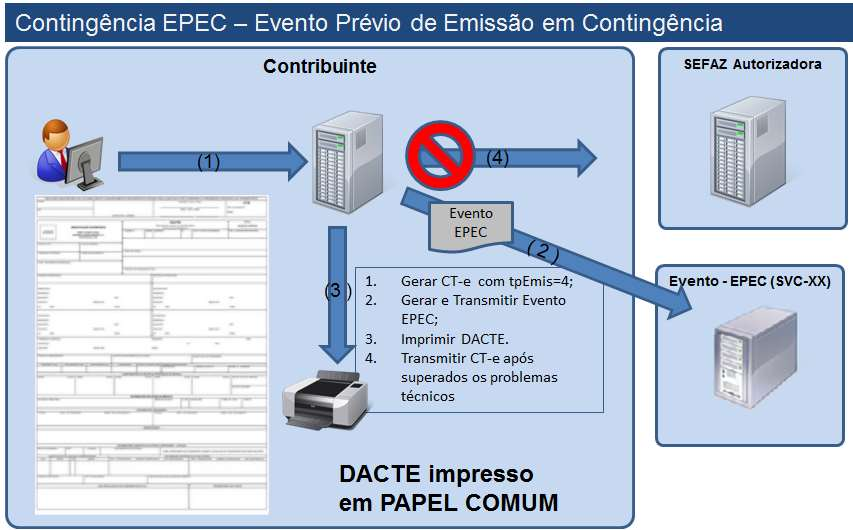

# 11.3. Modalidades de Emissão de CTe

O AJUSTE SINIEF 09/07 e as legislações específicas de cada UF disciplinam e detalham as modalidades de emissão do CTe que serão descritos de forma simplificada a seguir.

Em um cenário de falha que impossibilite a emissão do CTe na modalidade normal, o emissor deve escolher a modalidade de emissão de contingência descrita capítulo, ou até mesmo aguardar a normalização da situação para voltar a emitir o CTe na modalidade normal, caso a emissão do CTe não seja premente.

Como não existe precedência ou hierarquia nas modalidades de emissão do CTe em contingência, o emissor pode adotar uma ou não as adotar.

## 11.3.1 Emissão Normal

O processo de emissão normal é a situação desejada e mais adequada para o emissor, pois é a situação em que todos os recursos necessários para a emissão do CTe estão operacionais e a autorização de uso do CTe é concedida normalmente pela SEFAZ.

Nesta situação a emissão dos CTe é realizada normalmente com a impressão do DACTE em papel comum, após o recebimento da autorização de uso do CTe.

<!-- p.92 -->

## 11.3.2 Contingência em Formulário de Segurança para Impressão do DACTE – FS-DA

Este procedimento de contingência será adotado pelos emissores que adquirirem o Formulário de Segurança para impressão de Documento Auxiliar – FS-DA.

Sendo identificada a existência de qualquer fator que prejudique ou impossibilite a transmissão dos CTe e/ou obtenção da autorização de uso da SEFAZ, a empresa pode acionar a Contingência com FS-DA, adotando os seguintes passos:

- Gerar novo arquivo XML do CTe com o campo ***tpEmis*** alterado para “5”;
- Imprimir o DACTE em pelo menos duas vias do FS-DA constando no corpo a expressão: ***DACTE em Contingência - impresso em decorrência de problemas técnicos”***, tendo as vias a seguinte destinação:

    I - Uma das vias permitirá o trânsito dos veículos do prestador do serviço de transporte e deverá ser mantida em arquivo pelo destinatário pelo prazo estabelecido na legislação tributária para a guarda de documentos fiscais;

    II - Outra via deverá ser mantida em arquivo pelo emitente pelo prazo estabelecido na legislação tributária para a guarda dos documentos fiscais;

    III - Sendo o Tomador diverso do destinatário deverá existir uma terceira via, que será remetida a este para efeito de registros contábeis e fiscais, pois somente esta via do FS-DA dará direito ao crédito.

- Transmitir os CTe imediatamente após a cessação dos problemas técnicos que impediam a transmissão do CTe inicialmente, observando o prazo limite de sete dias a partir da emissão do documento;
- <!-- p.93 -->Tratar os CTe transmitidos por ocasião da ocorrência dos problemas técnicos que estão pendentes de retorno.

## 11.3.3 SVC – Sistema Virtual de Contingência

Para uso dos serviços de recepção e autorização da SVC, a empresa deve adotar os seguintes procedimentos:

- Identificação que a SVC-XX foi ativada pela SEFAZ de origem da sua circunscrição, conforme resultado do Web Service de Consulta Status do Serviço, descrito anteriormente;
- Geração de novo arquivo XML do CTe com a seguinte alteração:

    Campo ***tpEmis*** alterado para “7” (SVC-RS) ou “8” (SVC-SP), conforme a SVC prevista para atender determinada SEFAZ;

- Transmissão do CTe para a SVC-XX e obtenção da autorização de uso;
- Impressão do DACTE em papel comum;
- Tratamento dos arquivos de CTe transmitidos para a SEFAZ de origem antes da ocorrência dos problemas técnicos e que estão pendentes de retorno, cancelando aqueles CTe autorizados e que foram substituídos por CTe autorizado na SVC.

<!-- p.94 -->

Os endereços dos Web Services do Ambiente de Homologação (Testes) e Produção da SVC estão disponível no Portal Nacional do CTe (www.cte.fazenda.gov.br) e no Portal da SVRS do CTe (dfe-portal.svrs.rs.gov.br/cte)

## 11.3.4 EPEC – Evento Prévio de Emissão em Contingência (Apenas modelo 57)

Para uso dos serviços de recepção e autorização do EPEC na SVC-XX, após identificar problemas técnicos, a empresa deve adotar os seguintes procedimentos:

- Geração do CTe (A) Normal com campo ***tpEmis*** alterado para “4” (EPEC), consequentemente essa informação fará parte da chave de acesso;
- Geração de um evento conforme layout definido para o EPEC indicando a chave de acesso do CTe gerado com ***tpEmis=*** “4”;
- Transmissão do Evento para a SVC-XX e obtenção da homologação do evento não vinculado (cStat=136);
- Impressão do DACTE (emissão em contingência) em papel comum;

Após cessarem os problemas:

- Transmissão do CTe com campo TpEmis = “4” para a SEFAZ Autorizadora Normal e obtenção da autorização de uso;

<!-- p.95 -->

É vedada a reutilização, em contingência, de número de CTe transmitido com tipo de emissão ‘Normal’.

Eventos do tipo EPEC somente serão autorizados no período máximo de sete dias (168 horas) sem que o documento CTe (com tpEmis=4) seja enviado para autorização na SEFAZ Autorizadora do contribuinte.

Não existirá cancelamento de eventos EPEC na SVC, e uma vez emitido o evento EPEC, este será compartilhado com a SEFAZ Autorizadora Normal pelo Ambiente Nacional.

Caso o contribuinte necessite cancelar uma operação emitida por engano em contingência EPEC na SVC, deverá primeiro autorizar o CTe (com tpEmis=4) na SEFAZ Autorizadora Normal e, logo em seguida, efetuar o seu cancelamento.

**IMPORTANTE:** esse modelo de contingência deverá ser utilizado somente em casos de dificuldade técnica, sendo que o uso de forma contínua poderá ser bloqueado por regra de validação ou medida restritiva.
