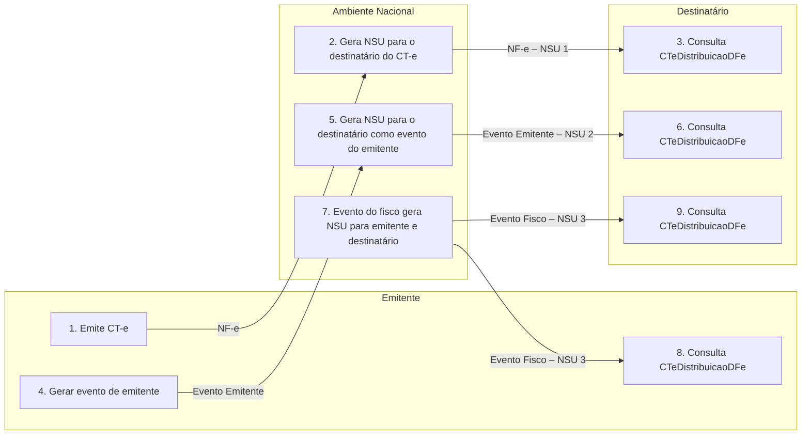

<!-- p.13 -->

# 2.10 Visão Geral do Modelo de Distribuição

O modelo de distribuição de documentos é baseado na geração de um número sequencial único (*NSU*) para cada CNPJ ou CPF. O fluxo abaixo exemplifica a geração do *NSU* para o emitente e destinatário do CT-e:

A consulta no *Web Service* CTeDistribuicaoDFe poderá ser realizada a qualquer instante pela empresa ou pessoa. O Ambiente Nacional disponibilizará para consulta os documentos de interesse de cada ator. Seguem os passos do fluxo exemplificado:

1. O emitente gera e transmite um CT-e que será autorizada pela Sefaz e compartilhada com o Ambiente Nacional;

<!-- p.14 -->

2. O Ambiente Nacional gera um NSU para o emitente, um NSU para destinatário e um NSU para cada um dos papéis relacionados no CT-e e o disponibiliza para consulta;
3. O destinatário consulta o WS CTeDistribuicaoDFe a partir do último NSU recebido e recupera o XML do CT-e;
4. O emitente gera um evento de seu CT-e (ex.: evento de cancelamento de CT-e, caso não exista outro evento que impeça este cancelamento) que será compartilhado pela Sefaz com o Ambiente Nacional;
5. O Ambiente Nacional gera um NSU para o cada um dos papéis relacionados com o CT-e para o evento gerado pelo emitente e o disponibiliza para consulta;
6. O destinatário consulta o WS CTeDistribuicaoDFe a partir do último NSU recebido e recupera o evento gerado pelo emitente;
7. O Ambiente Nacional recebe um evento gerado pelo fisco e gera um NSU para o emitente, outro NSU para o destinatário (e tantos NSU quantos forem os papéis relacionados), disponibilizando-os para consulta;
8. Tanto o emitente quanto o destinatário consultam o WS CTeDistribuicaoDFe a partir do último NSU recebido e recuperam o evento gerado pelo fisco;
