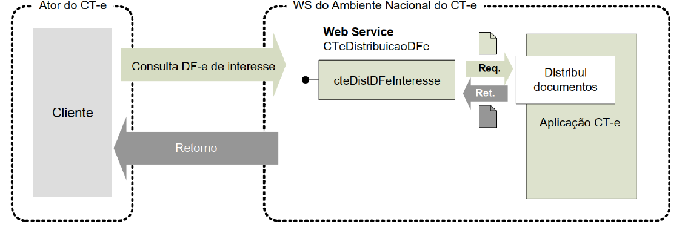

<!-- p.05 -->

# 2 Web Service – CteDistribuicaoDFe

Distribui documentos e informações de interesse do ator do CT-e<mark>/ CT-eOS/GTV-e</mark>

**Função:** Serviço destinado à distribuição de informações de documentos fiscais eletrônicos de interesse de um ator, seja este pessoa física ou jurídica.

**Processo:** síncrono

**Método:** cteDistDFeInteresse

**Pacote de liberação de Schemas da NT:** PL_CTeDistDFe_100

Este serviço permite que um ator do CT-e<mark>/ CT-eOS/GTV-e</mark> tenha acesso aos documentos fiscais eletrônicos (DF-e) que não tenham sido gerados por ele e que sejam de seu interesse. Pode ser consumido por qualquer ator de CT-e<mark>/ CT-eOS/GTV-e</mark>, Pessoa Jurídica ou Pessoa Física, que possua um certificado digital de PJ ou PF. No caso de Pessoa <!-- p.06 -->Jurídica, a empresa será autenticada pelo CNPJ base e poderá realizar a consulta com qualquer CNPJ da empresa desde que o CNPJ base consultado seja o mesmo do certificado digital.

Os documentos fiscais eletrônicos estarão disponíveis para distribuição por até 3 meses após sua recepção pelo Ambiente Nacional do CT-e. A distribuição ocorrerá para os atores que desempenham papéis de emitente, destinatário, remetente, recebedor, expedidor, tomador e terceiros (informado na tag *autXML*) conforme tabela abaixo:

| Documento | Emitente do CT-e (Modelo 57) | Remetente, Destinatário, Recebedor, Expedidor | Tomador | Terceiros¹ |
|---|---|---|---|---|
| CT-e | Não | Sim | Sim | Sim |
| <mark>CT-e Simplificado</mark> | <mark>Não</mark> | <mark>Não</mark> | <mark>Sim</mark> | <mark>Sim</mark> |
| Evento de Cancelamento | Não | Sim | Sim | Sim |
| Evento de Carta de Correção | Não | Sim | Sim | Sim |
| EPEC | Não | Sim | Sim | Não |
| Eventos MDF-e Autorizado/Cancelado | Sim | Sim | Sim | Não |
| Evento Comprovante de Entrega/ Cancelado | Não | Sim | Sim | Sim |
| Evento Insucesso na Entrega/Cancelado | Não | Sim | Sim | Sim |
| Evento Prestação de Serviço em Desacordo /Cancelado(gerado pelo Tomador) | Sim | Sim | Não | Sim |

| <mark>Documento</mark> | <mark>Emitente do CT-e OS Modelo (67)</mark> | <mark>Remetente, Destinatário, Recebedor, Expedidor</mark> | <mark>Tomador</mark> | <mark>Terceiros¹</mark> |
|---|---|---|---|---|
| <mark>CT-e OS</mark> | <mark>Não</mark> | <mark>Sim</mark> | <mark>Sim</mark> | <mark>Sim</mark> |
| <mark>Evento de Cancelamento</mark> | <mark>Não</mark> | <mark>Sim</mark> | <mark>Sim</mark> | <mark>Sim</mark> |
| <mark>Evento de Carta de Correção</mark> | <mark>Não</mark> | <mark>Sim</mark> | <mark>Sim</mark> | <mark>Sim</mark> |
| <mark>Evento Prestação de Serviço em Desacordo /Cancelado(gerado pelo Tomador)</mark> | <mark>Sim</mark> | <mark>Sim</mark> | <mark>Não</mark> | <mark>Sim</mark> |

| <mark>Documento</mark> | <mark>Emitente da GTV-e (Modelo 64)</mark> | <mark>Remetente, Destinatário, Recebedor, Expedidor</mark> | <mark>Tomador</mark> | <mark>Terceiros¹</mark> |
|---|---|---|---|---|
| <mark>GTV-e</mark> | <mark>Não</mark> | <mark>Sim</mark> | <mark>Sim</mark> | <mark>Sim</mark> |
| <mark>Evento de Cancelamento</mark> | <mark>Não</mark> | <mark>Sim</mark> | <mark>Sim</mark> | <mark>Sim</mark> |

¹ O CT-e<mark>/ CT-eOS/GTV-e</mark> estará disponível para terceiros somente cujo CNPJ ou CPF estiverem informados no grupo autXML, sendo que para estes usuários, visando a preservação do sigilo fiscal, todas as chaves de acesso de CT-e e NF-e relacionadas no CT-e<mark>/ CT-</mark><!-- p.07 --><mark>eOS/GTV-e</mark> distribuído deverão ser alteradas para o literal 99999999999999999999999999999999999999999999, conforme decisão do ENCAT.

As subseções deste capítulo estão em:

- [2.1 Leiaute Mensagem de Entrada](02-01-leiaute-mensagem-de-entrada.md)
- [2.2 Leiaute Mensagem de Retorno](02-02-leiaute-mensagem-de-retorno.md)
- [2.3 Mensagem de Retorno Compactada](02-03-mensagem-de-retorno-compactada.md)
- [2.4 Descrição do Processo de Distribuição de DF-e de Interesse](02-04-descricao-do-processo-de-distribuicao-de-df-e-de-interesse.md)
- [2.5 Processamento da Requisição de Distribuição de Conjunto de DF-e a Partir do NSU Informado (distNSU)](02-05-processamento-distnsu.md)
- [2.6 Processamento da Requisição de Distribuição de DF-e Vinculado ao NSU Informado (consNSU)](02-06-processamento-consnsu.md)
- [2.7 Validação do Certificado de Transmissão](02-07-validacao-do-certificado-de-transmissao.md)
- [2.8 Validação Inicial da Mensagem no Web Service](02-08-validacao-inicial-da-mensagem-no-web-service.md)
- [2.9 Validação da Área de Dados](02-09-validacao-da-area-de-dados.md)
- [2.10 Visão Geral do Modelo de Distribuição](02-10-visao-geral-do-modelo-de-distribuicao.md)
- [2.11 Recomendações Para Evitar o Uso Indevido](02-11-recomendacoes-para-evitar-o-uso-indevido.md)
- [2.12 Endereço do Web Service](02-12-endereco-do-web-service.md)
