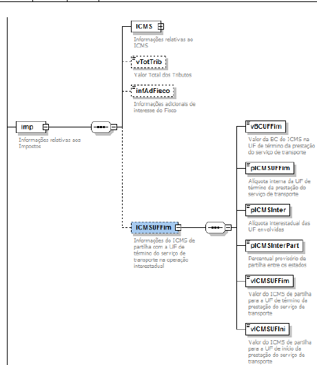

<!-- p.02 -->

# 3. Serviço: Autorização de Uso – Alteração do Schema Parte Geral

Foi criado um novo grupo de informações para identificar a partilha do ICMS para a UF de término da prestação do serviço de transporte nas operações interestaduais para consumidor final, atendendo ao disposto na Emenda Constitucional 87 de 2015.

| Campo | Ele | Tipo | Ocor. | Tam. | Dec. | Descrição/Observação |
| --- | --- | --- | --- | --- | --- | --- |
| **ICMSUFFim** | **G** | **G** | **0-1** | **-** | | **Grupo a ser informado nas prestações de serviço de transporte interestaduais para consumidor final, não contribuinte do ICMS** |
| vBCUFFim | E | N | 1-1 | 13 | 2 | Valor da Base de Cáclculo do ICMS na UF de término da prestação do serviço de transporte |
| pICMSUFFim | E | N | 1-1 | 3 | 2 | Alíquota interna da UF de término da prestação do serviço de transporte |
| pICMSInter | E | N | 1-1 | 3 | 2 | Alíquota interestadual das UF envolvidas |
| pICMSInterPart | E | N | 1-1 | 3 | 2 | Percentual de partilha para a UF de término da prestação do serviço de transporte: - 40% em 2016; - 60% em 2017; - 80% em 2018; -100% a partir de 2019. |
| vICMSUFFim | E | N | 1-1 | 13 | 2 | Valor do ICMS de partilha para a UF de término da prestação do serviço de transporte |
| vICMSUFIni | E | N | 1-1 | 13 | 2 | Valor do ICMS de partilha para a UF de início da prestação do serviço de transporte |

<!-- p.03 -->

AVISO: Não serão criadas regras de validação no primeiro momento, o que poderá ocorrer em futura Nota Técnica.

**Sobre o DACTE:**

**Não haverá alteração no leiaute do DACTE, mas as empresas emitentes devem informar, no campo de informações adicionais, os valores recolhidos através de GNRE e descritos no campo vICMSUFFim, visando à conferência nas unidades de fiscalização de mercadorias em trânsito das UFs de término da prestação do serviço de transporte.**
