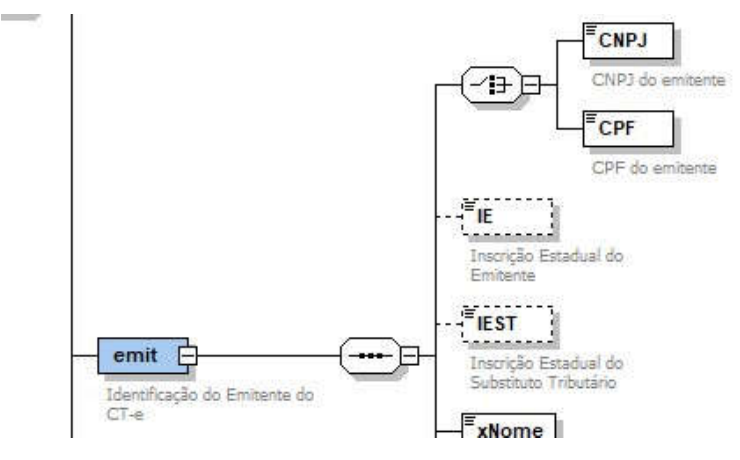

# 3.3. Emitente do CT-e

O emitente passa a poder ser identificado pelo CPF do transportador autônomo de cargas (TAC), desde que atendidas as regras da NFF. A IE do emitente passa a ser uma tag opcional, que não será informada somente no caso da NFF.

| Campo | Descrição | Ele | Tipo | Ocor. | Tam. |
|---|---|---|---|---|---|
| **emit** | **Identificação do Emitente do CT-e** | **G** | | **1 - 1** | |
| CNPJ | CNPJ do emitente | CE | N | 1 - 1 | 14 |
| CPF | CPF do emitente (TAC) | CE | N | 1 - 1 | 14 |
| IE | Inscrição Estadual do Emitente | E | N | 0 - 1 | 14 |
| IEST | Inscrição Estadual do Substituto Tributário | E | N | 0 - 1 | 14 |
| xNome | Razão social ou Nome do emitente | E | C | 1 - 1 | 2 - 60 |
| xFant | Nome fantasia | E | C | 0 - 1 | 2 - 60 |

<!-- p.07 -->

