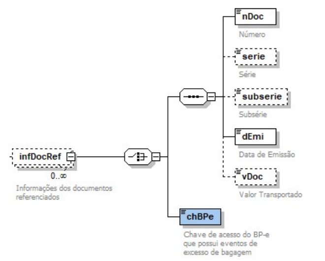
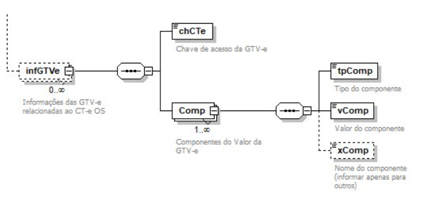

<!-- p.13 -->

# 3 Alteração no layout do CT-e OS

Possibilidade de indicar chaves de BP-e com evento excesso de bagagem no CT-e OS de excesso de bagagem.

Criação do grupo de informações da GTVe.

| # | Campo | Ele | Pai | Tipo | Ocor. | Tam. | Descrição/Observação |
|---|---|---|---|---|---|---|---|
| **#** | **infGTVe** | **G** | **infCteNorm** | | **0 - n** | | **Grupo de informações da GTVe relacionadas ao CT-e OS de Transporte de valores** |
| # | chCTe | E | infGTVe | C | 1 - 1 | 44 | Chave de acesso da GTVe |
| **#** | **Comp** | **G** | **infGTVe** | | **1 - n** | | **Componentes do Valor da GTVe** |
| # | tpComp | E | Comp | N | 1 - 1 | 1 | 1-Custodia 2-Embarque 3-Tempo de espera 4-Malote 5-Ad Valorem 6-Outros |
| # | vComp | E | Comp | N | 1 - 1 | 13,2 | 15 posições, sendo 13 inteiras e 2 decimais. |
| # | xComp | E | Comp | C | 0 - 1 | 1-15 | Exemplos: FRETE PESO, FRETE VALOR, SEC/CAT, ADEME, AGENDAMENTO, etc |

