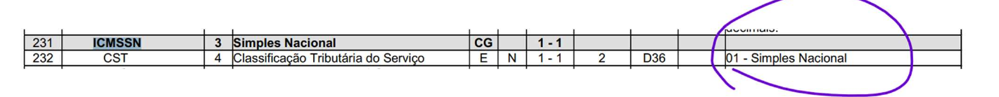

<!-- p.07 -->

# 7 Retificação de informação do MOC 4.00

O valor de preenchimento da tag CST do grupo ICMSSN deve ser conforme está no schema da versão 4.00 com o valor 90 – Simples Nacional e não 01 – Simples Nacional como saiu no MOC.

A tag correta deverá aceitar apenas o valor 90 – Simples Nacional.
