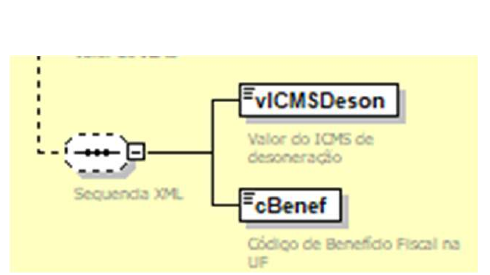

<!-- p.04 -->
# Alteração de Schema CTe e CTe OS – Inclusão do Benefício Fiscal

Criadas as tags Valor de ICMS de Desoneração (vICMSDeson) e Código do Benefício Fiscal (cBenef) de forma opcional nos grupos de tributação de CTe e CTeOS conforme abaixo:

| DFe | Grupos ICMS com as tags Benefício Fiscal |
|---|---|
| CTe | ICMS20 ICMS45 ICMS60 ICMS90 ICMSOutraUF |
| CTe OS | ICMS20 ICMS45 ICMS90 ICMSOutraUF |
