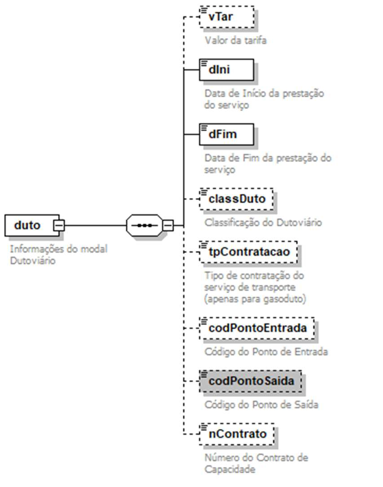

<!-- p.18 -->

# 9 Alterações no Layout do Modal Dutoviário

Foram criados campos no schema específico do Modal Dutoviário.

| # | Campo | Ele | Pai | Tipo | Ocor. | Tam. | Descrição/Observação |
|---|---|---|---|---|---|---|---|
| 1 | **duto** | **G** | **0** | | **1 - 1** | | **Informações do modal Dutoviário** |
| 2 | vTar | E | 1 | C | 0 - 1 | 9, 6 | Valor da tarifa 15 posições, sendo 9 inteiras e 6 casas decimais. |
| 3 | dIni | E | 1 | D | 1 - 1 | 10 | Data de Início da prestação do serviço |
| 4 | dFim | E | 1 | D | 1 - 1 | 10 | Data de Fim da prestação do serviço |
| 5 | classDuto | E | 1 | N | 0-1 | 1 | Classificação Dutoviário Informar: 1 – Gasoduto; 2 – Mineroduto ou 3 - Oleoduto |
| 6 | tpContratacao | E | 1 | N | 0-1 | 1 | Tipo de contratação do serviço de transporte (apenas para gasoduto) Informar: 0 – Ponto a ponto 1 – Capacidade de Entrada ou 2 – Capacidade de Saída |
| 7 | codPontoEntrada | E | 1 | C | 0-1 | 20 | Código do Ponto de Entrada |
| 8 | codPontoSaida | E | 1 | C | 0-1 | 20 | Código do Ponto de Saída |
| 9 | nContrato | E | 1 | C | 0-1 | 20 | Número do Contrato de Capacidade |

| Regra de Validação | Aplic. | cStat | Efeito | Mensagem |
|---|---|---|---|---|
| **001** Se informado classificação do dutoviário = Gasoduto (tag: classDuto = 1), o tipo de contratação deve ser informado (tag: tpContratacao) | Obrig. | 371 | Rej. | Rejeição: Tipo de contratação deve ser informado para tipo de dutoviário gasoduto |
| **002** Se Tipo de contratação for ponto a ponto (tag: tpContratacao=0), os campos do código dos pontos de entrada e saída devem ser informados | Obrig. | 372 | Rej. | Rejeição: Dutoviário com tipo de contratação ponto a ponto deve informar Código dos pontos de entrada e saída |
| **003** Se Tipo de contratação for capacidade de entrada (tag: tpContratacao=1), o campo do código do ponto de entrada deve ser informado | Obrig. | 373 | Rej. | Rejeição: Dutoviário com tipo de contratação capacidade de entrada deve informar Código do ponto de entrada |
| **004** Se Tipo de contratação for capacidade de saída (tag: tpContratacao=2), o campo do código do ponto de saída deve ser informado | Obrig. | 374 | Rej. | Rejeição: Dutoviário com tipo de contratação capacidade de saída deve informar Código do ponto de saída |

