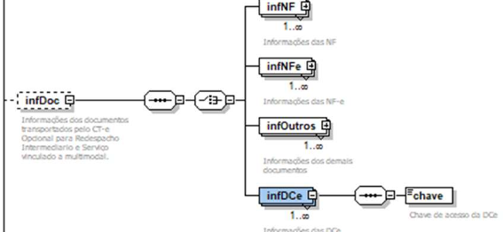

<!-- p.19 -->

# 10 Criação do grupo de informações da DCe nos documentos originários

## Validações dos Documentos Transportados

| Regra de Validação | Aplic. | cStat | Efeito | Mensagem |
|---|---|---|---|---|
| **G045a** Se Tipo do CTe= 0 (Normal) ou 3 (Substituição) e informado grupo informação de documentos (infDoc): Quantidade de documentos informados (infNF/infNFe/infOutros/infDCe) não pode ultrapassar 2000 documentos | Obrig. | 601 | Rej. | Rejeição: Quantidade de documentos informados no remetente excede limite de 2000 |
| **G045b** Se Tipo do CTe= 0 (Normal) ou 3 (Substituição) e informados grupos de informações de documentos (infDoc) e DCe (infDCe) - Verificar se existe alguma chave de acesso de DCe duplicada no CTe Retornar a chave duplicada | Obrig. | 375 | Rej. | Rejeição: DCe duplicada no CTe [chDCe: 99999999999999999999999999999999999999999999] [Motivo: XXXXXXXXXXXX] |
| **G045c** Se Tipo do CTe= 0 (Normal) ou 3 (Substituição) e informados grupos de informações de documentos (infDoc) e DCe (infDCe), para cada uma das DCe´s relacionadas: - Validar chave de acesso Retornar a primeira chave inválida e o motivo da rejeição da Chave de Acesso: CNPJ / CPF zerado ou inválido, Ano < 2025 ou maior que atual, Mês inválido (0 ou > 12), Modelo diferente de 99, Número zerado, Tipo de emissão inválido, UF inválida ou DV inválido) [chDCe: 99999999999999999999999999999999999999999999] [Motivo: XXXXXXXXXXXX] | Obrig. | 376 | Rej. | Rejeição: Chave de acesso da DCe transportada inválida |
| **G045d** Se Tipo do CTe= 0 (Normal) ou 3 (Substituição) e informados grupos de informações de documentos (infDoc) e DCe (infDCe), para cada uma das DCe´s relacionadas: - Acessar BD CHAVES DCE (Chave: UF, CNPJ/CPF Emit, Modelo, Série, Nro): &nbsp;&nbsp;&nbsp;&nbsp;- A DCe deve existir Retornar a primeira chave de acesso de DCe inexistente.  **Exceção:** DCe em contingência fica dispensada dessa validação (verificar tpEmis da chave de acesso da DCe) | Facult. | 377 | Rej. | Rejeição: DCe inexistente na base de dados da SEFAZ |
| **G045e** Se Tipo do CTe= 0 (Normal) ou 3 (Substituição) e informados grupos de informações de documentos (infDoc) e DCe (infDCe), para cada uma das DCe´s relacionadas: - Acessar BD CHAVES DCE (Chave: UF, CNPJ/CPF Emit, Modelo, Série, Nro): &nbsp;&nbsp;&nbsp;&nbsp;- A DCe não pode existir com diferença de chave de acesso Retornar a primeira chave de acesso de DCe com situação inválida. | Facult. | 378 | Rej. | Rejeição: DCe com diferença de Chave de Acesso |
| **G045f** Se Tipo do CTe= 0 (Normal) ou 3 (Substituição) e informados grupos de informações de documentos (infDoc) e DCe (infDCe), para cada uma das DCe´s relacionadas: - Acessar BD CHAVES DCE (Chave: UF, CNPJ/CPF Emit, Modelo, Série, Nro): &nbsp;&nbsp;&nbsp;&nbsp;- A DCe não pode estar cancelada Retornar a primeira chave de acesso de DCe com situação inválida. | Facult. | 379 | Rej. | Rejeição: DCe não pode estar cancelada ou denegada |

As regras G45d, G45e e G45f dependem do ambiente de autorização possuir acesso a base de dados de DCe.

