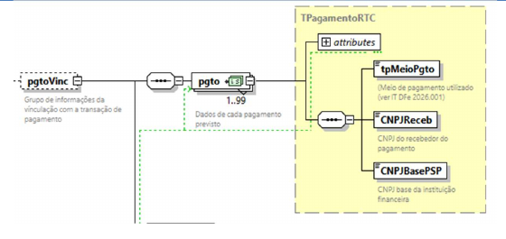

<!-- p.06 -->

# 2 Informação da vinculação da transação de pagamento no DFe

Este grupo de informações deverá ser informado sempre que a transação de pagamento for iniciada antes da emissão do DFe. Exemplos: boleto gerado antes da emissão do DFe; QR Code dinâmico Pix gerado antes da emissão do DFe. Neste caso, o DFe deverá reportar os dados das transações financeiras previamente iniciadas, ainda que estejam pendentes de efetivo pagamento e liquidação.

Aplica-se a CTe, CTeOS e CTeSimp.

| # | Campo | Ele | Pai | Tipo | Ocor. | Tam. | Descrição/Observação |
|---|---|---|---|---|---|---|---|
| # | **pgtoVinc** | **G** | **infCte** | **-** | **0-1** | **-** | **Grupo de informações da vínculação com a transação de pagamento** |
| 1 | pgto | E | pgtoVinc | G | 1-99 | | Dados de cada pagamento previsto para o DFe |
| 2 | nPag | A | pgto | N | 1-1 | 3 | Atributo numerador único de cada ocorrência de pagamento |
| 3 | idTransacao | A | pgto | C | 1-1 | 2-35 | Atributo Identificador específico da transação financeira, de acordo com a transação de pagamento. O próprio schema impede que se repita dentro do grupo |
| 4 | tpMeioPgto | E | pgto | N | 1-1 | 2 | Código do meio de pagamento utilizado <mark>Ver IT DFe 2026.001 que divulgará códigos que serão aceitos (conforme tabela nacional de Meios de Pagamento da NFe)</mark> |
| 5 | CNPJReceb | E | pgto | C | 1-1 | 14 | CNPJ completo do recebedor do pagamento (fornecedor, plataforma, ou outra entidade que receba o pagamento do adquirente). **Observação:** indicar o CNPJ responsável por receber dinheiro do adquirente na transação de pagamento. É possível que o CNPJ do recebedor seja diferente do CNPJ do fornecedor constante no documento fiscal. |
| 6 | CNPJBasePSP | E | pgto | C | 1-1 | 8 | CNPJ base da instituição financeira ou de pagamento utilizada pelo recebedor do pagamento (fornecedor, plataforma, ou outra entidade que receba o pagamento do adquirente). |

## Regras de Validação

| Regra de Validação | Aplic. | cStat | Efeito | Mensagem |
|---|---|---|---|---|
| **01** Se informado grupo de informações de vinculação com a transação de pagamento (grupo: gPgtoVinc), para cada ocorrência de pagamento vinculado: Validar o CNPJ do Recebedor do Pagamento (dígito de controle, zeros, validação CNPJ Alfanumérico)  **Observação**: Informar na mensagem de rejeição qual o numerador do pagamento que ocorreu a rejeição | Obrig. | 1001 | Rej. | Rejeição: CNPJ do recebedor do pagamento inválido [nPag: XXX] |
| <mark>**02** Verificar se o código informado em tpMeioPgto é válido  **Observação**: Os códigos válidos estarão publicados em Informe Técnico dos DFe de número 2006.001 e correspondem a codificação padronizada com a tabela de Meios de Pagamento da NFe publicada no Ambiente Nacional</mark> | <mark>Obrig.</mark> | <mark>1003</mark> | <mark>Rej.</mark> | <mark>Rejeição: Meio de pagamento inválido  [nPag: XXX]</mark> |
