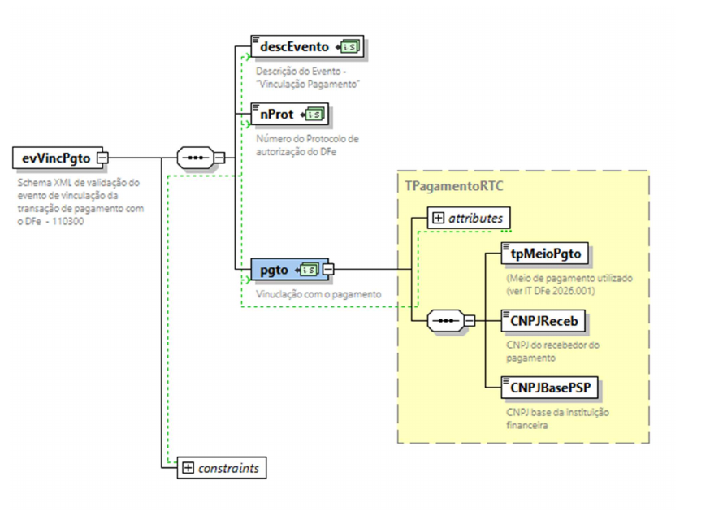

<!-- p.07 -->

# 3 Evento de vinculação da transação de pagamento no DFe

Este evento deverá ser gerado pelo emitente do DFe sempre que se for vincular uma ou mais transações financeiras a um documento fiscal previamente autorizado.

Obs.: É possível que a transação financeira vinculada esteja em situação iniciada, ainda pendente de pagamento e/ou liquidação (ex. boleto emitido ou QR code Pix gerado)

**Função**: evento destinado ao atendimento de solicitações vinculação do pagamento do DFe.

**Autor do Evento**: O autor do evento é o emissor do DFe. A mensagem XML do evento será assinada com o certificado digital que tenha o CNPJ base do Emissor

**Código do Tipo de Evento**: 110300

**Schema XML**: evVincPgto_v9.99.xsd

| # | Campo | Ele | Pai | Tipo | Ocor. | Tam. | Descrição/Observação |
|---|---|---|---|---|---|---|---|
| # | **evVincPgto** | **Raiz** | **detEvento** | **G** | **1-1** | | **Schema XML de validação do evento de vinculação da transação de pagamento com o DFe - 110300** |
| 1 | descEvento | E | evVincPgto | E | 1-1 | 20 | Descrição do Evento - “Vinculação Pagamento” |
| 2 | nProt | E | evVincPgto | E | 1-1 | 15 | Número do protocolo de autorização do DFe |
| 3 | **pgto** | **E** | **pgtoVinc** | **G** | **1-1** | | **Dados de cada pagamento previsto para o DFe** |
| 4 | nPag | A | pgto | N | 1-1 | 3 | Atributo numerador único de cada ocorrência de pagamento |
| 5 | idTransacao | A | pgto | C | 1-1 | 2-35 | Atributo Identificador específico da transação financeira, de acordo com a transação de pagamento. O próprio schema impede que se repita dentro do grupo |
| 6 | tpMeioPgto | E | pgto | N | 1-1 | 2 | Código do meio de pagamento utilizado <mark>Ver IT DFe 2026.001 que divulgará códigos que serão aceitos (conforme tabela nacional de Meios de Pagamento da NFe)</mark> |
| 7 | CNPJReceb | E | pgto | C | 1-1 | 14 | CNPJ completo do recebedor do pagamento (fornecedor, plataforma, ou outra entidade que receba o pagamento do adquirente). **Observação:** indicar o CNPJ responsável por receber dinheiro do adquirente na transação de pagamento. É possível que o CNPJ do recebedor seja diferente do CNPJ do fornecedor constante no documento fiscal. |
| 8 | CNPJBasePSP | E | pgto | C | 1-1 | 8 | CNPJ base da instituição financeira ou de pagamento utilizada pelo recebedor do pagamento (fornecedor, plataforma, ou outra entidade que receba o pagamento do adquirente). |

## Validação das Regras Específicas do Evento

| Regra de Validação | Aplic. | cStat | Efeito | Mensagem |
|---|---|---|---|---|
| **L01** Verificar se a UF da Chave de Acesso difere da UF do Web Service | Obrig. | 249 | Rej. | Rejeição: UF da Chave de Acesso diverge da UF autorizadora |
| **L02** Verificar se o nSeqEvento é maior que o valor permitido (1 a 999) | Obrig. | 636 | Rej. | Rejeição: O número sequencial do evento é maior que o permitido |
| **L03** Emitente deve estar habilitado na base de dados para emissão do DFe | Obrig. | 203 | Rej. | Rejeição: Emissor não habilitado para emissão de CTe |
| **L04** Verificar se DFe já está cancelado. | Obrig. | 218 | Rej. | Rejeição: CTe já está cancelado na base de dados da SEFAZ. [nProt:999999999999999][dhCanc: AAAA-MM-DDTHH:MM:SS TZD]. |
| **L06** Verificar se DFe foi substituído | Obrig. | 224 | Rej. | Rejeição: CTe já está substituído na base de dados da SEFAZ. [nProt:999999999999999][dhSubst: AAAA-MM-DDTHH:MM:SS TZD]. |
| **L10** Verificar se número do Protocolo informado difere do número do Protocolo do DFe | Obrig. | 222 | Rej. | Rejeição: Protocolo de Autorização de Uso difere do cadastrado |
| <!-- p.08 -->**L11** Se informado grupo de informações de vinculação com a transação de pagamento (grupo: gPgtoVinc), para cada ocorrência de pagamento vinculado: Validar o CNPJ do Recebedor do Pagamento (dígito de controle, zeros, validação CNPJ Alfanumérico)  **Observação**: Informar na mensagem de rejeição qual o numerador do pagamento que ocorreu a rejeição | Obrig. | 1001 | Rej. | Rejeição: CNPJ do recebedor do pagamento inválido [nPag: XXX] |
| **L12** <mark>Verificar se o código informado em tpMeioPgto é válido  **Observação**: Os códigos válidos estarão publicados em Informe Técnico dos DFe de número 2006.001 e correspondem a codificação padronizada com a tabela de Meios de Pagamento da NFe publicada no Ambiente Nacional</mark> | Obrig. | <mark>1003</mark> | <mark>Rej.</mark> | <mark>Rejeição: Meio de pagamento inválido  [nPag: XXX]</mark> |

## Final do Processamento

Se o evento de vinculação de pagamento do DFe for homologado o status de retorno deverá ser cStat=135.

