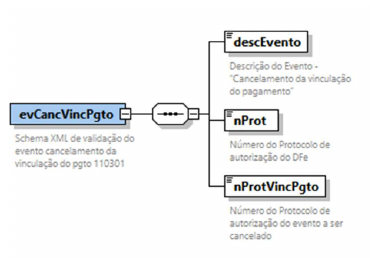

<!-- p.09 -->

# 4 Evento de Cancelamento da Vinculação de Pagamento

**Função**: Evento para indicar o cancelamento de um evento de vinculação de pagamento do DFe nas ocasiões em que ocorrer erro na geração do evento.

**Autor do Evento**: O autor do evento é o emissor do DFe. A mensagem XML do evento será assinada com o certificado digital que tenha o CNPJ base do Emissor.

**Código do Tipo de Evento**: 110301 (Este evento exige existência do DFe em situação autorizado)

**Schema XML**: evCancVincPGto_v9.99.xsd

| # | Campo | Ele | Pai | Tipo | Ocor. | Tam. | Descrição/Observação |
|---|---|---|---|---|---|---|---|
| IP01 | **evCancVincPgto** | **G** | **-** | **-** | **-** | **-** | **TAG raiz** |
| IP02 | descEvento | E | IP01 | C | 1-1 | 44 | Descrição do Evento: “Cancelamento da Vinculação do Pagamento” |
| IP03 | nProt | E | IP01 | N | 1-1 | 15 | Informar o número do protocolo de autorização do DFe |
| IP04 | nProtVincPgto | E | IP01 | N | 1-1 | 15 | Informar o número do protocolo de autorização do evento de vinculação de pagamento que será cancelado |

## Validação das Regras Específicas do Evento

| Regra de Validação | Aplic. | cStat | Efeito | Mensagem |
|---|---|---|---|---|
| **Q01** Verificar se a UF da Chave de Acesso difere da UF do Web Service | Obrig. | 249 | Rej. | Rejeição: UF da Chave de Acesso diverge da UF autorizadora |
| **Q02** Verificar se o nSeqEvento é maior que o valor permitido (1 a 999) | Obrig. | 636 | Rej. | Rejeição: O número sequencial do evento é maior que o permitido |
| **Q03** Emitente deve estar habilitado na base de dados para emissão do DFe | Obrig. | 203 | Rej. | Rejeição: Emissor não habilitado para emissão de CTe |
| **Q04** Verificar se número do Protocolo informado difere do número do Protocolo do DFe | Obrig. | 222 | Rej. | Rejeição: Protocolo de Autorização de Uso difere do cadastrado |
| **Q05** Verificar se número do Protocolo do evento de vinculação de pgto a ser cancelado existe para o DFe e encontra-se na situação autorizado | Obrig. | 1002 | Rej. | Rejeição: Protocolo do evento a ser cancelado não existe, não está associado ao DFe ou já está cancelado |

## Final do Processamento

Se o evento de Cancelamento da vinculação do pagamento do DFe for homologado o status de retorno deverá ser cStat=135 e o evento cancelado passará a condição de anulado.

