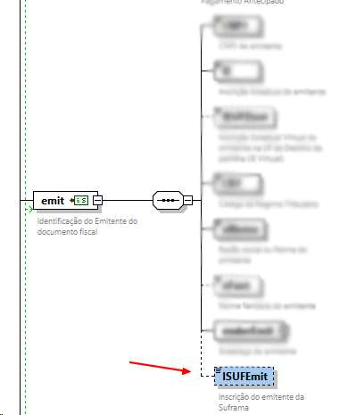

<!-- p.06 -->

# 4 Novo campo Inscrição Suframa do Emitente

| # | Campo | Ele | Pai | Tipo | Ocor. | Tam. | Descrição/Observação |
|---|---|---|---|---|---|---|---|
| 1 | ISUFEmit | E | Emit | C | 0 - 1 | 8-9 | Informar o número do Cadastro do emitente na Suframa. Campo obrigatório nas operações que se beneficiam de incentivos fiscais existentes nas áreas sob controle da SUFRAMA com alíquota zero da CBS referente aos arts. 451 e 466 da LC 214/25. |

| # | Regra de Validação | Aplic. | cStat | Efeito | Mensagem |
|---|---|---|---|---|---|
| 001 | Se Inscrição do emitente na SUFRAMA (emit/ISUFemit) informada: - Município do Emitente (tag:emit/cMun) diferente de:  **ZFM:** 1302603-Manaus, 1303569-Rio Preto da Eva, 1301902-Itacoatiara  **ALC:** 1304062-Tabatinga (AM), 1600303-Macapá (AP), 1600600-Santana (AP), 1100106-Guajará-Mirim (RO), 1400100-Boa Vista (RR), 1400159-Bonfim (RR), 1200104-Brasileia (AC), 1200252-Epitaciolândia (AC), 1200203-Cruzeiro do Sul (AC) | Obrig. | 1015 | **Rej.** | Rejeição: Município do Emitente não pertence à área incentivada - CBS |
| 002 | Se inscrição do emitente na SUFRAMA (emit/ISUFemit) informada: - Validar inscrição com dígito verificador inválido | Obrig. | 1016 | **Rej.** | Rejeição: Inscrição do emitente na Suframa com dígito verificador inválido |
