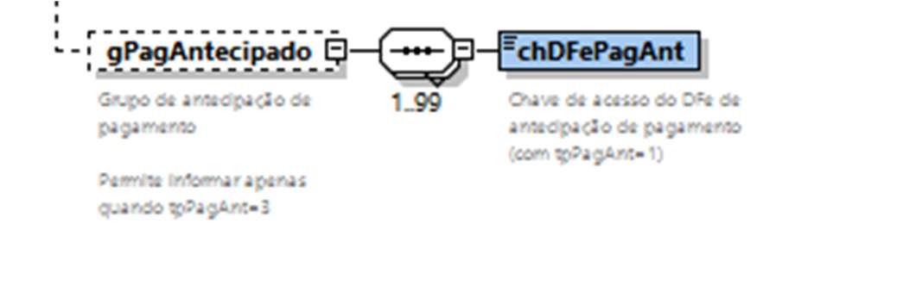

<!-- p.11 -->

# 7 Antecipação de Pagamento

| # | Campo | Ele | Pai | Tipo | Ocor. | Tam. | Descrição/Observação |
|---|---|---|---|---|---|---|---|
| 1 | tpPagAnt | E | ide | N | 0 - 1 | 1 | Tipo Pagamento ou Pagamento Antecipado Informar: 1 - Pagamento Antecipado 3 - Fornecimento com pagamento realizado anteriormente Este campo é opcional e apenas deve ser informado em caso de Antecipação de Pagamento e no CTe de fornecimento associada a esses pagamentos antecipados, demais hipóteses de prestação de serviço sem antecipação não devem preencher. |
| 2 | **gPagAntecipado** | **G** | **ide** | **-** | **0 - 1** | **-** | **Grupo de antecipação de pagamento** **Permite informar apenas quando tpPagAnt=3** |
| 3 | chDFePagAnt | E | gPagAntecipado | C | 1 - 99 | 44 | Chave de acesso do DFe de antecipação de pagamento (com tpPagAnt=1) Referência a DFe emitido anteriormente, referente a pagamento antecipado |

| # | Regra de Validação | Aplic. | cStat | Efeito | Mensagem |
|---|---|---|---|---|---|
| 001 | Se Tipo de Antecipação de pagamento (tag:ide\tpPagAnt) não estiver informado ou estiver informado e for igual a 1 (Pagamento Antecipado): O grupo gPagAntecipado **NÃO DEVE SER** Informado | Obrig. | 1026 | **Rej.** | Rejeição: Grupo de pagamento antecipado não deve ser informado |
| 002 | Se Tipo de Antecipação de pagamento (tag:ide\tpPagAnt) estiver informado e for igual a 3 (Fornecimento com pagamento realizado anteriormente): O grupo gPagAntecipado **DEVE SER** Informado | Obrig. | 1027 | **Rej.** | Rejeição: Grupo de pagamento antecipado deve ser informado |
| 003 | Se o grupo de antecipação de pagamento (grupo: ide\gPagAntecipado) estiver informado: Para cada chave de acesso de CTe informado verificar: - Validar chave de acesso do CTe de Pagamento antecipado  Retornar o motivo da rejeição da Chave de Acesso: CNPJ zerado ou inválido, Ano < 2009 ou maior que atual, Mês inválido (0 ou > 12), Modelo diferente de 57/67, Número zerado, Tipo de emissão inválido, UF inválida ou DV inválido)  [chCTe:99999999999999999999999999999999999999999999]  [Motivo: XXXXXXXXXXXX] | Obrig | 1030 | **Rej.** | Rejeição: Chave de acesso do CTe de pagamento antecipado inválida |
| 004 | Se o grupo de antecipação de pagamento (grupo: ide\gPagAntecipado) estiver informado: Para cada chave de acesso de CTe informado verificar:  - Verificar se existe o CTe de Pagamento **antecipado**.  Acesso BD CTE (Chave: UF, CNPJ Emit, Modelo, Série, Nro) | Obrig | 1031 | **Rej.** | Rejeição: CTe de pagamento antecipado inexistente |
| 005 | Se o grupo de antecipação de pagamento (grupo: ide\gPagAntecipado) estiver informado: Para cada chave de acesso de CTe informado verificar: <!-- p.12 -->Acessar BD CTE (Chave: UF, CNPJ Emit, Modelo, Série, Nro) - Verificar se o CTe de pagamento antecipado existe com diferença na Chave de Acesso Retornar a chave de acesso já autorizada, o número do protocolo e data de autorização do CTe [chCTe:99999999999999999999999999999999999999999999] [[nProt:999999999999999][dhAut:AAAA-MM-DDTHH:MM:SS TZD]. | Obrig | 1032 | **Rej.** | Rejeição: CTe de pagamento antecipado com diferença de Chave de Acesso [chCTe: 99999999999999999999999999999999999999999999] [nProt:999999999999999][dhAut: AAAA-MM-DDTHH:MM:SS TZD]. |
| 006 | Se o grupo de antecipação de pagamento (grupo: ide\gPagAntecipado) estiver informado: Para cada chave de acesso de CTe informado verificar:  CTe de pagamento antecipado deve ser do tipo Normal ou Substituição.  Acessar BD CTE (Chave: UF, CNPJ Emit, Modelo, Série, Nro) | Obrig | 1033 | **Rej.** | Rejeição: CTe de pagamento antecipado é diferente de Normal ou Substituição |
| 007 | Se o grupo de antecipação de pagamento (grupo: ide\gPagAntecipado) estiver informado: Para cada chave de acesso de CTe informado verificar:  - Verificar se o CTe de pagamento antecipado está com Situação: **Autorizado o Uso.**  Acesso BD CTE (Chave: UF, CNPJ Emit, Modelo, Série, Nro) | Obrig | 1034 | **Rej.** | Rejeição: CTe de pagamento antecipado deve estar com a situação autorizada (não pode estar cancelado) |
| 008 | Se o grupo de antecipação de pagamento (grupo: ide\gPagAntecipado) estiver informado: Para cada chave de acesso de CTe informado verificar:  - Verificar se o CTe de pagamento antecipado foi substituído. | Obrig. | 1035 | **Rej.** | Rejeição: CTe de pagamento antecipado não pode ter sido substituído |
| 009 | Se o grupo de antecipação de pagamento (grupo: ide\gPagAntecipado) estiver informado: Para cada chave de acesso de CTe informado verificar:  - Verificar se o CTe de pagamento antecipado possui tpPagAnt = 1 (Pagamento antecipado). | Obrig. | 1039 | **Rej.** | Rejeição: CTe referenciado deve ser do tipo de pagamento igual a Pagamento Antecipado |
| 010 | Se o grupo de antecipação de pagamento (grupo: ide\gPagAntecipado) estiver informado: Para cada chave de acesso de CTe informado verificar:  - O CNPJ-Base da chave de acesso do CTe de pagamento antecipado deve ser do mesmo CNPJ-Base do emitente do CTe de fornecimento | Obrig. | 1020 | **Rej.** | Rejeição: CNPJ Base do DFe de antecipação deve ser igual ao CNPJ Base do DFe de fornecimento |
| 011 | Se o grupo de antecipação de pagamento (grupo: ide\gPagAntecipado) estiver informado:  - Não aceitar chaves de acesso repetidas dentro do grupo gPagAntecipado | Obrig. | 1046 | **Rej.** | Rejeição: Chave de acesso de DFe de antecipação repetida no grupo de informações do Pagamento antecipado |
