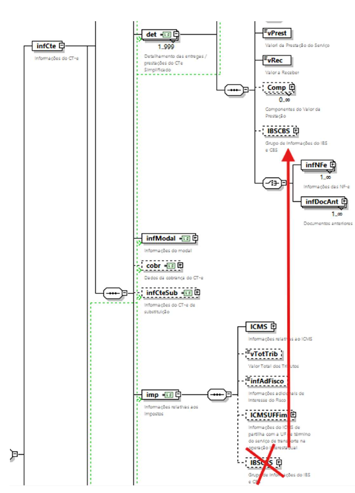
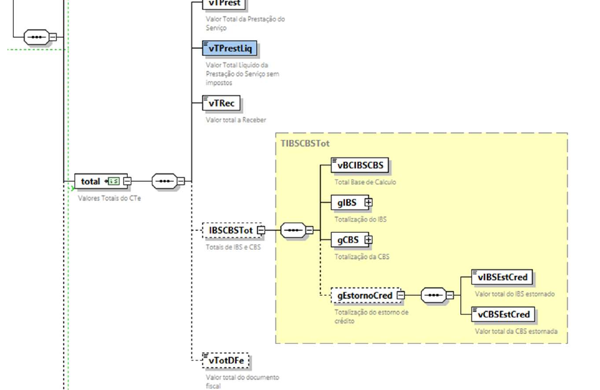

<!-- p.11 -->

# 6 Mudança na estrutura do CTe Simplificado

Atualmente, o CTe Simplificado agrupa diversas prestações (viagens) para um único tomador, mas com a tributação do IBS e da CBS centralizada no corpo do documento (imp/IBSCBS). Esta NT propõe descentralizar essas informações para o nível de item (det/nItem), possibilita-se que cada viagem ou trecho tenha sua própria situação tributária, alíquota efetiva ou classificação tributária no contexto da Reforma Tributária, mantendo os dados de ICMS centralizados no documento.

A razão para a mudança é ampliar o alcance do CTe Simplificado, como originalmente ele foi projetado. Como o IBS e a CBS são calculados e destinados com base no local de término da prestação de serviços, centralizar a tributação no cabeçalho criou um gargalo técnico: o sistema autorizador precisava de um destino unificado para validar e destinar o tributo de forma correta. Por esse motivo, o fisco foi obrigado a criar a regra de validação **G101a (Rejeição 370)**, que estabelece:

- *“O município de fim de prestação em todos os itens do CTe Simplificado (det:cMunFim) devem ser iguais”.*

Essa restrição reduziu drasticamente a utilidade do CTe Simplificado, forçando o transportador a emitir documentos diferentes para cada município de destino, mesmo que o tomador do serviço fosse o mesmo.

Ao realocar o grupo de IBS e CBS no detalhamento das viagens, o CTe pode ser utilizado novamente para retratar prestações com diversos destinos, mantendo a ideia de único tomador do serviço.

*Figura: estrutura do infCte do CTe Simplificado. A seta vermelha do original indica o grupo IBSCBS em det; o X vermelho indica o grupo IBSCBS em imp, que deixa de existir.*

<!-- p.12 -->
## Alterações nas regras de validação do CTe Simplificado

Com a mudança da localização do grupo IBSCBS, as regras de validação previstas nas NTs da Reforma Tributária passam a atuar neste tipo de CTe no nível do item (det), em caso de rejeição deverá ser retornado o [nItem] em que foi detectada a rejeição.

Revoga-se a regra de validação:

| # | Regra de Validação | Aplic. | cStat | Efeito | Mensagem |
|---|---|---|---|---|---|
| ~~G101a~~ | ~~O município de fim de prestação em todos os itens do CTe Simplificado (det:cMunFim) devem ser iguais~~ | ~~Obrig.~~ | ~~370~~ | ~~Rej.~~ | ~~Rejeição: O CTe Simplificado deve ter a prestação terminada em apenas um município~~ |

> **Revogado/Descontinuado:** a regra G101a (Rejeição 370), riscada na tabela acima e revogada pela própria NT (“Revoga-se a regra de validação”).

## Alteração no grupo total do CTe Simplificado

*Figura: grupo total do CTe Simplificado. No original, o campo vTPrestLiq e o grupo TIBSCBSTot aparecem destacados.*

Deverá ser adicionado ao grupo de totais do CTe Simplificado, um grupo de totalização do IBS/CBS em relação ao declarado nos itens (det).

| # | Campo | Ele | Pai | Tipo | Ocor. | Tam. | Descrição/Observação |
|---|---|---|---|---|---|---|---|
| ... |  |  |  |  |  |  |  |
| **#** | **IBSCBSTot** | **G** | **total** | **-** | **0-1** | **-** | **Grupo de informações para apuração do IBS e CBS declarado pelo contribuinte** |
| 1 | vBCIBSCBS | E | IBSCBSTot | N | 1-1 | 13,2 | Total da Base de cálculo do IBS/CBS |
| **2** | **gIBS** | **G** | **IBSCBSTot** | **-** | **1-1** | **-** | **Totalização do IBS** |
| **3** | **gIBSUF** | **G** | **gIBS** | **-** | **1-1** | **-** | **Totalização do IBS de competência da UF** |
| 4 | vDif | E | gIBSUF | N | 1-1 | 13,2 | Total do Diferimento |
| 5 | vDevTrib | E | gIBSUF | N | 1-1 | 13,2 | Total de Devolução de Tributo IBS UF |
| 6 | vIBSUF | E | gIBSUF | N | 1-1 | 13,2 | Total do IBS UF |
| **7** | **gIBSMun** | **G** | **gIBS** | **-** | **1-1** | **-** | **Totalização do IBS de competência Municipal** |
| 8 | vDif | E | gIBSMun | N | 1-1 | 13,2 | Total do Diferimento |
| 9 | vDevTrib | E | gIBSMun | N | 1-1 | 13,2 | Total de Devolução de Tributo IBS Municipal |
| 10 | vIBSMun | E | gIBSMun | N | 1-1 | 13,2 | Total do IBS Municipal |
| 11 | vIBS | E | gIBS | N | 1-1 | 13,2 | Total do IBS (IBS UF + IBS Mun) |
| **14** | **gCBS** | **G** | **IBSCBSTot** | **-** | **1-1** | **-** | **Total do CBS** |
| 15 | vDif | E | gCBS | N | 1-1 | 13,2 | Total do Diferimento |
| 16 | vDevTrib | E | gCBS | N | 1-1 | 13,2 | Total de Devolução do tributo CBS |
| 17 | vCBS | E | gCBS | N | 1-1 | 13,2 | Total do CBS |
| **18** | **gEstornoCred** | **G** | **IBSCBSTot** | **-** | **0-1** | **-** | <!-- p.13 -->**Total do Estorno de crédito** |
| 19 | vIBSEstCred | E | gEstornoCred | N | 1-1 | 13,2 | Total do Estorno de crédito IBS |
| 20 | vCBSEstCred | E | gEstornoCred | N | 1-1 | 13,2 | Total do Estorno de crédito CBS |

**Regras de Validação do Grupo de Totais IBS e CBS no CTe Simplificado**

| # | Regra de Validação | Aplic. | cStat | Efeito | Mensagem |
|---|---|---|---|---|---|
| 001 | O grupo de totais do IBS e CBS (IBSCBSTot) só deve ser informado se existir pelo menos uma ocorrência de IBS/CBS nos itens | Obrig. | 348 | Rej. | Rejeição: Total de IBS/CBS só deve ser informado se existir IBS/CBS declarado nos itens do DFe |
| 002 | O grupo de totais do IBS e CBS (IBSCBSTot) deve ser informado se existir pelo menos uma ocorrência de IBS/CBS nos itens | Obrig. | 349 | Rej. | Rejeição: Total de IBS/CBS deve ser informado se existir IBS/CBS declarado nos itens do DFe |
| 003 | O total do Diferimento do IBS UF deverá ser a soma do campo vDif do IBS UF informados nos itens | Obrig. | 350 | Rej. | Rejeição: Total de Diferimento do IBS UF difere da soma dos itens |
| 004 | O total Devolvido do IBS UF deverá ser a soma do campo vDevTrib do IBS UF informados nos itens | Obrig. | 351 | Rej. | Rejeição: Total Devolvido do IBS UF difere da soma dos itens |
| 005 | O total do IBS UF deverá ser a soma do campo vIBSUF informados nos itens | Obrig. | 352 | Rej. | Rejeição: Total de IBS UF difere da soma dos itens |
| 006 | O total do Diferimento do IBS Municipal deverá ser a soma do campo vDif do IBS Municipal informados nos itens | Obrig. | 353 | Rej. | Rejeição: Total de Diferimento do IBS Municipal difere da soma dos itens |
| 007 | O total Devolvido do IBS Municipal deverá ser a soma do campo vDevTrib do IBS Municipal informados nos itens | Obrig. | 354 | Rej. | Rejeição: Total Devolvido do IBS Municipal difere da soma dos itens |
| 008 | O total do IBS Municipal deverá ser a soma do campo vIBSMun informados nos itens | Obrig. | 355 | Rej. | Rejeição: Total de IBS Municipal difere da soma dos itens |
| 009 | O Total do IBS deverá ser a soma do IBS das UF e do IBS Municipal (vIBSUF + vIBSMun) | Obrig. | 356 | Rej. | Rejeição: Total do IBS difere da soma do IBS UF e IBS Municipal |
| 010 | O total do Diferimento do CBS deverá ser a soma do campo vDif do CBS informados nos itens | Obrig. | 357 | Rej. | Rejeição: Total de Diferimento do CBS difere da soma dos itens |
| 011 | O total Devolvido do CBS deverá ser a soma do campo vDevTrib do CBS informados nos itens | Obrig. | 358 | Rej. | Rejeição: Total Devolvido do CBS difere da soma dos itens |
| 012 | O total do CBS deverá ser a soma do campo vCBS informados nos itens | Obrig. | 359 | Rej. | Rejeição: Total de CBS difere da soma dos itens |
| 013 | Se informado grupo de estorno de crédito nos itens (gEstornoCred) o total do IBS estornado deverá ser igual a soma campo valor do IBS estornado nos itens (gEstornoCred/vIBS) | Obrig. | 305 | Rej. | Rejeição: Total de IBS estornado difere da soma dos itens |
| 014 | Se informado grupo de estorno de crédito nos itens (gEstornoCred) o total da CBS estornada deverá ser igual a soma campo valor da CBS estornada nos itens (gEstornoCred/vCBS) | Obrig. | 306 | Rej. | Rejeição: Total de CBS estornada difere da soma dos itens |
