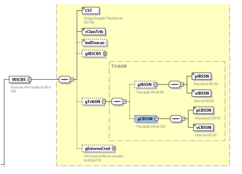

<!-- p.05 -->

# 5 Grupo de informações da composição do valor de IBS e CBS para SN

| # | Campo | Ele | Pai | Tipo | Ocor. | Tam. | Descrição/Observação |
|---|---|---|---|---|---|---|---|
| **1** | **gTribSN** | **G** | **IBSCBS** | **-** | **0-1** | | **Grupo de informações da composição do valor do IBS e da CBS para o Simples Nacional** |
| **2** | **gIBSSN** | **G** | **gTribSN** | **-** | **0-1** | | **Grupo de informações da composição do valor do IBS para o Simples Nacional** |
| 3 | pIBSSN | E | gIBSSN | N | 1-1 | 3v2-4 | Alíquota efetiva do IBS para os Optantes do Simples  **Observação**: nos anos de 2027 e 2028, no caso de Compra Governamental:  - Se tpEnteGov igual a ”1-União”, pIBSSN deve ser zero;  - Se tpEnteGov diferente de ”1-União”, pIBSSN deve ser a alíquota efetiva do Simples Nacional para o IBS. |
| 4 | vIBSSN | E | gIBSSN | N | 1-1 | 13v2 | Valor do IBS para os Optantes do Simples Nacional |
| **5** | **gCBSSN** | **G** | **gTribSN** | **-** | **0-1** | | **Grupo de informações da composição do valor da CBS para o Simples Nacional** |
| 6 | pCBSSN | E | gCBSSN | N | 1-1 | 3v2-4 | Alíquota efetiva da CBS para os Optantes do Simples  **Observação**: nos anos de 2027 e 2028, no caso de Compra Governamental:  - Se tpEnteGov igual a ”1-União”, pCBSSN deve ser a soma das alíquotas efetivas de IBS e CBS para o Simples Nacional;  - Se tpEnteGov diferente de ”1-União”, pCBSSN deve ser a alíquota efetiva do Simples Nacional para a CBS. |
| 7 | vCBSSN | E | gCBSSN | N | 1-1 | 13v2 | Valor do CBS para os Optantes do Simples Nacional |

<!-- p.06 -->

