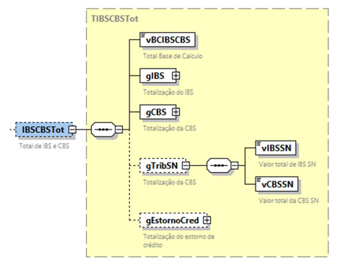

<!-- p.09 -->

# 7 Grupo de Totais do DFe (CTe Simplificado)

| # | Campo | Ele | Pai | Tipo | Ocor. | Tam. | Descrição/Observação |
|---|---|---|---|---|---|---|---|
| **1** | **gTribSN** | **G** | **IBSCBSTot** | **-** | **0-1** | | **Grupo de informações de totais do IBS e da CBS para o Simples Nacional** |
| 4 | vIBSSN | E | gTribSN | N | 1-1 | 13v2 | Valor Total do IBS para os Optantes do Simples Nacional |
| 7 | vCBSSN | E | gTribSN | N | 1-1 | 13v2 | Valor Total do CBS para os Optantes do Simples Nacional |

| # | Regra de Validação | Aplic. | cStat | Efeito | Mensagem |
|---|---|---|---|---|---|
| 01 | O grupo total da tributação do Simples Nacional deverá ser informado se pelo menos um dos itens apresentar o grupo gTribSN (IBSCBS\gTribSN) | Obrig. | 1110 | Rej. | Rejeição: Total de Tributação SN deve ser informada se existir tributação de Simples Nacional no documento |
| 02 | O total de IBS SN (Se informando) deverá ser a soma do campo vIBSSN informados nos itens | Obrig. | 1111 | Rej. | Rejeição: Total de IBS SN difere da soma dos itens |
| 03 | O total do CBS SN (Se informando) deverá ser a soma do campo vCBSSN informados nos itens | Obrig. | 1112 | Rej. | Rejeição: Total de CBS SN difere da soma dos itens |
