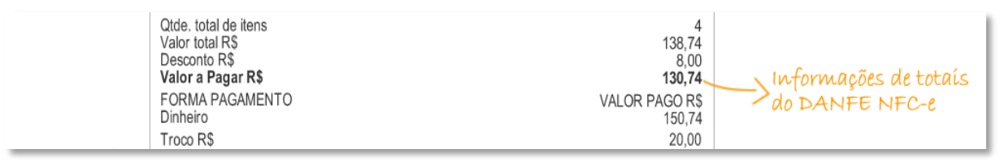
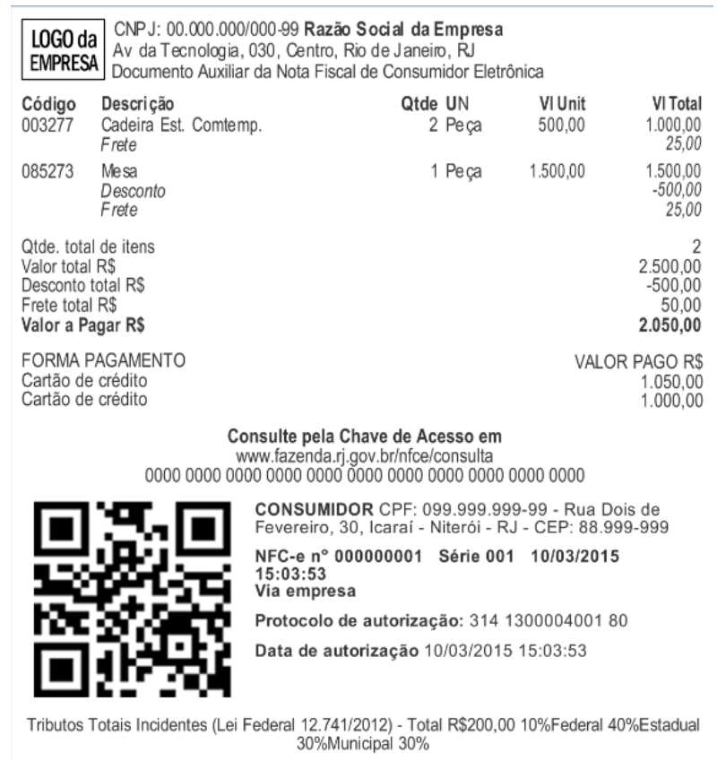

<!-- p.10 -->
# 3.1.3 Divisão III – Informações de Totais do DANFE NFC-e

*Figura 3: informações de totais do DANFE NFC-e*

Esta divisão define os totais que deverão ser impressos no DANFE NFC-e de acordo com o detalhamento abaixo:

- **Qtde. Total de Itens**: somatório da quantidade de itens (observação: a quantidade de itens refere-se à quantidade de itens de produtos/serviços distintos na NFC-e não guardando qualquer relação com a soma de quantidade de produtos/serviços);
- **Valor Total R$**: somatório dos valores totais dos itens;
- **Acréscimos (frete, seguro e outras despesas) /Desconto R$**: somatório dos valores dos itens dos acréscimos (frete, seguro e outras despesas) e dos descontos (deve ser impresso a linha apenas se existir acréscimo ou desconto) ) (IDs: W08, W09, W10 e W15, tags: vFrete, vSeg, vDesc e vOutro);

OBS.: Estas informações, a critério da UF, podem estar descriminadas por item (IDs: I15, I16, I17 e I17a, tags: vFrete, vSeg, vDesc e vOutro).

*Exemplo de DANFE NFC-e com logotipo da empresa e totais (sem legenda no original)*

<!-- p.11 -->

- **Valor a Pagar R$**: somatório dos valores totais dos itens somados os acréscimos e subtraído dos descontos (deve ser impresso apenas se existir acréscimo ou desconto) (ID: W16, tag: vNF);
- **FORMA PAGAMENTO**: forma na qual o pagamento da NFC-e foi efetuado (podem ocorrer mais de uma forma de pagamento, devendo neste caso ser indicado o montante parcial do pagamento para a respectiva forma. Exemplo: em dinheiro, em cheque e etc(ID: YA02, tag: tPag);
- **Valor Pago**: valor pago efetivamente em cada forma de pagamento pagamento (ID: YA03, tag: vPag);
- **Troco**: valor do troco (ID: YA09, tag: vTroco).

As informações de valores devem ter as casas decimais separadas por vírgula e ser utilizado ponto para a indicação de milhar.

A informação do troco será obrigatória a partir da nova versão do leiaute da NFC-e, conforme NT 2016.002.
