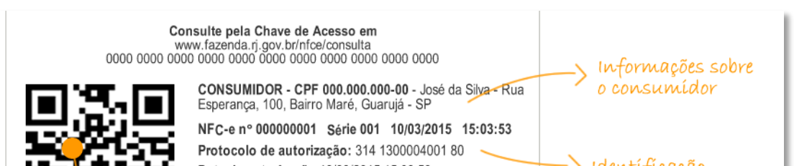
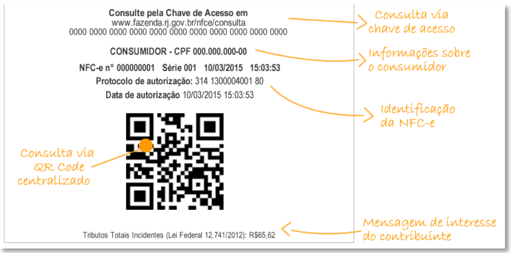

# 3.1.5 Divisão V – Informações da consulta via QR Code

A divisão V corresponde à área de impressão no DANFE NFC-e do QR Code. A imagem do QR Code poderá ser impressa à esquerda das informações exigidas nas Divisões VI e VII, conforme figura 4, ou centralizada, conforme figura 5, e deve ter tamanho mínimo 25 mm x 25mm, sendo 22 mm de conteúdo para 3 mm de margem segura (quiet zone), para dimensões superiores a 25 mm, considerar a margem segura de 10% da dimensão total.

<!-- p.12 -->

<!-- REVISAR p.12: figura 4 aparece cortada no topo no original (cabeçalho do DANFE não visível) -->

*Figura 4: layout DANFE NFC-e QR Code à esquerda*

*Figura 5: layout DANFE NFC-e QR Code centralizado*
