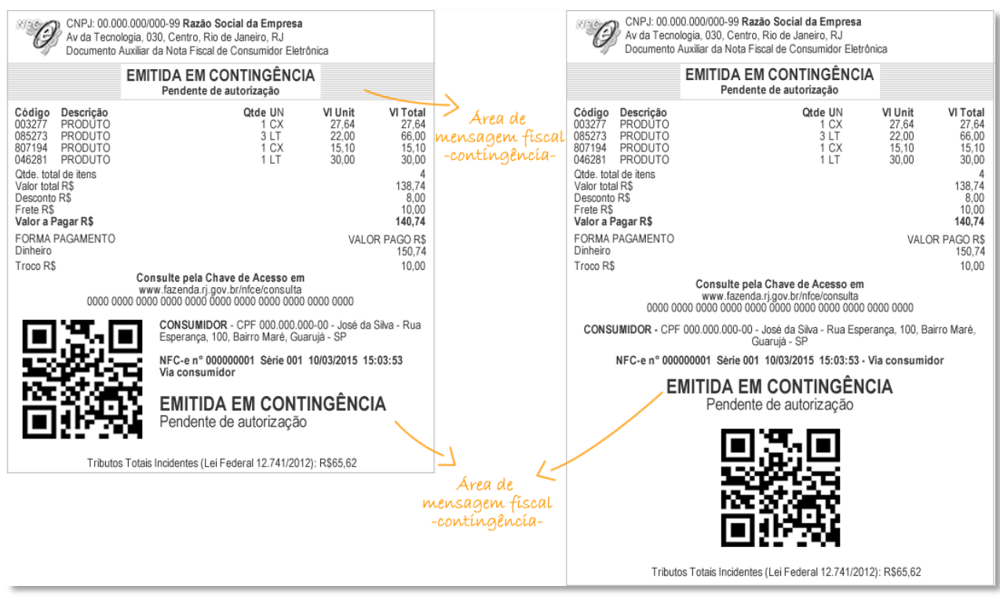

# 3.1.8 Divisão VIII – Área de Mensagem Fiscal

Esta divisão é reservada para a impressão de mensagens de interesse fiscal que constem do campo informações fiscais do arquivo eletrônico da NFC-e (tag: infAdFisco) ou, a critério da UF, a tag xMsg contida no XML de retorno da autorização da NFC-e.

Na hipótese de emissão de NFC-e em contingência é obrigatório imprimir em destaque o texto em duas linhas: “EMITIDA EM CONTINGÊNCIA Pendente de autorização”.

O texto deve ser exibido em dois locais no documento:

- **Abaixo do cabeçalho** (divisão I): centralizado em duas linhas, entre bloco de linhas, conforme imagem a seguir.
- **Abaixo da identificação da NFC-e** (divisão VII) em duas linhas, conforme imagem a seguir.

<!-- p.14 -->

*Figura 6: DANFE NFC-e emitida em contingência*

Ainda na hipótese contingência, deverá ser impressa uma segunda via do DANFE NFC-e que deverá permanecer a disposição do Fisco no estabelecimento até que tenha sido transmitida e autorizada a respectiva NFC-e emitida em contingência. Esta obrigação poderá, a critério da Unidade Federada, ser dispensada. Alternativamente à impressão da segunda via do DANFE NFC-e quando de emissão em contingência, o contribuinte poderá optar pela guarda eletrônica, em local seguro, do respectivo arquivo XML da NFC-e que deve possibilitar impressão do respectivo DANFE NFC-e para apresentação ao fisco quando solicitado.

Para poder fazer uso desta opção de guarda eletrônica do arquivo XML emitido em contingência, deverá, previamente, lavrar termo no livro Registro de Utilização de Documentos Fiscais e Termos de Ocorrência - modelo 6, ou formalizar declaração de opção segundo disciplina que vier a ser estabelecida por sua Unidade Federada, assumindo total responsabilidade pela guarda do arquivo e declarando ter ciência que não poderá, posteriormente, alegar problemas técnicos para justificar a eventual perda desta informação eletrônica que está sob sua posse, assumindo as consequências legais por ventura cabíveis.

Para qualquer NFC-e emitida em ambiente de homologação é obrigatório imprimir nesta área, de forma centralizada e em caixa alta, o seguinte texto: “EMITIDA EM AMBIENTE DE HOMOLOGAÇÃO – SEM VALOR FISCAL”.

<!-- p.15 -->

No caso de emissão de NFC-e em contingência, a 2ª via do DANFE NFC-e deverá ser identificada com a impressão ao lado da data e hora da emissão do texto “Via do Estabelecimento”.
