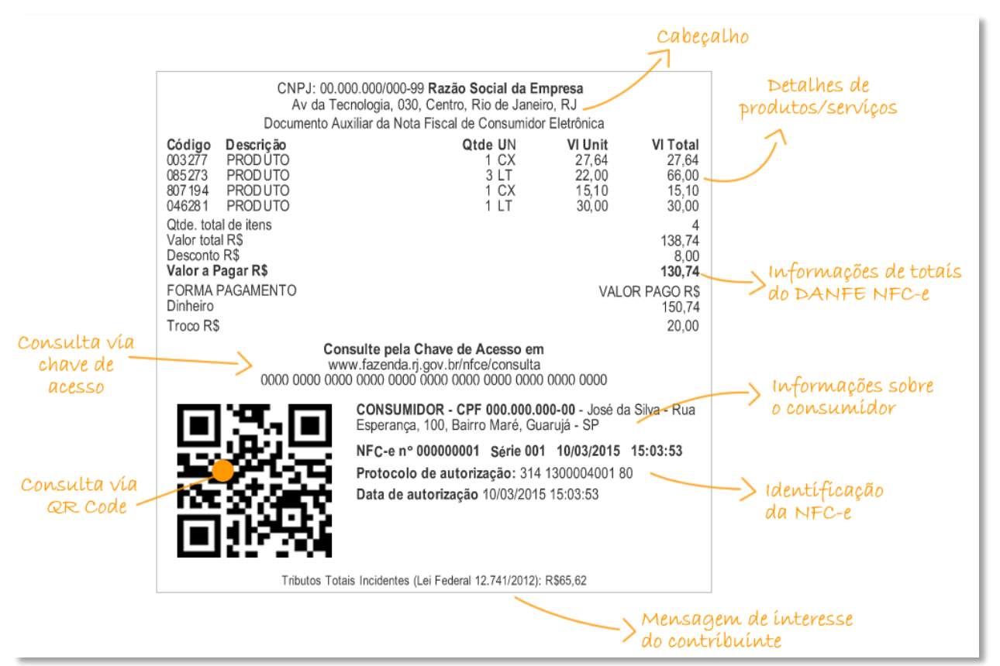
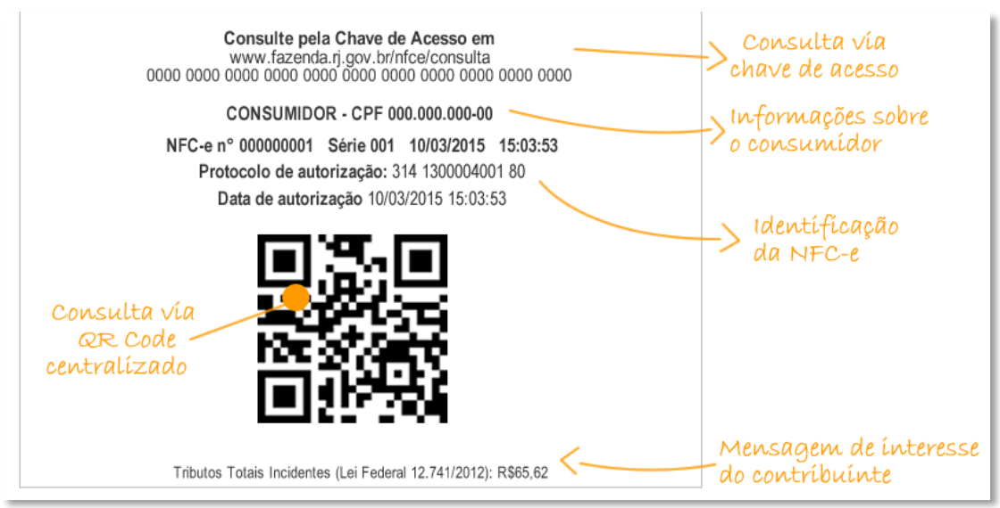

<!-- p.8 -->
# 3.1 Modelo do DANFE NFC-e

Seguem abaixo nas Figuras 1A e 1B as divisões de informações que compõem o DANFE NFC-e.

*Figura 1A: Modelo DANFE NFC-e – QR Code na lateral*

*Figura 1B: QR Code centralizado*
