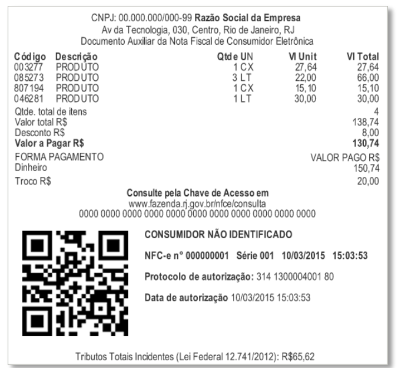
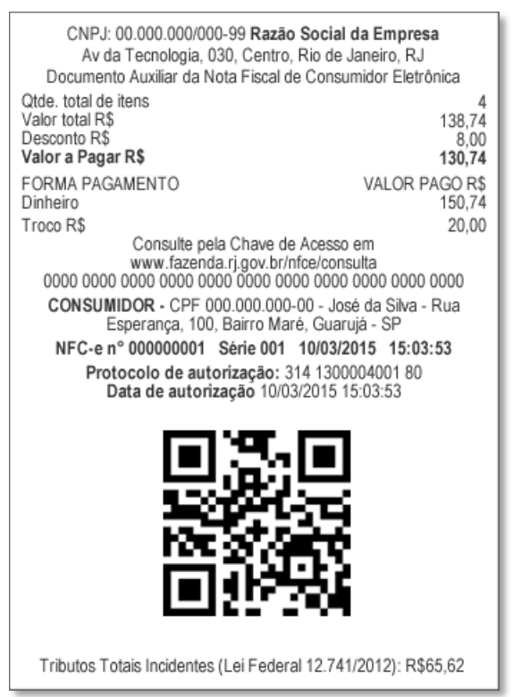
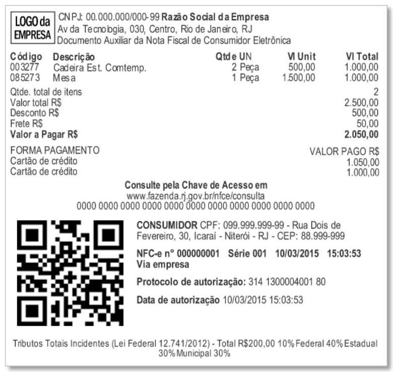
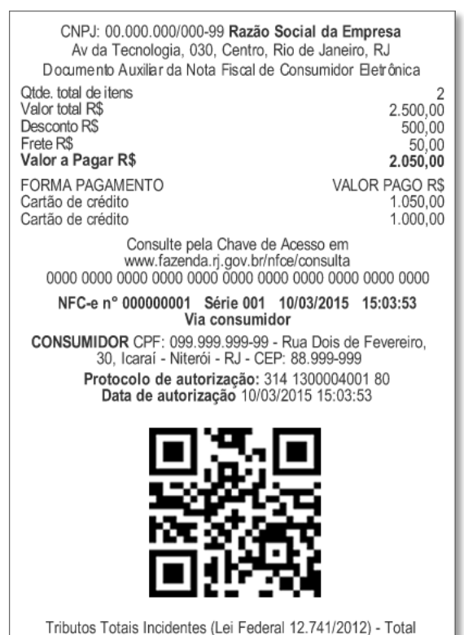
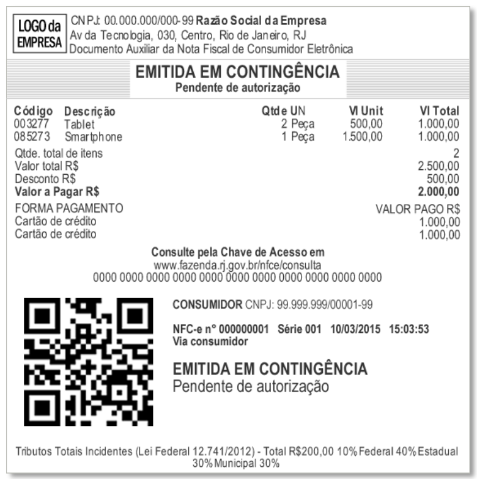
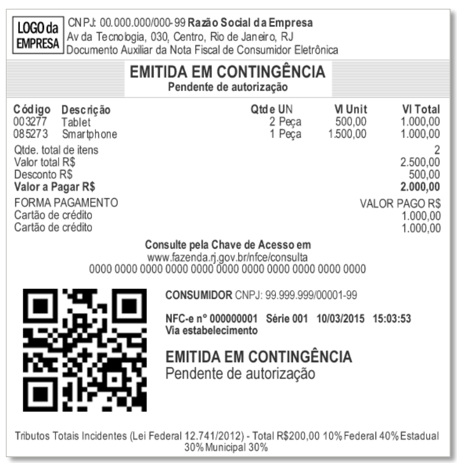

<!-- p.16 -->
# 3.2 Exemplos de DANFE NFC-e

Para facilitar aos emissores e aos desenvolvedores de NFC-e apresentamos a seguir alguns exemplos hipotéticos de DANFE NFC-e.

**Exemplo 1:** DANFE NFC-e normal com vários itens e sem identificação do consumidor

**NFC-e completo**

**NFC-e Resumido**

<!-- p.17 -->

**Exemplo 2:** DANFE NFC-e normal com 2 itens, 2 formas de pagamento, desconto, frete (ou taxa de entrega), entrega em domicílio e com identificação do consumidor (com endereço entrega)

**NFC-e completo**

**NFC-e Resumido**

<!-- p.18 -->

**Exemplo 3:** DANFE NFC-e com Logo da Empresa, NFC-e Contingência com 2 itens, 2 formas de pagamento e com identificação do consumidor

**Via Consumidor**

**Via Empresa**

