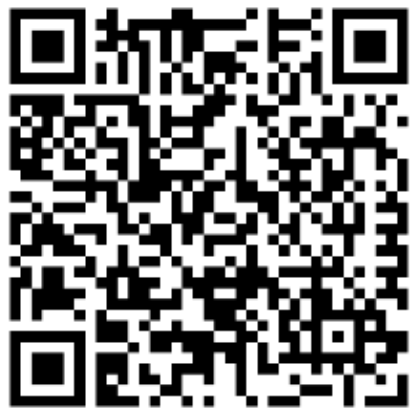

# 4.4.1 Exemplo de QR Code para NFC-e ONLINE

Considere uma situação hipotética de emissão de NFC-e em ambiente de produção na forma ONLINE, cujos parâmetros a serem utilizados no cálculo do hash do QR Code são:

- Chave de Acesso: 28170800156225000131650110000151341562040824
- Versão do QR Code: 2
- Identificação do Ambiente: 1 (Produção)
- Identificação do CSC: 1 (informar sem os zeros não significativos)
- CSC de produção 1: CODIGO-CSC-CONTRIBUINTE-36-CARACTERES

Seguindo as sequências descritas nas seções 4.2.1 e 4.3.1:

- **Passo 1**: Montar a string com os valores dos parâmetros separados por barra “|”, na ordem indica na tabela 2 (seção 4.2.1);

  Resultado: 28170800156225000131650110000151341562040824|2|1|1

- **Passo 2**: Adicionar, ao final dos parâmetros, o CSC referente ao identificador indicado no parâmetro 4 (CSC do contribuinte disponibilizado pela SEFAZ da UF onde a empresa está localizada):

  <!-- p.26 -->
  Resultado: 28170800156225000131650110000151341562040824|2|1|1**SEU-CODIGO-CSC-CONTRIBUINTE-36-CARACTERES**

- **Passo 3**: Gerar o Hash, aplicando o algoritmo SHA-1 sobre o resultado acima. A saída do algoritmo SHA-1 deve ser em HEXADECIMAL. Para verificar se a conversão realizada está correta, acesse o Portal Nacional NFC-e - Desenvolvedor (http://nfce.encat.org/desenvolvedor/) na opção "Validador de SHA1 e HEXA".

  Entrada: 28170800156225000131650110000151341562040824|2|1|1**SEU-CODIGO-CSC-CONTRIBUINTE-36-CARACTERES**

  Saída: Hash do QR Code = DC6AE2C2B9A992BE59679AC365E29922DE6B7511

- **Passo 4**: Gerar a imagem do QR Code, conforme descrito na seção 4.2: 1ª parte (endereço da consulta) + 2ª parte (parâmetros da tabela 2 separados por “|”)

O resultado da URL formada deverá ser incluída na imagem QR Code:

| Parte | Conteúdo |
|---|---|
| **1ª parte** | http://www.sefazexemplo.gov.br/nfce/qrcode?p= |
| **2ª parte** | 28170800156225000131650110000151341562040824\|2\|1\|1\|DC6AE2C2B9A992BE59679AC365E29922DE6B7511 |

*Tabela 4: Demonstração das partes componentes da URL da consulta via QR Code*

A URL para se adicionar dentro da imagem do QRCode ficaria então assim:

**http://www.sefazexemplo.gov.br/nfce/qrcode?p=**28170800156225000131650110000151341562040824|2|1|1|DC6AE2C2B9A992BE59679AC365E29922DE6B7511

A Figura 09 foi gerada com a URL apresentada acima. Se desejar, você pode testar efetuando a leitura do QR Code da Figura.

*Figura 09: QRCode gerado do exemplo hipotético*
