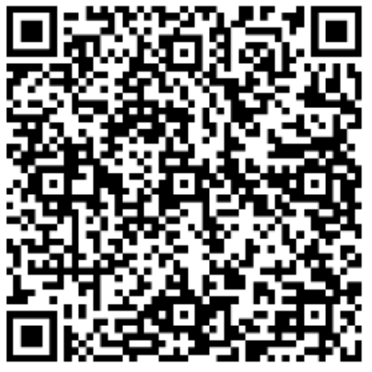

# 4.4.2 Exemplo de QR Code e Hash QR Code para NFC-e OFFLINE

<!-- p.27 -->

Considere uma situação hipotética de emissão de NFC-e em ambiente de produção na forma OFFLINE (contingência), cujos parâmetros a serem utilizados no cálculo do hash do QR Code são:

- Chave de Acesso: 28170800156225000131650110000151349562040824
- Versão do QR Code: 2
- Identificação do Ambiente: 1 (Produção)
- Dia da data de emissão da NFC-e: 02
- Valor Total da NFC-e: 60.90
- DigestValue da NFC-e: yzGYhUx1/XYYzksWB+fPR3Qc50c=
- Identificação do CSC: 1 (informar sem os zeros não significativos)
- CSC de produção 1: **CODIGO-CSC-CONTRIBUINTE-36-CARACTERES**

Seguindo as sequências descritas nas seções 4.3.1 e 4.3.2:

- **Passo 1**: Converter o valor do DigestValue da NFC-e para HEXADECIMAL. Para verificar se a conversão realizada está correta, acesse o site: Portal Nacional NFC-e - Desenvolvedor (http://nfce.encat.org/desenvolvedor/) na opção "Validador de SHA1 e HEXA".

  Entrada: yzGYhUx1/XYYzksWB+fPR3Qc50c=

  Saída: 797a4759685578312f5859597a6b7357422b6650523351633530633d

- **Passo 2**: Montar a string com os valores dos parâmetros separados por “|”, na ordem indica na tabela 3 (seção 4.2.2);

  Resultado: 28170800156225000131650110000151349562040824|2|1|02|60.90|797a4759685578312f5859597a6b7357422b6650523351633530633d|1

- **Passo 3**: Adicionar, ao final dos parâmetros, o CSC referente ao identificador indicado no parâmetro 7 (CSC do contribuinte disponibilizado pela SEFAZ da UF onde a empresa está localizada):

  Resultado: 28170800156225000131650110000151349562040824|2|1|02|60.90|797a4759685578312f5859597a6b7357422b6650523351633530633d|1**SEU-CODIGO-CSC-CONTRIBUINTE-36-CARACTERES**

<!-- p.28 -->

- **Passo 4**: Aplicar o algoritmo SHA-1 sobre todos os parâmetros concatenados. A saída do algoritmo SHA-1 deve ser em HEXADECIMAL. Para verificar se a conversão realizada está correta, acesse o site: Portal Nacional NFC-e - Desenvolvedor (http://nfce.encat.org/desenvolvedor/) na opção "Validador de SHA1 e HEXA".

  Entrada: 28170800156225000131650110000151349562040824|2|1|02|60.90|797a4759685578312f5859597a6b7357422b6650523351633530633d|1**SEU-CODIGO-CSC-CONTRIBUINTE-36-CARACTERES**

  Saída: 4615A93BB0D7C4E780F8D30EE77EDD5BA55C7D66

- **Passo 5**: Gerar a imagem do QR Code, conforme descrito na seção 4.2: 1ª parte (endereço da consulta) + 2ª parte (parâmetros da tabela 3 separados por “|”)

O resultado da URL formada deverá ser incluída na imagem QR Code:

| Parte | Conteúdo |
|---|---|
| **1ª parte** | http://www.sefazexemplo.gov.br/nfce/qrcode?p= |
| **2ª parte** | 28170800156225000131650110000151349562040824\|2\|1\|02\|60.90\|797a4759685578312f5859597a6b7357422b6650523351633530633d\|1\|4615A93BB0D7C4E780F8D30EE77EDD5BA55C7D66 |

*Tabela 5: Demonstração das partes componentes da URL da consulta via QR Code*

A URL para se adicionar dentro da imagem do QRCode ficaria então assim:

http://www.sefazexemplo.gov.br/nfce/qrcode?p=28170800156225000131650110000151349562040824|2|1|02|60.90|797a4759685578312f5859597a6b7357422b6650523351633530633d|1|4615A93BB0D7C4E780F8D30EE77EDD5BA55C7D66

A Figura 10 foi gerada com a URL apresentada acima. Se desejar, você pode testar efetuando a leitura do QR Code da Figura.

*Figura 10: QRCode gerado do exemplo hipotético*
