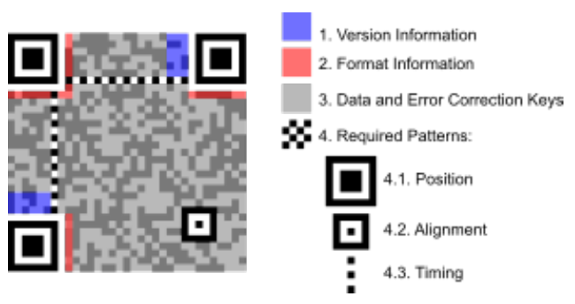
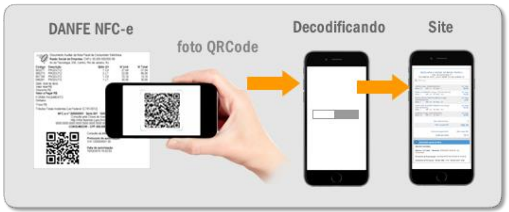

<!-- p.20 -->
# 4. Versão 2.00 do QR Code do DANFE NFC-e

O QR code é um código de barras bidimensional que foi criado em 1994 pela empresa japonesa Denso-Wave. QR significa "quick response" devido à capacidade de ser interpretado rapidamente. Esse tipo de codificação permite que possa ser armazenada uma quantidade significativa de caracteres:

- **Numéricos:** 7.089
- **Alfanumérico:** 4.296
- **Binário (8 bits):** 2.953

O QR code a ser impresso na Nota Fiscal do Consumidor eletrônica – NFC-e seguirá o padrão internacional ISO/IEC 18004.

*Figura 7: Padrão da imagem do QRCode – Fonte: Wikipédia*

O QR Code deverá existir no DANFE NFC-e relativo à emissão em operação normal ou em contingência, seja ele impresso ou virtual (DANFE NFC-e em mensagem eletrônica).

A impressão do QR Code no DANFE NFC-e tem a finalidade de facilitar a consulta dos dados do documento fiscal eletrônico pelos consumidores, mediante leitura com o uso de aplicativo leitor de QR Code, instalado em smartphones ou tablets.

Atualmente existem no mercado, inúmeros aplicativos gratuitos para smartphones que possibilitam a leitura de QR Code.

Esta tecnologia tem sido amplamente difundida e é de crescente utilização como forma de comunicação.

<!-- p.21 -->

*Figura 8: Processo de leitura do QRCode (adaptado)*
