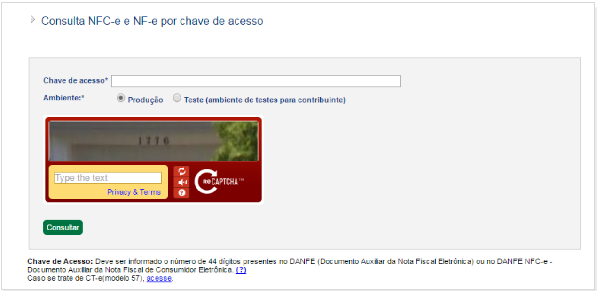
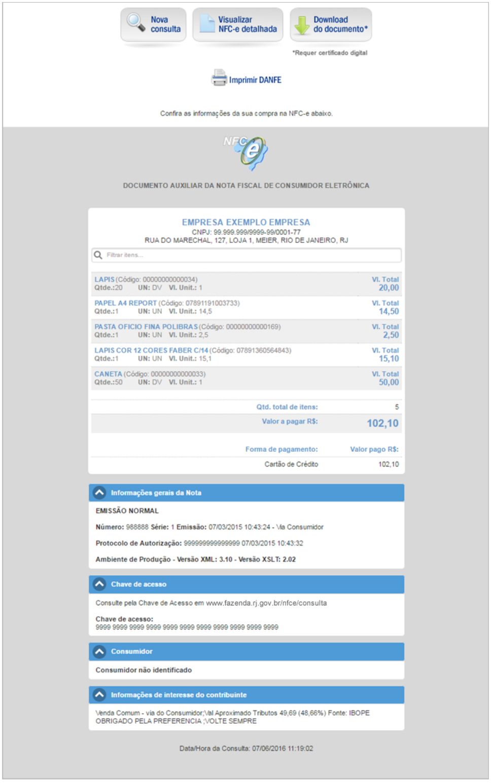
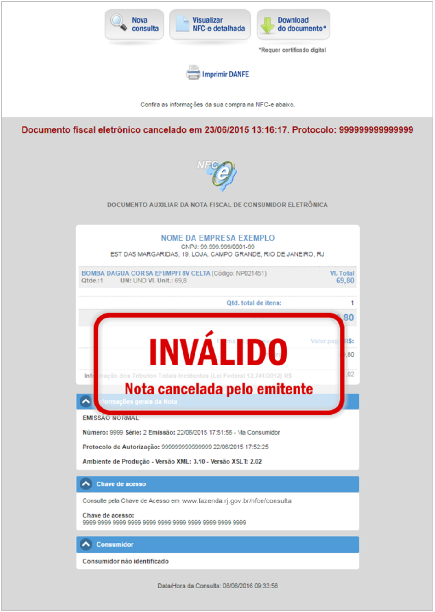
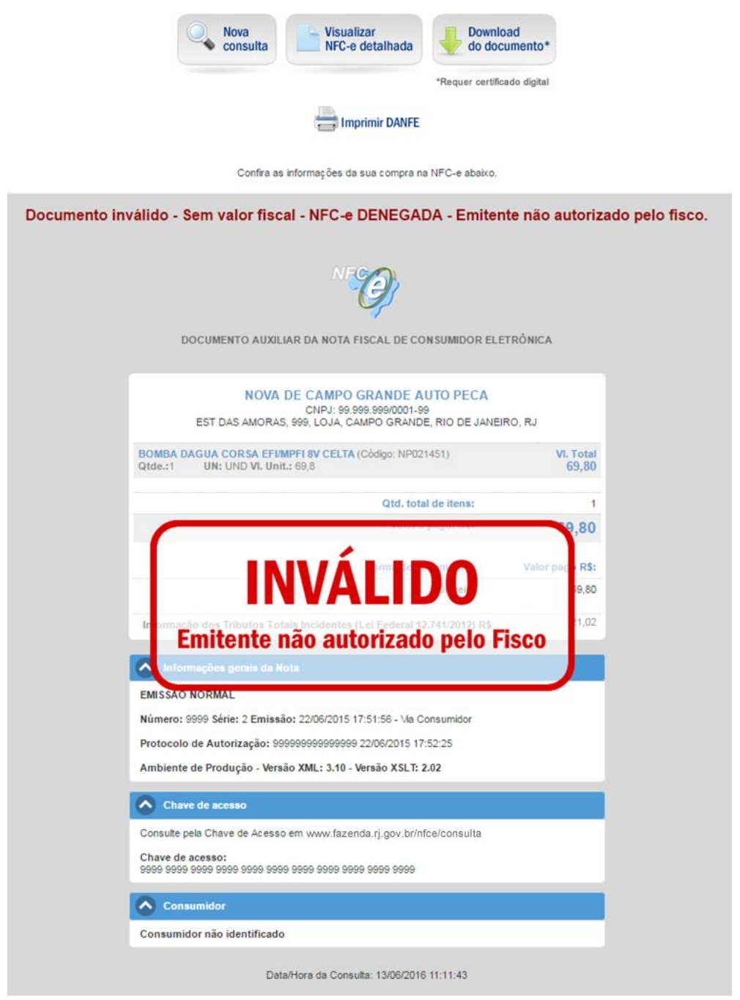

# 5.1 Consulta Pública de NFC-e via Digitação de Chave de Acesso

O endereço que deve estar impresso no DANFE NFC-e destinado à consulta utilizando a chave de acesso, está indicado por cada Unidade Federada, e consta do Portal Nacional NFC-e (http://nfce.encat.org/) na opção "Consumidor" - "Consulte sua Nota".

NT determina que a URL da consulta chaves da NFC-e deve constar do arquivo da NFC-e (XML) em ZX-03. Informações Suplementares da Nota Fiscal.

Nesta hipótese o consumidor deverá acessá-los pela internet e digitar a chave de acesso composta por 44 caracteres numéricos.

*Figura 11: Tela de consulta da NFC-e com digitação da chave de acesso*

<!-- p.33 -->

Como resultado da consulta pública, deverá ser apresentado ao consumidor na tela o DANFE NFC-e completo (com itens de mercadoria). Nesta tela o consumidor terá a opção de imprimir o DANFE NFC-e completo ou optar pela visualização do conteúdo da NFC-e em formato de abas.

A opção visualização por abas apresentará os dados da mesma NFC-e todavia com apresentação similar à consulta pública atual da NF-e modelo 55.

*Figura 12: Resultado da consulta da NFC-e com digitação da chave de acesso*

<!-- p.34 -->

<!-- REVISAR p.34: referência de figura sem número no original, “cancelada (Figura )” -->

Na hipótese da consulta pública de um NFC-e que esteja com status de cancelada (Figura ) ou denegada (Figura 14), serão apresentados os dados da respectiva NFC-e consultada, todavia com mensagem ao consumidor indicativa de que se trata de documento inválido – sem valor fiscal.

*Figura 13: Resultado da consulta da NFC-e com status CANCELADA*

<!-- p.35 -->

*Figura 14: Resultado da consulta da NFC-e com status DENEGADA*
