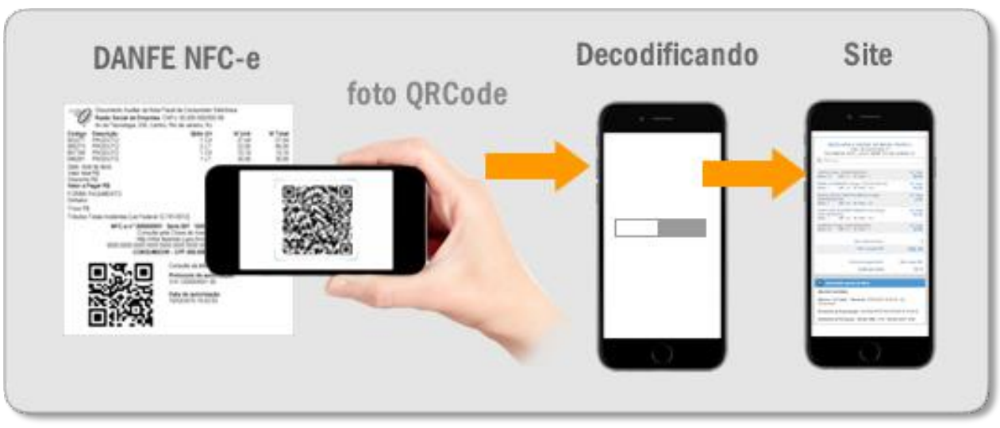

# 5.2 Consulta Pública de NFC-e via QRCode

A aplicação de consulta pública da NFC-e via QR Code será efetuada por cada Unidade Federada e efetuará validações do conteúdo de informações constantes do QR Code versus o conteúdo da respectiva NFC-e, bem como a conferência do hash do QR Code.

Nesta hipótese, o consumidor deverá apontar o seu dispositivo móvel (smartphone ou tablet) para a imagem do QR Code gerada na tela do caixa ou impressa no DANFE NFC-e entregue pelo operador do caixa. O leitor de QR Code se encarregará de <!-- p.36 --> interpretar a imagem e efetuar a consulta da NFC-e da URL recuperada no Portal da SEFAZ da Unidade Federada da emissão do documento.

*Figura 15: Processo de leitura do QRCode (adaptado)*

Como resultado da consulta QR Code, deverá ser apresentado ao consumidor na tela do dispositivo móvel o DANFE NFC-e completo (com itens de mercadoria). Nesta tela, o consumidor terá a opção de imprimir o DANFE NFC-e completo ou optar pela visualização do conteúdo da NFC-e também em formato de abas. O resultado deve ser idêntico ao resultado utilizando a consulta com digitação em tela conforme visto no tópico 5.1.

Eventuais divergências encontradas entre as informações da NFC-e constantes dos parâmetros do QR Code ou problemas na validação do Hash do QR Code deverão ser informadas ao consumidor em área de mensagem a ser disponibilizada na tela de resposta da consulta pública sem, todavia, um detalhamento excessivo do erro identificado, que será de pouco interesse ao consumidor e apenas poderá acabar por gerar dúvidas e inseguranças.

Assim, será apresentado na tela ao consumidor o código do erro e uma mensagem de aviso mais genérica.
