# 1.1.1 Acesso com Usuário/Senha

Para realizar este acesso, é necessário, incialmente, fazer um cadastro para o emissor (CPF ou CNPJ). Para isto deve-se clicar em: “Fazer primeiro acesso”.

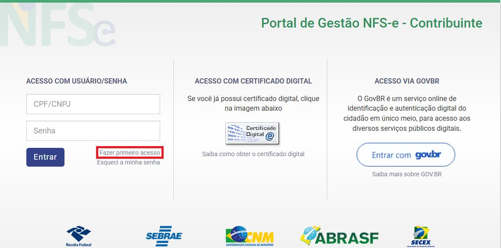

*Figura 2 – Link “Fazer primeiro acesso” na tela de acesso.*

<!-- p.08 -->

Na próxima tela serão solicitadas as informações conforme o tipo de contribuinte: Pessoa Física ou Jurídica.

## a) Pessoa Física

Marcar a opção “Pessoa Física”. O sistema abrirá os campos: “CPF” e “Data de nascimento”. Preencher os dois campos e clicar no botão de avanço.

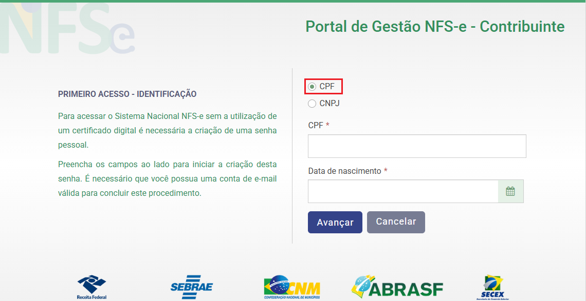

*Figura 3 – Identificação de Pessoa Física no primeiro acesso (CPF e data de nascimento).*

| Erro | Mensagem |
| ---- | -------- |
| CPF não existente | “Não foi possível recuperar informações do Contribuinte.” |
| CPF informado para o emitente da NFS-e é inválido (verificar DV). | “Informe um CPF válido” |

<!-- p.09 -->

| Erro | Mensagem |
| ---- | -------- |
| A data de nascimento diferente da informada no cadastro CPF. | “A data de nascimento informada não corresponde ao CPF informado.” |

A tela seguinte solicitará o número do título de eleitor para o CPF informado. Preencher o campo e clicar no botão de avanço.

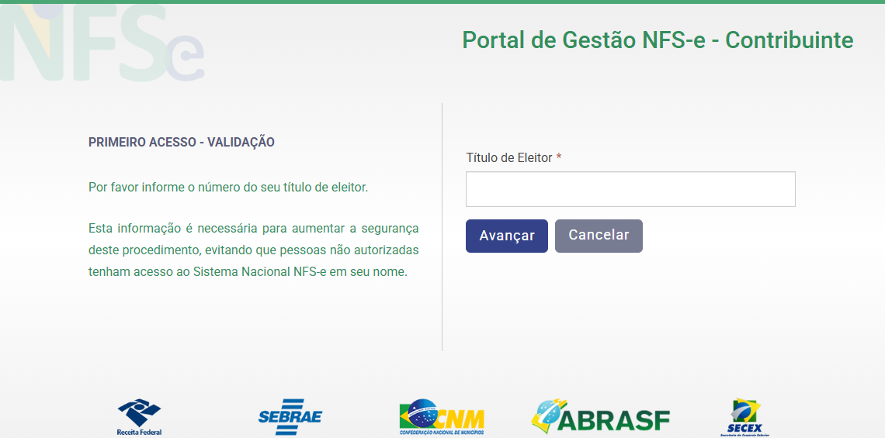

*Figura 4 – Validação do primeiro acesso: título de eleitor.*

Caso o emissor tenha declarado imposto de renda pessoa física, será necessário informar os números dos recibos das declarações de renda dos dois últimos anos, se for o caso. Preencher os campos e clicar no botão de avanço.

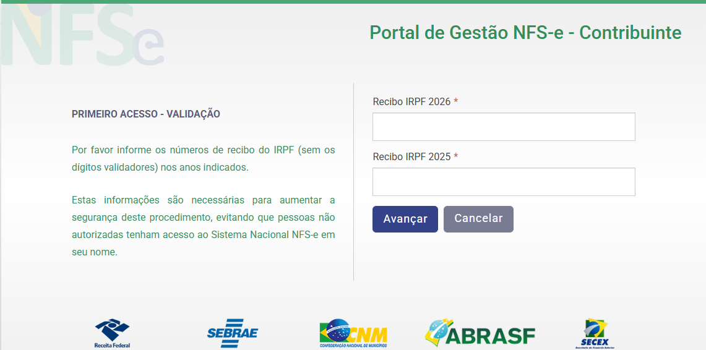

*Figura 5 – Validação do primeiro acesso: recibos do IRPF dos dois últimos anos.*

Na próxima tela, deverá ser informado um e-mail e criada uma senha de acesso. Preencher todo os campos e clicar no botão de avanço.

<!-- p.10 -->

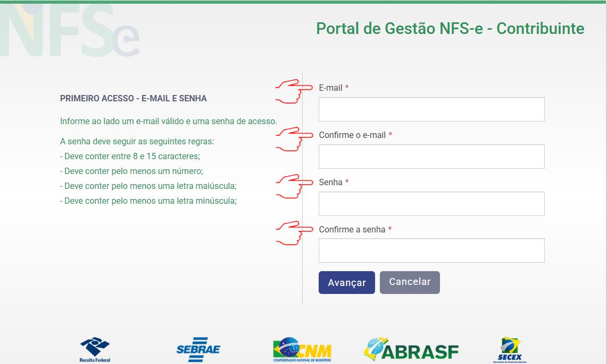

*Figura 6 – E-mail e senha no primeiro acesso (Pessoa Física).*

Será enviado um “código de segurança” no e-mail cadastrado. Deve-se acessar o e-mail e verificar o “código de segurança” enviado. Informar o código no campo correspondente e clicar no botão de avanço.

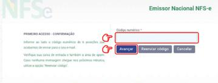

*Figura 7 – Código de segurança enviado por e-mail (Pessoa Física).*

A etapa para o primeiro acesso de Pessoa Física está finalizada.

## b) Pessoa Jurídica

Marcar a opção “Pessoa Jurídica”. O sistema abrirá os campos: “CNPJ”, “CPF do responsável” e “Data de nascimento” (do responsável). Preencher os três campos e clicar no botão de avanço.

<!-- p.11 -->

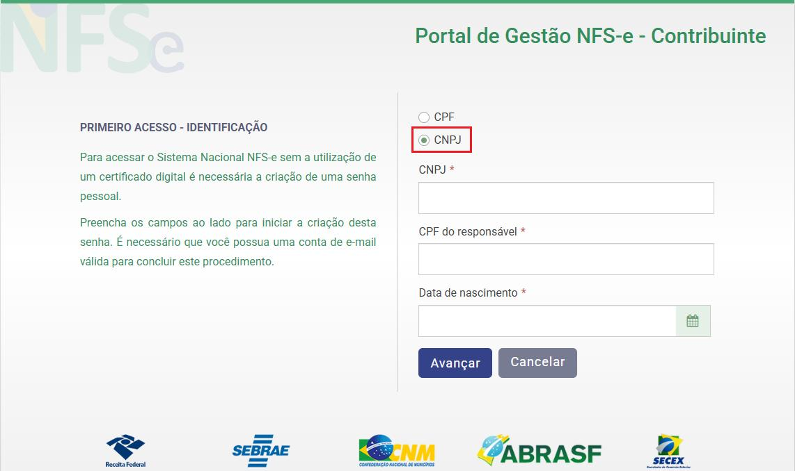

*Figura 8 – Identificação de Pessoa Jurídica no primeiro acesso (CNPJ, CPF do responsável e data de nascimento).*

| Erro | Mensagem |
| ---- | -------- |
| CNPJ não existente | “Não foi possível recuperar informações do Contribuinte.” |
| CPF do responsável diferente do informado no Cadastro CNPJ | “O CPF informado não corresponde ao CPF responsável pelo CNPJ informado.” |
| A data de nascimento do responsável é diferente da cadastrada no cadastro CPF | “A data de nascimento informada não corresponde ao CPF informado.” |

A tela seguinte solicitará o número do título de eleitor do responsável pelo CNPJ informado. Preencher o campo e clicar no botão de avanço.

<!-- p.12 -->

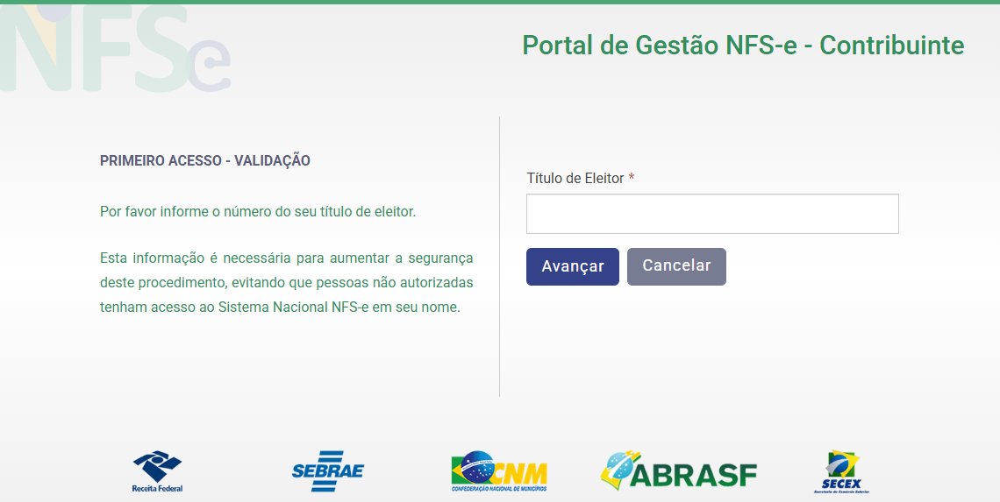

*Figura 9 – Validação do primeiro acesso (PJ): título de eleitor do responsável pelo CNPJ.*

Caso o responsável pelo CNPJ tenha declarado imposto de renda pessoa física, será necessário informar os números dos recibos das declarações de renda dos dois últimos anos, se for o caso. Preencher os campos e clicar no botão de avanço.

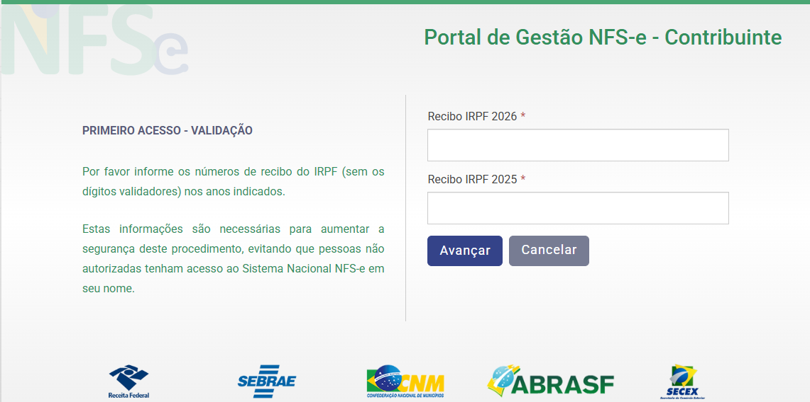

*Figura 10 – Validação do primeiro acesso (PJ): recibos do IRPF do responsável pelo CNPJ.*

Na próxima tela, deverá ser informado um e-mail e criada uma senha de acesso. Preencher todo os campos e clicar no botão de avanço.

<!-- p.13 -->

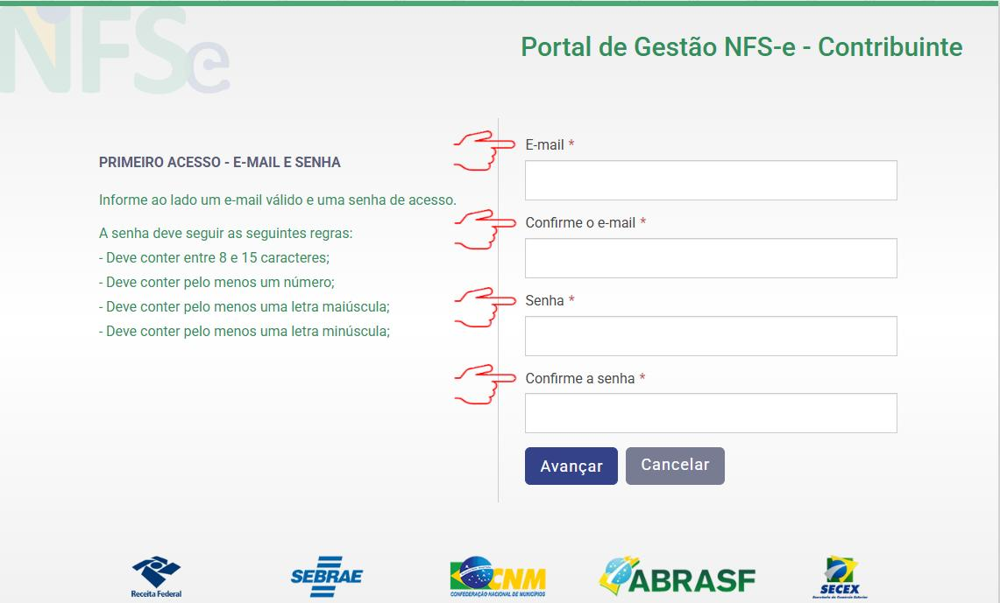

*Figura 11 – E-mail e senha no primeiro acesso (Pessoa Jurídica).*

Será enviado um “código de segurança” no e-mail cadastrado. Deve-se acessar o e-mail e verificar o “código de segurança” enviado. Informar o código no campo correspondente e clicar no botão de avanço.

*Figura 12 – Código de segurança enviado por e-mail (Pessoa Jurídica).*

A etapa para o primeiro acesso de Pessoa Jurídica está finalizada.

Em ambos os casos, ao finalizar o cadastro de Usuário/Senha, será exibida a página inicial do Portal onde deve ser informado o usuário (CPF/CNPJ) e a senha previamente cadastrados. Preencher ambos os campos e clicar no botão de acesso.

<!-- p.14 -->

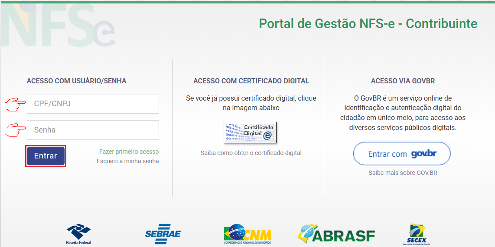

*Figura 13 – Campos de CPF/CNPJ e Senha e botão “Entrar” na tela de acesso.*

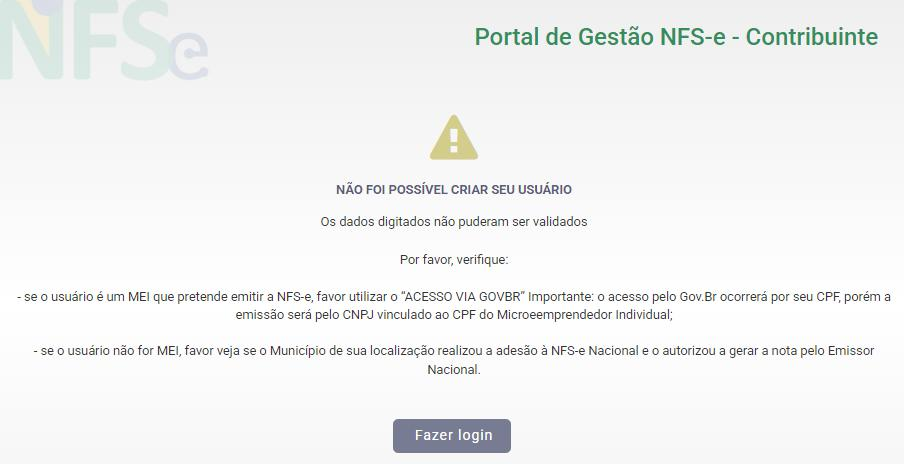

*Figura 14 – Mensagem “Não foi possível criar seu usuário”.*

1) Não foi possível criar seu usuário
