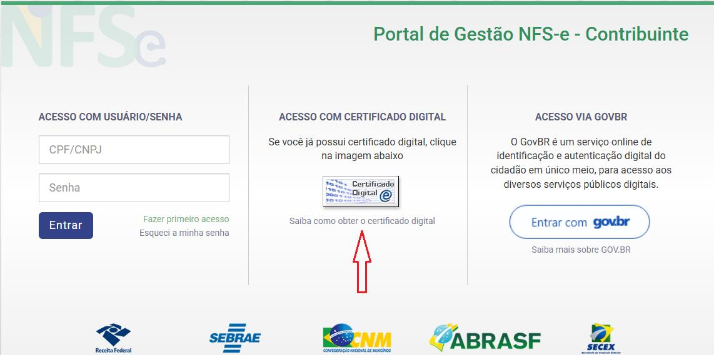
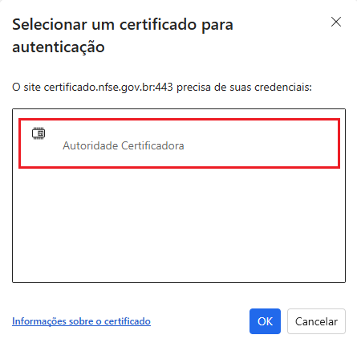
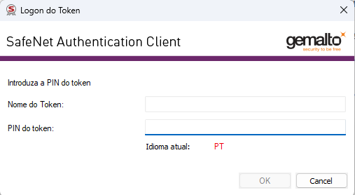

<!-- p.15 -->

# 1.1.2 Acesso com Certificado Digital

Outra forma de acesso é com o uso do certificado digital. Clicar sobre o ícone do certificado e o sistema abrirá a janela para selecionar o certificado.

*Figura 15 – Ícone do certificado digital na tela de acesso.*

Selecione o certificado a ser usado e informe a senha na janela seguinte.

*Figura 16 – Janela para seleção do certificado digital.*

*Figura 17 – Janela de logon do token (PIN).*

> **Obs.:** Certificados digitais do tipo A1, instalados diretamente no computador do usuário, não exigem senha ao utilizá-los.
