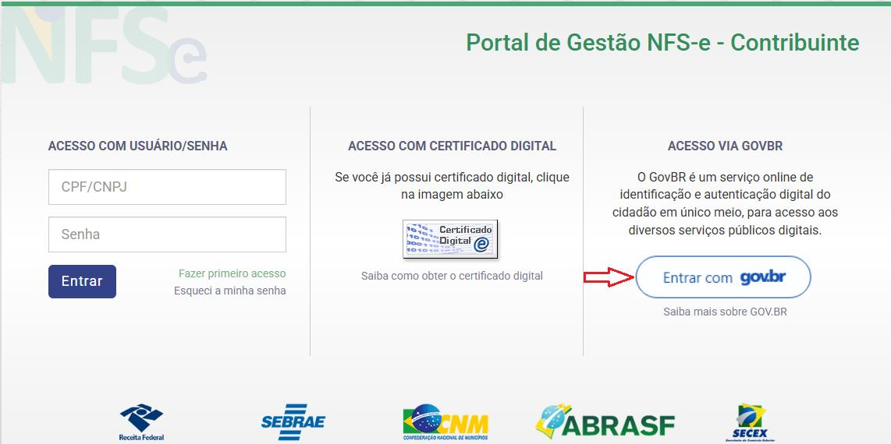
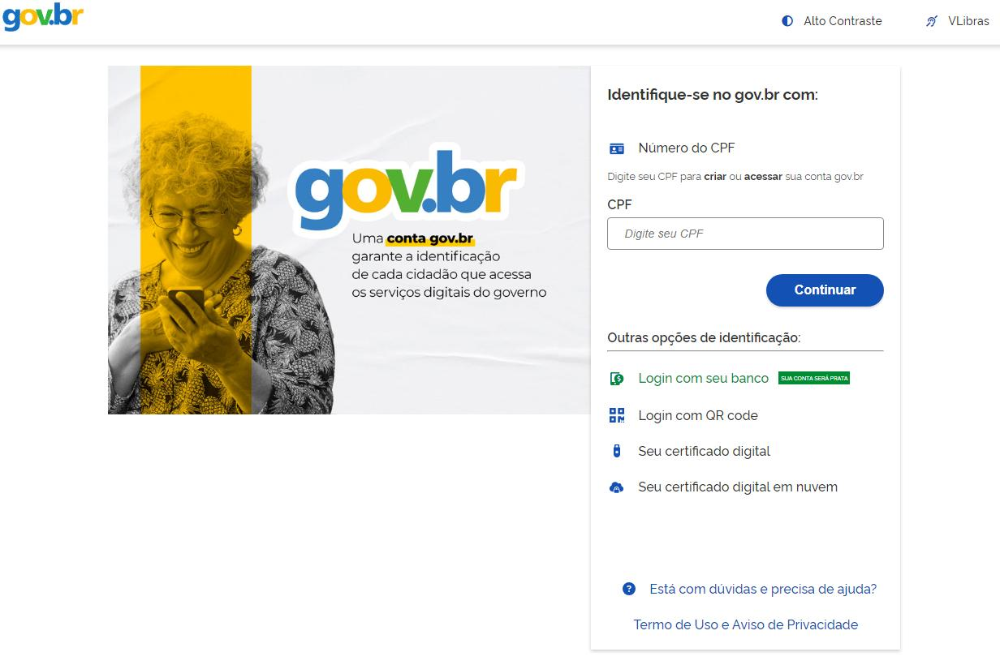

<!-- p.16 -->

# 1.1.3 Acesso com GOV.BR

Uma terceira forma de acesso é com o uso do serviço GOV.BR. Clicar sobre o ícone “Entrar com gov.br” e o sistema abrirá a janela de login do GOV.BR. Realizar o login, conforme as orientações do site.

*Figura 18 – Botão “Entrar com gov.br” na tela de acesso.*

*Figura 19 – Tela de identificação do gov.br.*
