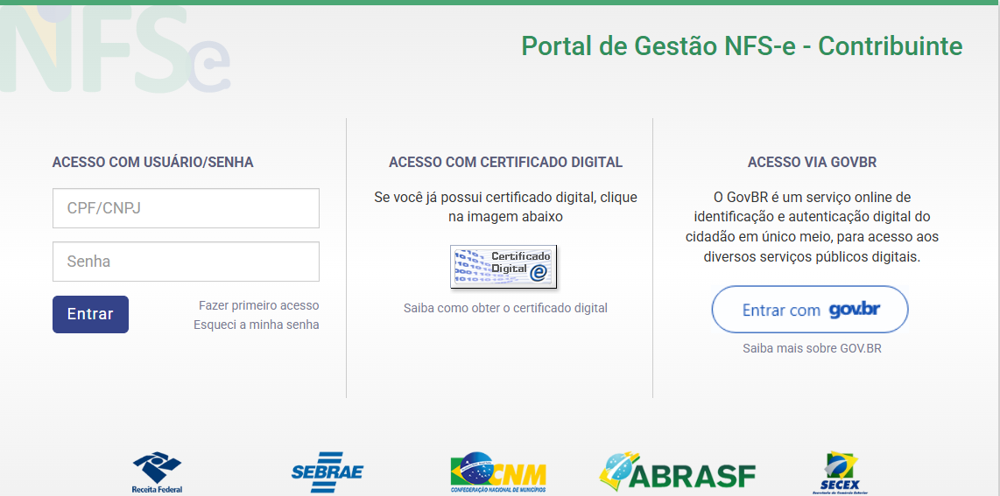

# 1.1 Acesso ao Emissor Público Nacional da NFS-e

O contribuinte deverá acessar o Portal de Gestão NFS-e - Contribuinte.

O acesso ao Portal se dá de 3 formas:

a) Acesso com usuário e senha;
b) Acesso com certificado digital;
c) Acesso via GOV.BR.

*Figura 1 – Portal de Gestão NFS-e – Contribuinte (tela de acesso).*
