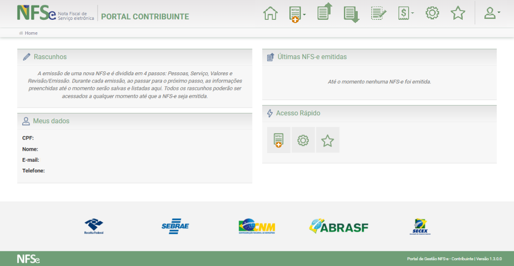

# 2 Painel Principal

Ao realizar o login por uma das formas descritas no item 1, o sistema exibirá o painel principal do módulo Emissor Público Nacional NFS-e. Este painel possui diversas consultas realizadas na base de dados do Emissor Web para o usuário que está acessando o sistema.

Estas informações consolidadas são apresentadas no painel principal em pequenos dashboards (painéis) de acordo com o perfil do usuário logado. Estas informações podem não ser apresentadas <!-- p.17 -->dependendo do usuário que estiver acessando o sistema, pois o objetivo principal desses dashboards é auxiliar a interação do usuário emitente de NFS-e com o Emissor Web. Assim, um usuário não emitente, por exemplo, não possui rascunhos ou últimas NFS-e emitidas para serem apresentadas.

*Figura 20 – Painel principal do Emissor Web.*

O Painel Principal apresenta um menu com os módulos do sistema e o painel gerencial, tratados a seguir.
