<!-- p.21 -->

# 4.1.1 Passo 1 – Pessoas

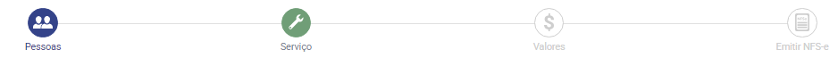

*Figura 29 – Barra de etapas da emissão completa, com o PASSO 1 – Pessoas.*

Nesta tela é feito o preenchimento dos dados dos participantes da NFS-e, quais sejam, emitente, prestador/fornecedor, tomador/adquirente e destinatário.

Além disso, informações gerais da DPS também são preenchidas nesta tela, tais como: data de competência, número e série da DPS, opção pelo preenchimento das informações de IBS/CBS e a informação de que a operação se trata de uma compra governamental.

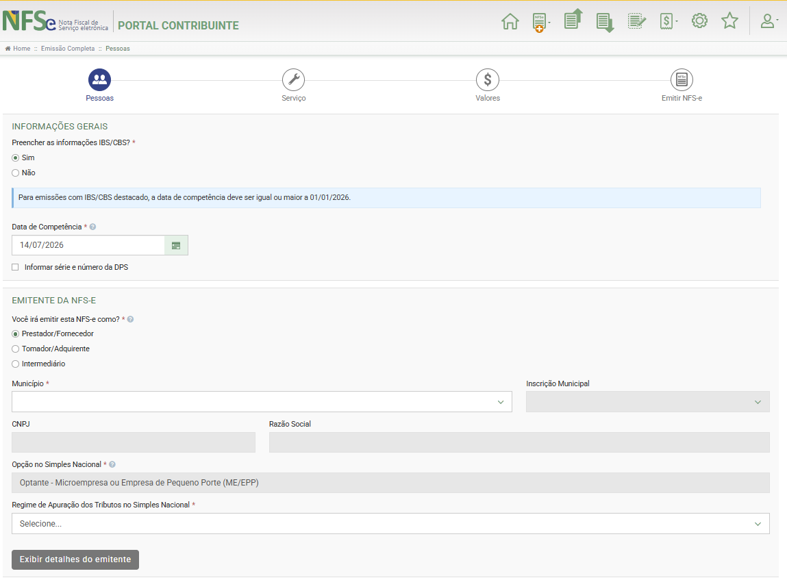

*Figura 30 – Passo 1 – Pessoas: informações gerais e emitente.*

A obrigatoriedade dos campos da tabela, bem como as regras de negócio aplicadas para cada um deles, estão dispostas na planilha de leiaute DPS e RN DPS descrita abaixo. Após o preenchimento dos campos, conforme indicado, clicar em “Avançar”.

<!-- p.22 -->

## Informações gerais

| Campo | Descrição | Tipo | Ocorrência | Ação |
| ----- | --------- | ---- | ---------- | ---- |
| Preencher as informações IBS/CBS? | Permite ao emitente indicar se preencherá ou não as informações relativas ao IBS e à CBS | CheckBox | Obrigatório | Selecionar uma das 2 opções para o emitente: Sim; Não |

A partir de 03 de agosto de 2026, passará a ser exigido o preenchimento das informações relativas ao IBS e à CBS, observadas as respectivas regras de validação. Dessa forma, não será permitida a emissão de documentos fiscais eletrônicos, pelas empresas sujeitas ao regime regular, sem o preenchimento dos campos correspondentes ao IBS e à CBS.

Às empresas optantes do regime do Simples Nacional, o início da obrigatoriedade do preenchimento das informações relativas ao IBS e à CBS se dará para os fatos geradores ocorridos a partir de 01 de janeiro de 2027.

| Campo | Descrição | Tipo | Ocorrência | Ação |
| ----- | --------- | ---- | ---------- | ---- |
| Data de Competência | Data em que o serviço foi prestado | Data | Obrigatório | Incluir a data da competência ou clicar no ícone do calendário e navegar até a data definida. |

<!-- p.23 -->

> **Obs.:** Ao selecionar “Sim” no campo “Preencher as informações IBS/CBS?”, a data de competência deve ser igual ou maior a 01/01/2026.

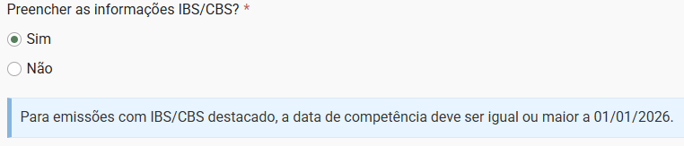

*Figura 31 – Passo 1 – Pessoas: seleção “Sim/Não” para IBS/CBS e aviso sobre a data de competência.*

DPS (Declaração de Prestação de Serviço) é um documento de posse e responsabilidade do contribuinte, que deverá ser gerado manualmente ou por alguma aplicação adquirida, possuindo uma numeração sequencial crescente e devendo ser convertido em NFS-e no prazo estipulado pela legislação tributária municipal.

Este documento atende também àqueles contribuintes que, porventura, não dispõem de infraestrutura de conectividade em tempo integral, podendo gerar os documentos e enviá-los, em lote, para processamento e geração das respectivas NFS-e.

Para que as DPS possam fazer parte de um lote a ser enviado para geração das NFS-e correspondentes, é necessário que o contribuinte possua uma aplicação instalada em seus computadores (desenvolvida particularmente seguindo as especificações disponibilizadas pelo Comitê Gestor da NFS-e).

Mais informações sobre DPS podem ser consultadas diretamente no site “O que é DPS?” — Portal da Nota Fiscal de Serviço eletrônica.

| Campo | Descrição | Tipo | Ocorrência | Ação |
| ----- | --------- | ---- | ---------- | ---- |
| Número e série da DPS (checkbox) | O número e a série da DPS são campos obrigatórios de controle da DPS que ajudam a identificar unicamente uma DPS. Em geral, campos são gerados automaticamente pelo sistema para cada emitente de NFS-e. No entanto, existem situações em que o emitente ainda necessita controlá-los ou deverá informá-los manualmente. O sistema emissor permite que o emitente possa informar o número de série (transcrever o número de série) que foi repassado ao não emitente da NFS-e. | CheckBox | Opcional | Clicar se a opção for informar a DPS. |

<!-- p.24 -->

| Campo | Descrição | Tipo | Ocorrência | Ação |
| ----- | --------- | ---- | ---------- | ---- |
| Série | Informação sobre a série da DPS. | Numérico | Obrigatório | Incluir a série da DPS. Deve ser um número entre 80.000 e 89.999, de acordo com a regra “Faixas de utilização da série da DPS”, descrita no ANEXO_I-SEFIN_ADN-DPS_NFSe-SNNFSe-v1.01-20260209 |
| Número da DPS | Número da DPS | Numérico | Obrigatório | Incluir o número da DPS |

## Emitente da NFS-e

EMITENTE DA NFS-E – Podem ser informadas 3 opções de emitente: Prestador/Fornecedor, Tomador/Adquirente ou Intermediário. A depender da opção feita, os campos para preenchimento vão sendo ajustados.

Na atual versão, a NFS-e somente poderá ser emitida pelo Prestador/Fornecedor de Serviço. As emissões de NFS-e por Tomador/Adquirente e Intermediário ainda não estão disponíveis. A funcionalidade será disponibilizada em uma versão futura.

<!-- p.25 -->

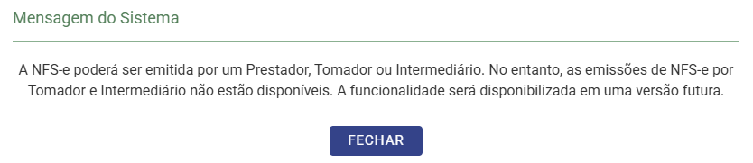

*Figura 32 – Passo 1 – Pessoas: mensagem sobre emissão somente por Prestador/Fornecedor.*

| Campo | Descrição | Tipo | Ocorrência | Ação |
| ----- | --------- | ---- | ---------- | ---- |
| Campo informação quem será o emitente da NFS-e: Prestador/Fornecedor, Tomador/Adquirente ou Intermediário. | Informação de quem será o emitente da NFS-e | CheckBox | Obrigatório | Selecionar uma das 3 opções para o emitente: Prestador/Fornecedor; Tomador/Adquirente; Intermediário |
| CPF/CNPJ | Informação do NI (CPF/CNPJ) do emitente | Numérico | Obrigatório | Este campo é recuperado dos cadastros RFB ou CNC conforme convênio do município |
| Nome | Informação sobre o nome ou Razão Social do emitente | Texto | Obrigatório | Este campo é recuperado dos cadastros RFB ou CNC conforme convênio do município |
| Município | Informação sobre o nome do município do emitente | Combo | Obrigatório | Este campo é recuperado dos cadastros RFB ou CNC conforme convênio do município. O município do emitente da NFS-e será preenchido automaticamente, e corresponde ao código do município emissor (cLocEmi) informado na NFS-e. De acordo com as regras de negócio. |
| Indicador Municipal (inscrição) | Informação do indicador (inscrição) Municipal do emitente | Combo | Obrigatório | Caso haja, este campo é recuperado do cadastro CNC, conforme convênio do município. |

<!-- p.26 -->

| Campo | Descrição | Tipo | Ocorrência | Ação |
| ----- | --------- | ---- | ---------- | ---- |
| Opção no Simples Nacional | Informa se o contribuinte emitente é ou não optante pelo Simples Nacional | Texto | De acordo com as regras de negócio | Este campo é recuperado dos cadastros RFB. |

### Regime de Apuração dos Tributos no Simples Nacional (para optantes do Simples Nacional)

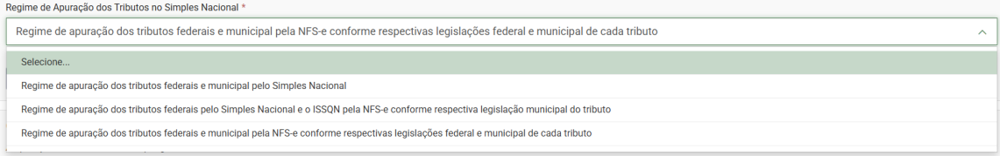

*Figura 33 – Passo 1 – Pessoas: opções do regime de apuração dos tributos no Simples Nacional.*

A depender da opção realizada neste campo, os campos da Tributação Municipal (ISSQN) serão ou não habilitados para preenchimento.

| Campo | Descrição | Tipo | Ocorrência | Ação |
| ----- | --------- | ---- | ---------- | ---- |
| Regime de apuração dos tributos federais e municipal serão realizados pelo SN ou pela NFS-e | Informação se o regime de apuração dos tributos federais e municipal serão realizados pelo SN ou pela NFS-e | Combo | De acordo com as regras de negócio | Selecionar o regime de apuração dos tributos federais e municipal, conforme o enquadramento do emitente. |
| Telefone | Informação do número do telefone do emitente. | Número | Opcional | Este campo é recuperado dos cadastros RFB ou CNC conforme convênio do município. Quando ausente nos cadastros oficiais, este campo é recuperado das informações complementares do emitente, preenchidas no menu Configurações |
| E-mail | Informação do endereço de e-mail do emitente. | Endereço de e-mail | Opcional | Este campo é recuperado dos cadastros RFB ou CNC conforme convênio do município. Quando ausente nos cadastros oficiais, este campo é recuperado das informações complementares do emitente, preenchidas no menu Configurações |

<!-- p.27 -->

| Campo | Descrição | Tipo | Ocorrência | Ação |
| ----- | --------- | ---- | ---------- | ---- |
| CEP | Informação do número do CEP | Número | Obrigatório | Este campo é recuperado dos cadastros RFB ou CNC conforme convênio do município |
| Logradouro | Informação do nome do logradouro | Texto | Obrigatório | Este campo é recuperado dos cadastros RFB ou CNC conforme convênio do município |
| Número | Informação do número do logradouro | Texto | Obrigatório | Este campo é recuperado dos cadastros RFB ou CNC conforme convênio do município |
| Complemento | Preencher com o complemento do logradouro | Texto | Opcional | - |
| Bairro | Preencher com o nome do bairro | Texto | Obrigatório | Este campo é recuperado dos cadastros RFB ou CNC conforme convênio do município |

## Compras governamentais

COMPRAS GOVERNAMENTAIS – Deve-se informar se a prestação/fornecimento de serviço se trata de uma compra governamental. Para emissões com destaque de IBS/CBS, as informações referentes a compras governamentais devem ser preenchidas.

Quando informado “Sim”, o endereço do Tomador/Adquirente será configurado para “Brasil” obrigatoriamente.

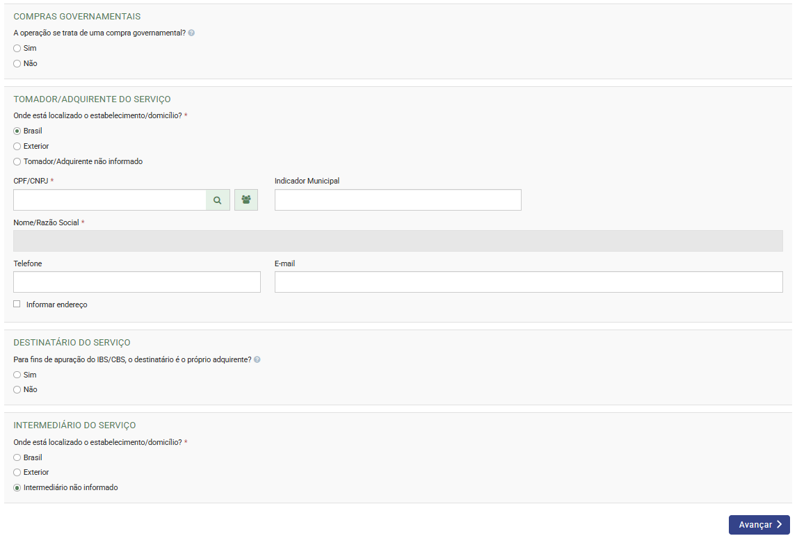

*Figura 34 – Passo 1 – Pessoas: compras governamentais, tomador/adquirente, destinatário e intermediário.*

| Campo | Descrição | Tipo | Ocorrência | Ação |
| ----- | --------- | ---- | ---------- | ---- |
| Compras Governamentais | Campo para informação de se a operação se trata de uma compra governamental | CheckBox | Obrigatório | Selecionar uma das 2 opções para o emitente: Sim; Não |

<!-- p.28 -->

| Campo | Descrição | Tipo | Ocorrência | Ação |
| ----- | --------- | ---- | ---------- | ---- |
| Selecionando “Sim”, deve-se informar o tipo de ente governamental | Informar o tipo de ente governamental | Combo | Obrigatório | Selecionar o ente governamental, dentre as opções: União; Estado; Distrito Federal; Município |

## Tomador/Adquirente do serviço

TOMADOR/ADQUIRENTE DO SERVIÇO – Podem ser informadas 3 opções relativas à localização do Tomador/Adquirente: Brasil ou Exterior ou Tomador/Adquirente não informado. A depender da opção feita, os campos para preenchimento vão sendo ajustados.

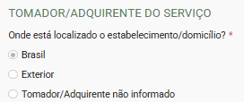

*Figura 35 – Passo 1 – Pessoas: localização do Tomador/Adquirente (Brasil, Exterior ou não informado).*

Para determinados Códigos de Tributação Nacional a serem preenchidos no passo 2 (Serviço), o preenchimento do Tomador/Adquirente do serviço é obrigatório, pois define o Local de Incidência do ISSQN (Lei Complementar 116/2003). Verificar a planilha MUN.INCID_INFO.SERV. do AnexoI-LeiautesRN_DPS_NFSe-SNNFSe.

| Campo | Descrição | Tipo | Ocorrência | Ação |
| ----- | --------- | ---- | ---------- | ---- |
| Opção para informar onde está localizado o estabelecimento/domicílio do Tomador/Adquirente. | Opção para informar onde está localizado o estabelecimento/domicílio do Tomador/Adquirente. | CheckBox | Obrigatório | Marcar uma das 3 opções disponíveis: Brasil; Exterior; Tomador/Adquirente não informado |

Tomador/Adquirente não informado – Caso esta opção seja marcada, nenhum campo será exibido para preenchimento posterior.

<!-- p.29 -->

### Tomador/Adquirente no Brasil

Caso esta opção seja marcada, os campos a serem disponibilizados referem-se a informações de uma pessoa física ou jurídica domiciliada no Brasil.

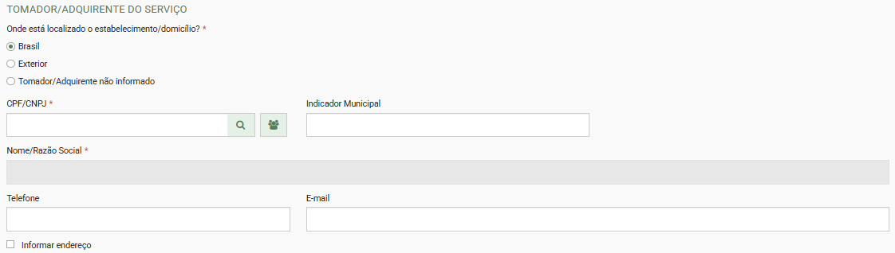

*Figura 36 – Passo 1 – Pessoas: tomador/adquirente no Brasil.*

| Campo | Descrição | Tipo | Ocorrência | Ação |
| ----- | --------- | ---- | ---------- | ---- |
| CPF/CNPJ | Informação do CPF/CNPJ do tomador/adquirente | Numérico | Obrigatório | Incluir o CPF/CNPJ do tomador/adquirente. Pode-se recuperar os dados dos últimos tomadores/adquirentes clicando em (ícone de pesquisa) |
| Indicador Municipal (Inscrição) | Informação do Indicador (Inscrição) Municipal do tomador/adquirente | Numérico | Obrigatório | Preencher com o indicador (inscrição) municipal do tomador/adquirente, caso haja. |
| Nome/Razão Social | Informação do nome ou Razão Social do tomador/adquirente | Texto | Obrigatório | Este campo é recuperado dos cadastros RFB conforme convênio do município |
| Telefone | Informação do número do telefone do tomador/adquirente | Número | Opcional | Incluir número do telefone do tomador/adquirente |

<!-- p.30 -->

| Campo | Descrição | Tipo | Ocorrência | Ação |
| ----- | --------- | ---- | ---------- | ---- |
| E-mail | Informação do endereço de e-mail cadastrado como contato no município | Endereço de e-mail | Opcional | Incluir o endereço de e-mail do tomador/adquirente |

#### Endereço Tomador/Adquirente no Brasil

> **Obs.:** As informações dos campos a seguir são recuperadas dos cadastros RFB, quando o tomador/adquirente for um CNPJ, podendo-se alterá-las.

| Campo | Descrição | Tipo | Ocorrência | Ação |
| ----- | --------- | ---- | ---------- | ---- |
| CEP | Informação do número do CEP | Número | Obrigatório | Incluir o CEP do endereço |
| Município | Informação do nome do município ao qual pertence o tomador no Brasil | Texto | Obrigatório | Este campo é recuperado da tabela TOM de acordo com o CEP informado |
| Bairro | Informação do nome do bairro | Texto | Obrigatório | Este campo é recuperado da tabela TOM de acordo com o CEP informado |
| Logradouro | Informação do nome do logradouro | Texto | Obrigatório | Este campo é recuperado da tabela TOM de acordo com o CEP informado |
| Número | Informação do número do logradouro | Texto | Obrigatório | Incluir o número do logradouro |
| Complemento | Informação do complemento do logradouro | Texto | Opcional | Incluir o complemento do logradouro |

### Tomador/Adquirente do Serviço no Exterior

Caso esta opção seja marcada, os campos a serem disponibilizados referem-se a informações específicas de outros países para uma pessoa <!-- p.31 -->física ou jurídica domiciliada fora do Brasil.

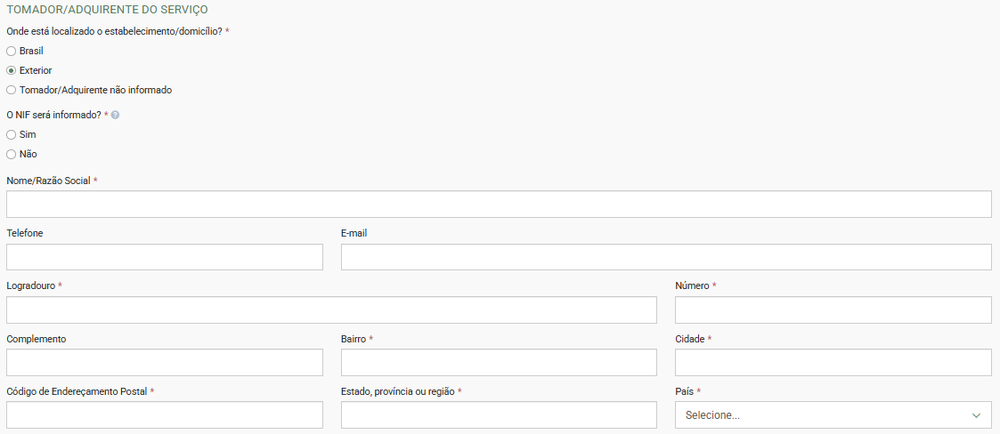

*Figura 37 – Passo 1 – Pessoas: tomador/adquirente no exterior.*

| Campo | Descrição | Tipo | Ocorrência | Ação |
| ----- | --------- | ---- | ---------- | ---- |
| Informação se haverá ou não a informação do NIF (Número de Identificação Fiscal – número fornecido pelo órgão de administração tributária do exterior e que identifica pessoa física ou jurídica externa ao Brasil (equivale ao CPF ou CNPJ, identificando a pessoa física ou jurídica no exterior). | Informação se haverá ou não a informação do NIF | CheckBox | Obrigatório | Selecionar uma das 2 opções disponíveis: Sim; Não |
| Opção para o caso de o NIF não ser informado | Opção para o caso de o NIF não ser informado | CheckBox | Obrigatório | Selecionar a opção “Não”. Nesse caso, deve-se informar o motivo da não informação do NIF. |

<!-- p.32 -->

| Campo | Descrição | Tipo | Ocorrência | Ação |
| ----- | --------- | ---- | ---------- | ---- |
| Informação sobre o motivo da não informação do NIF | Informação sobre o motivo da não informação do NIF | Checkbox | Obrigatório | Selecionar uma das duas opções: Dispensado do NIF; Não exigência do NIF |
| NIF | Informação do número de identificação internacional | Numérico | Obrigatório | Incluir o NIF do tomador/adquirente. Pode-se recuperar o NIF informado dos últimos tomadores em |
| Nome/Razão Social | Nome ou Razão Social do tomador/adquirente | Texto | Obrigatório | Preencher com o Nome/Razão Social do tomador/adquirente |
| Telefone | Número do telefone do tomador/adquirente | Número | Opcional | Preencher com número do telefone do tomador/adquirente |
| E-mail | Endereço de e-mail cadastrado como contato no município | Endereço de e-mail | Opcional | Preencher com o endereço de e-mail do tomador/adquirente |

#### Endereço do Tomador/Adquirente no Exterior

| Campo | Descrição | Tipo | Ocorrência | Ação |
| ----- | --------- | ---- | ---------- | ---- |
| Logradouro | Informação do nome do logradouro no exterior | Texto | Obrigatório | Preencher com o logradouro no exterior |
| Número | Informação do número do logradouro no exterior | Texto | Obrigatório | Preencher com o número do logradouro no exterior |
| Complemento | Informação do complemento do logradouro no exterior | Texto | Opcional | Preencher com o complemento do logradouro no exterior |

<!-- p.33 -->

| Campo | Descrição | Tipo | Ocorrência | Ação |
| ----- | --------- | ---- | ---------- | ---- |
| Bairro | Informação do nome do bairro no exterior | Texto | Obrigatório | Preencher com o bairro no exterior |
| Cidade | Informação do nome da cidade no exterior | Texto | Obrigatório | Preencher com o nome da cidade no exterior |
| Código de Endereçamento Postal | Informação do código de endereçamento postal do endereço no exterior | Caractere | Obrigatório | Preencher com o código de endereçamento postal do endereço no exterior |
| Estado, província ou região | Informação do nome do Estado, província ou região no exterior | Texto | Obrigatório | Preencher com o nome do Estado, província ou região no exterior |
| País | Informação do nome do País | Combo | Obrigatório | Selecionar um dos países da lista |

## Destinatário do serviço

DESTINATÁRIO DO SERVIÇO – Podem ser informadas 2 opções: “Sim”, para quando o Destinatário do Serviço é o próprio Tomador/Adquirente; ou “Não”, para quando o Destinatário do Serviço é uma pessoa física ou jurídica diversa do Tomador/Adquirente. A depender da opção feita, os campos a serem preenchidos serão disponibilizados na tela.

Esta opção será habilitada quando selecionado “Sim” na informação geral “Preencher as informações IBS/CBS?”

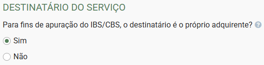

*Figura 38 – Passo 1 – Pessoas: destinatário do serviço é o próprio tomador/adquirente.*

| Campo | Descrição | Tipo | Ocorrência | Ação |
| ----- | --------- | ---- | ---------- | ---- |
| Opção para o caso de o Destinatário do serviço ser o próprio tomador/adquirente informado | Opção para o caso de o Destinatário do serviço ser o próprio tomador/adquirente informado | Combo | Obrigatório | Selecionar a opção “Sim”. Nesse caso, não há campos adicionais para preenchimento. |

<!-- p.34 -->

| Campo | Descrição | Tipo | Ocorrência | Ação |
| ----- | --------- | ---- | ---------- | ---- |
| Opção para o caso de o Destinatário do serviço não ser o próprio tomador/adquirente informado | Opção para o caso de o Destinatário do serviço não ser o próprio tomador/adquirente informado | Combo | Obrigatório | Caso selecione “Não” na opção anterior, deve-se selecionar uma das 2 opções disponíveis para a localização do Destinatário: Brasil; Exterior |

### Destinatário no Brasil

Caso esta opção seja marcada, os campos a serem disponibilizados referem-se a informações de uma pessoa física ou jurídica domiciliada no Brasil.

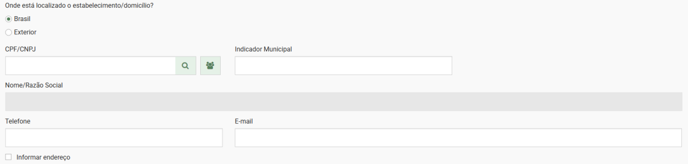

*Figura 39 – Passo 1 – Pessoas: destinatário no Brasil.*

| Campo | Descrição | Tipo | Ocorrência | Ação |
| ----- | --------- | ---- | ---------- | ---- |
| CPF/CNPJ | Informação do CPF/CNPJ do destinatário | Numérico | Obrigatório | Incluir o CPF/CNPJ do destinatário. Pode-se recuperar os dados dos últimos destinatários clicando em (ícone de pesquisa) |
| Indicador Municipal (Inscrição) | Informação do Indicador (Inscrição) Municipal do destinatário | Numérico | Obrigatório | Preencher com o indicador (inscrição) municipal do destinatário |
| Nome/Razão Social | Informação do nome ou Razão Social do destinatário | Texto | Obrigatório | Este campo é recuperado dos cadastros RFB ou CNC conforme convênio do município |
| Telefone | Informação do número do telefone do destinatário | Número | Opcional | Incluir número do telefone do destinatário |
| E-mail | Informação do endereço de e-mail cadastrado como contato no município | Endereço de e-mail | Opcional | Incluir o endereço de e-mail do destinatário |

<!-- p.35 -->

#### Endereço do Destinatário no Brasil

> **Obs.:** As informações dos campos a seguir são recuperadas dos cadastros RFB, quando o destinatário for um CNPJ, podendo-se alterá-las.

| Campo | Descrição | Tipo | Ocorrência | Ação |
| ----- | --------- | ---- | ---------- | ---- |
| CEP | Informação do número do CEP | Número | Obrigatório | Incluir o CEP do endereço |
| Município | Informação do nome do município ao qual pertence o destinatário no Brasil | Texto | Obrigatório | Este campo é recuperado da tabela TOM de acordo com o CEP informado |
| Bairro | Informação do nome do bairro | Texto | Obrigatório | Este campo é recuperado da tabela TOM de acordo com o CEP informado |
| Logradouro | Informação do nome do logradouro | Texto | Obrigatório | Este campo é recuperado da tabela TOM de acordo com o CEP informado |
| Número | Informação do número do logradouro | Texto | Obrigatório | Incluir o número do logradouro |
| Complemento | Informação do complemento do logradouro | Texto | Opcional | Incluir o complemento do logradouro |

### Destinatário do Serviço no Exterior

Caso esta opção seja marcada, os campos a serem disponibilizados referem-se a informações específicas de outros países para uma pessoa física ou jurídica domiciliada fora do Brasil.

<!-- p.36 -->

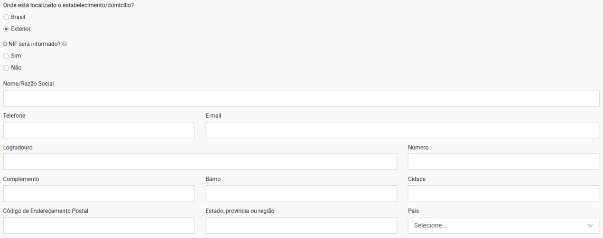

*Figura 40 – Passo 1 – Pessoas: destinatário no exterior.*

| Campo | Descrição | Tipo | Ocorrência | Ação |
| ----- | --------- | ---- | ---------- | ---- |
| Opção se haverá ou não a informação do NIF (Número de Identificação Fiscal – número fornecido pelo órgão de administração tributária do exterior e que identifica pessoa física ou jurídica externa ao Brasil (equivale ao CPF ou CNPJ, identificando a pessoa física ou jurídica no exterior). | Opção se haverá ou não a informação do NIF | CheckBox | Obrigatório | Selecionar uma das 2 opções disponíveis: Sim; Não |
| Opção para o caso de o NIF não ser informado | Opção para o caso de o NIF não ser informado | CheckBox | Obrigatório | Selecionar a opção “Não”. Nesse caso, deve-se informar o motivo da não informação do NIF. |
| Informação sobre o motivo da não informação do NIF | Informação sobre o motivo da não informação do NIF | Checkbox | Obrigatório | Selecionar uma das duas opções: Dispensado do NIF; Não exigência do NIF |

<!-- p.37 -->

| Campo | Descrição | Tipo | Ocorrência | Ação |
| ----- | --------- | ---- | ---------- | ---- |
| NIF | Informação do número de identificação internacional | Numérico | Obrigatório | Incluir o NIF do destinatário. Pode-se recuperar o NIF informado dos últimos destinatários em |
| Nome/Razão Social | Nome ou Razão Social do destinatário | Texto | Obrigatório | Preencher com o Nome/Razão Social do destinatário |
| Telefone | Número do telefone do destinatário | Número | Opcional | Preencher com número do telefone do destinatário |
| E-mail | Endereço de e-mail cadastrado como contato no município | Endereço de e-mail | Opcional | Preencher com o endereço de e-mail do destinatário |

#### Endereço do Destinatário no Exterior

| Campo | Descrição | Tipo | Ocorrência | Ação |
| ----- | --------- | ---- | ---------- | ---- |
| Logradouro | Informação do nome do logradouro no exterior | Texto | Obrigatório | Preencher com o logradouro no exterior |
| Número | Informação do número do logradouro no exterior | Texto | Obrigatório | Preencher com o número do logradouro no exterior |
| Complemento | Informação do complemento do logradouro no exterior | Texto | Opcional | Preencher com o complemento do logradouro no exterior |
| Bairro | Informação do nome do bairro no exterior | Texto | Obrigatório | Preencher com o bairro no exterior |
| Cidade | Informação do nome da cidade no exterior | Texto | Obrigatório | Preencher com o nome da cidade no exterior |

<!-- p.38 -->

| Campo | Descrição | Tipo | Ocorrência | Ação |
| ----- | --------- | ---- | ---------- | ---- |
| Código de Endereçamento Postal | Informação do código de endereçamento postal do endereço no exterior | Caractere | Obrigatório | Preencher com o código de endereçamento postal do endereço no exterior |
| Estado, província ou região | Informação do nome do Estado, província ou região no exterior | Texto | Obrigatório | Preencher com o nome do Estado, província ou região no exterior |
| País | Informação do nome do País | Combo | Obrigatório | Selecionar um dos países da lista |

## Intermediário do serviço

INTERMEDIÁRIO DO SERVIÇO – Podem ser informadas 3 opções relativas à localização do Intermediário: Brasil, Exterior ou Intermediário não informado. A depender da opção feita, os campos a serem preenchidos serão disponibilizados na tela.

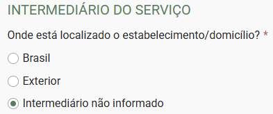

*Figura 41 – Passo 1 – Pessoas: localização do intermediário do serviço.*

| Campo | Descrição | Tipo | Ocorrência | Ação |
| ----- | --------- | ---- | ---------- | ---- |
| Opção para informar se há um intermediário e onde ele está localizado. | Opção para informar se há um intermediário e onde ele está localizado. | CheckBox | Obrigatório | Deve-se marcar uma das 3 opções: Brasil; Exterior; Intermediário não informado |

Intermediário não informado – Caso esta opção seja marcada, nenhum campo será exibido para preenchimento posterior.

### Intermediário no Brasil

Caso esta opção seja marcada, os campos a serem disponibilizados referem-se a informações de uma pessoa física ou jurídica domiciliada no Brasil.

<!-- p.39 -->

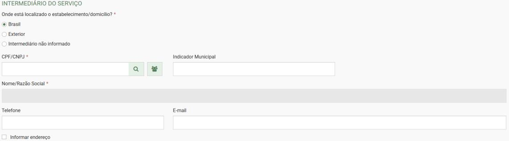

*Figura 42 – Passo 1 – Pessoas: intermediário no Brasil.*

| Campo | Descrição | Tipo | Ocorrência | Ação |
| ----- | --------- | ---- | ---------- | ---- |
| CPF/CNPJ | CPF/CNPJ do intermediário | Numérico | Obrigatório | Preencher com o CPF/CNPJ do intermediário |
| Indicador Municipal (Inscrição) | Indicador (Inscrição) Municipal do intermediário | Numérico | Opcional | Preencher com o indicador (inscrição) municipal do intermediário |
| Nome/Razão Social | Nome ou Razão Social do intermediário | Texto | Obrigatório | Este campo é recuperado dos cadastros RFB ou CNC conforme convênio do município |
| Telefone | Número do telefone do intermediário | Número | Opcional | Preencher com número do telefone do intermediário |
| E-mail | Endereço de e-mail cadastrado como contato no município | Endereço de e-mail | Opcional | Preencher com o endereço de e-mail do intermediário |

#### Endereço Intermediário no Brasil

> **Obs.:** As informações dos campos a seguir são recuperadas dos cadastros RFB, quando o intermediário for um CNPJ, podendo-se alterá-las.

| Campo | Descrição | Tipo | Ocorrência | Ação |
| ----- | --------- | ---- | ---------- | ---- |
| CEP | Informação do número do CEP | Número | Obrigatório | Preencher com o CEP do endereço |
| Município | Informação do nome do município ao qual pertence o intermediário no Brasil | Texto | Obrigatório | Este campo é recuperado da tabela TOM de acordo com o CEP informado |

<!-- p.40 -->

| Campo | Descrição | Tipo | Ocorrência | Ação |
| ----- | --------- | ---- | ---------- | ---- |
| Bairro | Informação do nome do bairro | Texto | Obrigatório | Este campo é recuperado da tabela TOM de acordo com o CEP informado |
| Logradouro | Informação do nome do logradouro | Texto | Obrigatório | Este campo é recuperado da tabela TOM de acordo com o CEP informado |
| Número | Informação do número do logradouro | Texto | Obrigatório | Preencher com o número do logradouro |
| Complemento | Informação do complemento do logradouro | Texto | Opcional | Preencher com o complemento do logradouro |

### Intermediário do Serviço no Exterior

Caso esta opção seja marcada, os campos a serem disponibilizados referem-se a informações específicas de outros países para uma pessoa física ou jurídica domiciliada fora do Brasil.

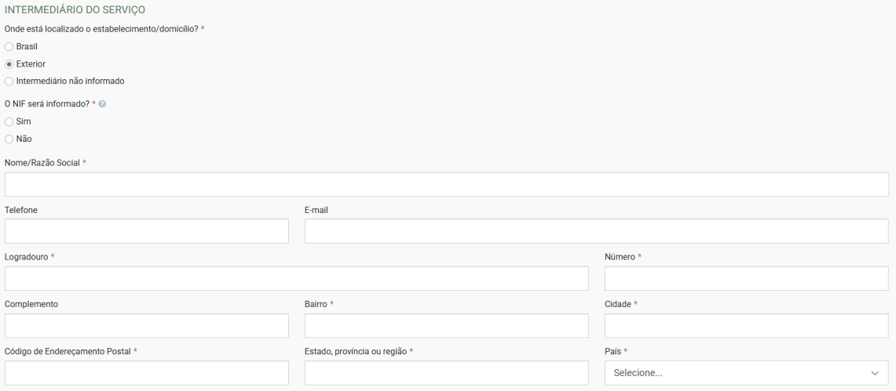

*Figura 43 – Passo 1 – Pessoas: intermediário no exterior.*

| Campo | Descrição | Tipo | Ocorrência | Ação |
| ----- | --------- | ---- | ---------- | ---- |
| Opção se haverá ou não a informação do NIF (Número de Identificação Fiscal – número fornecido pelo órgão de administração tributária do exterior e que identifica pessoa física ou jurídica externa ao Brasil (equivale ao CPF ou CNPJ, identificando a pessoa física ou jurídica no exterior). | Opção se haverá ou não a informação do NIF | CheckBox | Obrigatório | Selecionar uma das 2 opções: Sim; Não |

<!-- p.41 -->

| Campo | Descrição | Tipo | Ocorrência | Ação |
| ----- | --------- | ---- | ---------- | ---- |
| Opção para o caso de o NIF não ser informado | Opção para o caso de o NIF não ser informado | CheckBox | Obrigatório | Selecionar a opção “Não”. Nesse caso, deve-se informar o motivo da não informação do NIF. |
| Informação sobre o motivo da não informação do NIF | Informação sobre o motivo da não informação do NIF | Checkbox | Obrigatório | Selecionar uma das duas opções: Dispensado do NIF; Não exigência do NIF |
| NIF | Informação do número de identificação internacional | Numérico | Obrigatório | Incluir o NIF do tomador/adquirente. Pode recuperar o NIF informado dos últimos Intermediários |
| Nome/Razão Social | Nome ou Razão Social do intermediário | Texto | Obrigatório | Preencher com o Nome/Razão Social do intermediário |
| Telefone | Número do telefone do intermediário | Número | Opcional | Preencher com número do telefone do intermediário |
| E-mail | Endereço de e-mail cadastrado como contato no município | Endereço de e-mail | Opcional | Preencher com o endereço de e-mail do intermediário |

<!-- p.42 -->

#### Endereço do Intermediário no Exterior

| Campo | Descrição | Tipo | Ocorrência | Ação |
| ----- | --------- | ---- | ---------- | ---- |
| Logradouro | Informação do nome do logradouro no exterior. | Texto | Obrigatório | Preencher com o logradouro no exterior |
| Número | Informação do número do logradouro no exterior | Texto | Obrigatório | Preencher com o número do logradouro no exterior |
| Complemento | Informação do complemento do logradouro no exterior | Texto | Opcional | Preencher com o complemento do logradouro no exterior |
| Bairro | Informação do nome do bairro no exterior | Texto | Obrigatório | Preencher com o bairro no exterior |
| Cidade | Informação do nome da cidade no exterior | Texto | Obrigatório | Preencher com o nome da cidade no exterior |
| Código de Endereçamento Postal | Informação do código de endereçamento postal do endereço no exterior | Caractere | Obrigatório | Preencher com o código de endereçamento postal do endereço no exterior |
| Estado, província ou região | Informação do nome do Estado, província ou região no exterior | Texto | Obrigatório | Preencher com o nome do Estado, província ou região no exterior |
| País | Informação do nome do País | Combo | Obrigatório | Selecionar um dos países da lista |

Após o preenchimento dos campos da etapa “Pessoas”, clicar em “Avançar”.
