<!-- p.66 -->

# 4.1.3 PASSO 3 – Valores

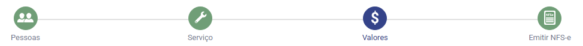

*Figura 4.1.3-1 – Etapas do fluxo, com o PASSO 3 – Valores em destaque.*

Tela para preenchimento dos valores do(s) serviço(s) que originou a emissão da NFSe.

A obrigatoriedade dos campos dessa tela, bem como as regras de negócio aplicadas para cada um deles, estão na planilha de leiaute DPS e RN DPS descrita abaixo.

Preencher os campos conforme as regras descritas na tabela abaixo e clicar em “Avançar”. A obrigatoriedade dos campos da tela do passo, bem como as regras de negócio aplicadas para cada um deles, são dadas para cada campo das planilhas de leiaute DPS e RN DPS (ANEXO_I-SEFIN_ADN-DPS_NFSe-SNNFSe) que corresponda ao campo na tela.

> **Atenção:** Alguns campos podem não estar editáveis e serão preenchidos de acordo com as configurações, do contribuinte e/ou serviço, do município em que o contribuinte está autorizado a emitir notas, bem como os indicadores municipais previamente cadastrados no Painel Municipal.

## Valores do fornecimento/serviço prestado

| Campo | Descrição | Tipo | Ocorrência | Ação |
|---|---|---|---|---|
| Valor da operação/serviço prestado | Informação sobre o valor total cobrado pelo serviço prestado | Valor | Obrigatório | Incluir o valor total da operação/serviço |
| Valor recebido pelo intermediário | Informação sobre o valor pago ao intermediário, caso informado na etapa 1 (pessoas) | Valor | Opcional | Incluir valor recebido pelo intermediário (se houver). |
| Desconto <!-- p.67 -->incondicionado | Informação sobre o valor do desconto incondicionado (desconto oferecido sem que haja necessidade de que alguma condição seja cumprida para obtenção do desconto. Ele é concedido por vontade do prestador/fornecedor sem qualquer imposição e reduzirá o valor do serviço prestado). | Valor | Opcional | Incluir o valor do desconto incondicionado. |
| Desconto condicionado | Informação sobre o valor do desconto condicionado (desconto oferecido desde que alguma condição seja cumprida para obtenção do desconto. Este depende de alguma condição posterior à emissão da NFS-e. A base de cálculo não é reduzida por este desconto). | Valor | Opcional | Incluir o valor do desconto condicionado. |

## Tributação municipal

Alguns campos já estarão preenchidos a depender das opções feitas em etapas anteriores. Por exemplo: não é permitido ao emitente informar alguns campos se se tratar de uma situação de exportação de serviço, conforme a planilha "COMEX - EXPORTAÇÃO DE SERVIÇO". Da mesma forma, **para os optantes pelo Simples Nacional, com apuração dos tributos pelo regime do Simples Nacional**, alguns campos não serão habilitados para preenchimento e a seguinte mensagem será exibida:

<!-- p.68 -->

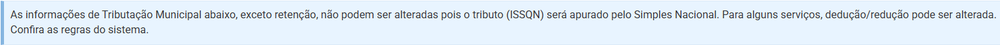

*Figura 4.1.3-2 – Mensagem sobre as informações de tributação municipal para optantes pelo Simples Nacional.*

Este campo será pré-preenchido dependendo das opções feitas nas telas anteriores:

- Operação tributável;
- Imunidade;
- Exportação de serviço;
- Não Incidência;

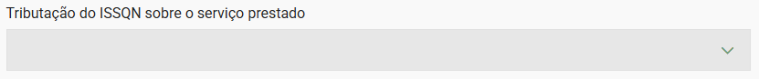

*Figura 4.1.3-3 – Campo “Tributação do ISSQN sobre o serviço prestado”.*

| Campo | Descrição | Tipo | Ocorrência | Ação |
|---|---|---|---|---|
| Tributação do ISSQN sobre o serviço prestado 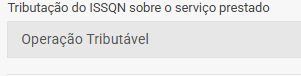 | Informação de que a operação é tributável. | Combo | Obrigatório | Preenchimento automático do tipo de exigibilidade do ISSQN seguindo regras conforme preenchimento de campos das telas anteriores. |
| Regime Especial de Tributação | Relaciona os Regimes Especiais de Tributação definidos pelo Município do emitente. **Somente disponível quando a operação for tributável.** | Combo | Obrigatório | Selecionar umas das opções, por exemplo: ○ Nenhum; ○ Ato cooperado; |

Se a opção for “Nenhum”, alguns campos serão disponibilizados para preenchimento;

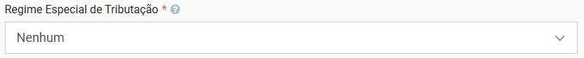

*Figura 4.1.3-4 – Campo “Regime Especial de Tributação” com a opção “Nenhum” selecionada.*

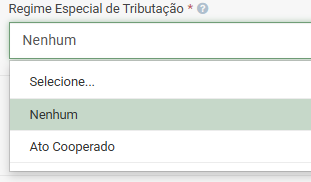

*Figura 4.1.3-5 – Campo “Regime Especial de Tributação”, com a opção “Nenhum”.*

## Suspensão da exigibilidade do ISSQN

**Suspensão da exigibilidade do ISSQN** – campos de informação sobre a exigibilidade do imposto.

> **Atenção:** A depender das opções das telas anteriores, alguns campos serão preenchidos automaticamente.

<!-- p.69 -->

Se a operação for tributável, alguns campos deverão ser preenchidos.

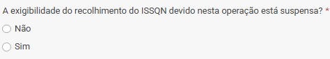

*Figura 4.1.3-6 – Campo “A exigibilidade do recolhimento do ISSQN devido nesta operação está suspensa?”.*

| Campo | Descrição | Tipo | Ocorrência | Ação |
|---|---|---|---|---|
| A exigibilidade do recolhimento do ISSQN devido nesta operação está suspensa? 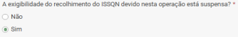 | Informação sobre a exigibilidade do recolhimento do ISSQN devido nesta operação está suspensa? | Combo | Obrigatório | Exibe os campos relativos à suspensão da exigibilidade: ○ Não ○ Sim |
| Tipo de suspensão | Informação sobre o tipo de suspensão: Judicial ou Administrativa | Combo | Obrigatório | Selecionar o tipo da suspensão: ○ Exigibilidade suspensa por decisão judicial ○ Exigibilidade suspensa por processo administrativo. |
| Número do processo | Informação do número da suspensão da exigibilidade | Valor | Obrigatório | Informar o número do processo da suspensão |

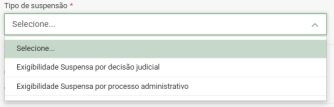

*Figura 4.1.3-7 – Lista de tipos de suspensão da exigibilidade.*

## Retenção do ISSQN

**Retenção do ISSQN** – Informação se haverá ou não retenção de ISSQN.

*Figura 4.1.3-8 – Campo “Há retenção do ISSQN pelo Tomador ou pelo Intermediário?”.*

Nos casos de exigibilidade suspensa não é possível informar retenção do ISSQN, o sistema exibirá uma mensagem de alerta.

<!-- p.70 -->

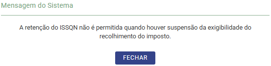

*Figura 4.1.3-9 – Mensagem do sistema: a retenção do ISSQN não é permitida quando há suspensão da exigibilidade.*

| Campo | Descrição | Tipo | Ocorrência | Ação |
|---|---|---|---|---|
| Há retenção do ISSQN pelo Tomador ou pelo Intermediário? – “Não”  | Informação de que “Não” haverá retenção de ISSQN | Combo | Obrigatório | Marcar “Não”. Neste caso nenhum campo a mais será exibido |
| Há retenção do ISSQN pelo Tomador ou pelo Intermediário? – “Sim”  | Informação de que “Sim” haverá retenção de ISSQN. | Combo | Obrigatório | Marcar “Sim”. Neste caso será aberto o campo “por quem o ISSQN será retido” |
| Opções de retenção do ISSQN  | Informação se o ISSQN: ○ Retido pelo Tomador ○ Retido pelo Intermediário | Botão Radio | Obrigatório | Informar o tipo da retenção do ISSQN. a) Se a opção for “Retido pelo Tomador”, deve ter sido informado o tomador/adquirente de serviço na primeira tela (Pessoas). Se não foi informado, será mostrada a mensagem (figura abaixo). Pode ser usado o botão “+Incluir Tomador”; b) Se a opção for “Retido pelo Intermediário”, deve ter sido informado o intermediário do serviço na primeira tela (Pessoas). Se não foi informado, será mostrada a mensagem. <!-- p.71 -->Pode ser usado o botão “+Incluir Intermediário”; 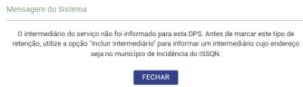 |

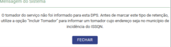

*Figura 4.1.3-10 – Mensagem do sistema: tomador do serviço não informado.*

| Campo | Descrição | Tipo | Ocorrência | Ação |
|---|---|---|---|---|
| Incluir/Editar Tomador  ou  | Incluir/Editar Tomador | Botão | Obrigatório | Informar os dados do tomador/adquirente, caso não tenham sido informados no passo pessoas; ou editá-los, caso tenham sido informados. |
| Incluir/Editar Intermediário  ou  | Incluir/Editar Intermediário | Botão | Obrigatório | Informar os dados do intermediário, caso não tenham sido informados no passo pessoas; ou editá-los, caso tenham sido informados. |

Para o prestador de serviço ME/EPP com apuração do ISSQN pelo Simples Nacional, é obrigatório informar alíquota do ISSQN quando há indicação de retenção do imposto.

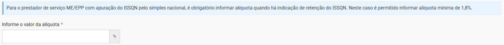

*Figura 4.1.3-11 – Mensagem sobre a alíquota do ISSQN para ME/EPP optante pelo Simples Nacional.*

| Campo | Descrição | Tipo | Ocorrência | Ação |
|---|---|---|---|---|
| Informe o valor da alíquota 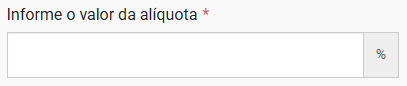 | Informação do valor da alíquota de ISSQN para o prestador/fornecedor optante pelo Simples Nacional | Valor | Obrigatório | Informe o valor da alíquota do ISSQN aplicável. |

## Benefício municipal

**Benefício Municipal** – Exibe os campos relativos ao benefício municipal

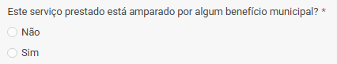

*Figura 4.1.3-12 – Campo “Este serviço prestado está amparado por algum benefício municipal?”.*

| Campo | Descrição | Tipo | Ocorrência | Ação |
|---|---|---|---|---|
| Este serviço prestado está amparado por algum benefício municipal? 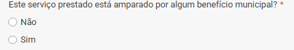 | Informação se há amparo de benefício municipal na tributação. | Opção Sim/ Não | Obrigatório | Informar: ○ “Não”: neste caso nenhum campo a mais será mostrado. <!-- p.72 -->○ “Sim”: só é possível se o município tiver cadastrado “benefício” para o serviço prestado e/ou prestador/fornecedor do serviço na data de competência informada. (Obs: entrar em contato com o município, se alguma das situações acima ocorrer.). |
| Este serviço prestado está amparado por algum benefício municipal? – “Sim” 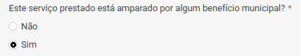 | Informação de “Sim” para amparo de benefício municipal na tributação. | Opção Sim/ Não | Obrigatório | Informar “Sim” para benefício fiscal. Alguns campos obrigatórios deverão ser preenchidos. |
| Identificação do Benefício Municipal (BM) | Informação sobre a identificação do BM | Combo | Obrigatório | Selecionar uma das opções configuradas pelo município concedente. Caso o BM cadastrado para o serviço/contribuinte seja do tipo “Redução de Base de Cálculo”, o emitente deverá informar o valor (percentual ou monetário) da redução. |
| Valor/Percentual para redução da BC | Informação sobre o valor percentual/monetário da redução do BM na BC | Valor | Obrigatório | Informar o percentual/valor da redução da BC. |

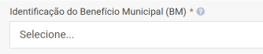

*Figura 4.1.3-13 – Campo “Identificação do Benefício Municipal (BM)”.*

## Informações para dedução/redução da base de cálculo do ISSQN

**Informações para dedução/redução da base de cálculo do ISSQN?** – Exibe os campos relativos a deduções/reduções da base de cálculo.

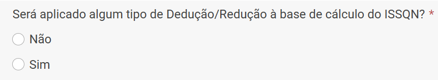

*Figura 4.1.3-14 – Campo “Será aplicado algum tipo de Dedução/Redução à base de cálculo do ISSQN?”.*

<!-- p.73 -->

| Campo | Descrição | Tipo | Ocorrência | Ação |
|---|---|---|---|---|
| Será aplicado algum tipo de Dedução/Redução à base de cálculo do ISSQN? 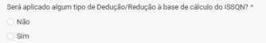 | Informação se há algum tipo de dedução/redução. | Combo | Obrigatório | Selecionar uma das opções: ○ Não ○ Sim |

Caso seja selecionado a opção “Sim”, deve-se selecionar o tipo de dedução/redução:

*Figura 4.1.3-15 – Tipos de dedução/redução da base de cálculo do ISSQN.*

| Campo | Descrição | Tipo | Ocorrência | Ação |
|---|---|---|---|---|
| Valor monetário | Informação sobre o valor de Redução da BC | Valor | Obrigatório | Informar o valor monetário a ser utilizado como redução da BC. O valor deve ser menor que o valor do serviço prestado. |
| Valor percentual | O valor da dedução/redução será calculado pelo percentual informado | Valor | Obrigatório | Informar o valor percentual a ser utilizado como redução da BC. |

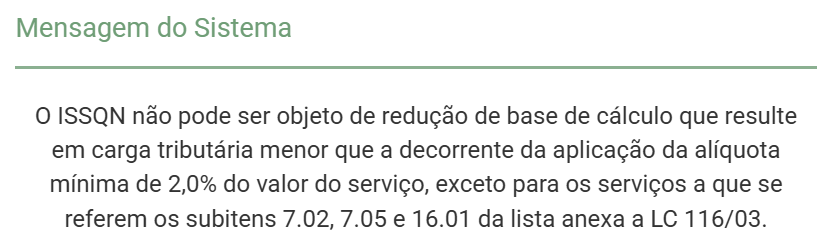

*Figura 4.1.3-16 – Mensagem do sistema: o ISSQN não pode ser objeto de redução de base de cálculo que resulte em carga tributária menor que a alíquota mínima de 2,0%.*

Caso o tipo de dedução/redução seja do tipo “Documentos”, selecionar **+ Incluir Documento** para vincular os documentos.

*Figura 4.1.3-17 – Tipos de dedução/redução com a opção “Documentos” selecionada.*

Em seguida, o painel exibirá a tela para inclusão das informações referentes ao documento vinculado à dedução.

<!-- p.74 -->

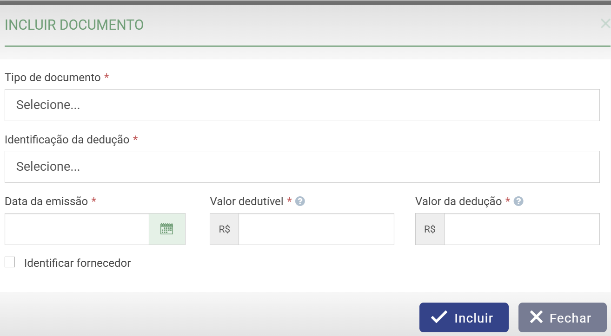

*Figura 4.1.3-18 – Tela “Incluir documento” para dedução/redução.*

Após o preenchimento dos campos, selecionar **Incluir**.

| Campo | Descrição | Tipo | Ocorrência | Ação |
|---|---|---|---|---|
| Tipo de documento  | Informação do tipo de documento a ser incluído | Combo | Obrigatório | Selecionar uma das opções da lista: ○ NF-e ○ NFS-e ○ Outras NFS-e ○ NF/NFS ○ Outros Documentos Fiscais ○ Outros Documentos. Obs.: A depender do tipo de documento informado, o painel exibirá campos específicos com as informações a serem preenchidas. Abaixo, trataremos dos tipos NF-e e NFS-e. |
| Chave de Acesso da NF-e ou Chave de acesso da NFS-e | Informação sobre a chave de acesso da NF-e ou NFS-e a ser vinculada à dedução | Valor | Obrigatório | Informar o número da chave de acesso do documento: Se NF-e deve conter 44 caracteres alfanuméricos; Se NFS-e deve conter 50 <!-- p.75 -->caracteres alfanuméricos; O sistema fará a busca do respectivo documento na base de dados e confirmará a existência dele. Caso o documento não exista será exibida a mensagem: “Informe uma chave de NF-e ou NFS-e válida.” |
| Identificação da dedução  | Informação sobre a identificação da dedução | Combo | Obrigatório | Selecionar uma das opções disponíveis, por exemplo: Materiais |
| Data da emissão | Informação sobre a data de emissão do documento | Data | Obrigatório | Informar a data de emissão do documento |
| Valor dedutível | Informação sobre valor dedutível | Valor | Obrigatório | Informar a parte do valor do documento apto a ser utilizado como dedução |
| Valor da dedução | Informação sobre o valor da dedução | Valor | Obrigatório | Informar a parte do valor identificado como apto a reduzir a base de cálculo da NFS-e em emissão |
| Identificar fornecedor  | Informação sobre o fornecedor na operação do documento informado | Checkbox | Opcional | Informar os dados do fornecedor na operação do documento informado. Selecionar entre as opções: ○ Brasil ○ Exterior. Preencher os campos exibidos, conforme obrigatoriedade e seguindo as orientações já indicadas no passo <!-- p.76 -->Pessoas. |

Salvo exceções previstas na legislação, o ISSQN não pode ser objeto de redução de base de cálculo que resulte em carga tributária menor que a decorrente da aplicação da alíquota mínima de 2,0% do valor do serviço. O sistema exibirá a seguinte mensagem de alerta, para que, se for o caso, sejam feitas as correções devidas:

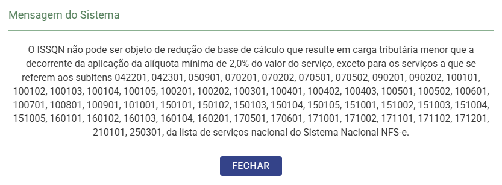

*Figura 4.1.3-19 – Mensagem de alerta sobre a alíquota mínima de 2,0% e os subitens da lista anexa.*

Após a inclusão, os documentos serão listados na tela, podendo-se editá-los ou excluí-los:

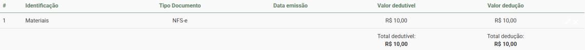

*Figura 4.1.3-20 – Lista de deduções/reduções incluídas.*

| Campo | Descrição | Tipo | Ocorrência | Ação |
|---|---|---|---|---|
| Valor dedução – edição 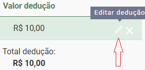 | Opção de edição do documento informado para dedução | Opção | Opcional | Selecionar “Editar dedução” e editar os campos necessários |
| Valor dedução – exclusão 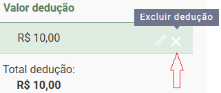 | Opção de exclusão do documento informado para dedução | Opção | Opcional | Selecionar “Excluir dedução” e confirmar a mensagem do sistema:  |
| Alíquota | Informação do percentual do imposto efetivo aplicado ao valor da base de cálculo | Valor | Conforme Regra de Negócio | Recuperado do valor percentual informado na tela “Serviço” para o cálculo do ISSQN |
| BC ISSQN | Informação sobre a base de cálculo do ISSQN. | Valor | Conforme Regra de Negócio | Recuperado do valor total do serviço reduzido o valor total das deduções e do valor do desconto incondicionado |
| <!-- p.77 -->Valor ISSQN | Valor do imposto a ser recolhido | Valor | Conforme Regra de Negócio | Calculado automaticamente, sendo o valor do imposto a ser recolhido para pagamento ao município. |

## Tributação federal

**TRIBUTAÇÃO FEDERAL**

> **Atenção:** Quando o emitente tem os tributos relacionados apurados pelo Simples Nacional, as informações de Tributação Federal já estarão preenchidas e não podem ser alteradas.

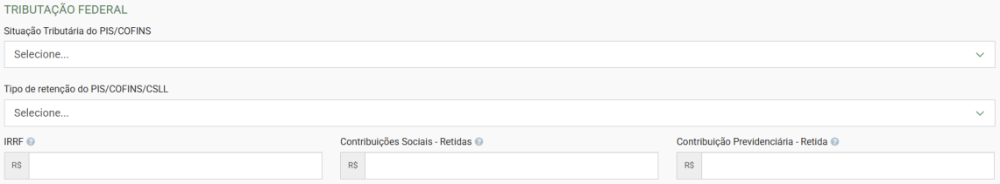

*Figura 4.1.3-21 – Seção “Tributação federal” com os campos de tributos federais.*

**PIS/COFINS** – Os campos a serem preenchidos dependem da opção da “Situação Tributária do PIS/COFINS” selecionada.

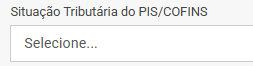

*Figura 4.1.3-22 – Campo “Situação Tributária do PIS/COFINS”.*

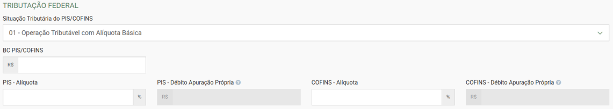

*Figura 4.1.3-23 – Campos de PIS/COFINS com a situação “01 – Operação Tributável com Alíquota Básica”.*

| Campo | Descrição | Tipo | Ocorrência | Ação |
|---|---|---|---|---|
| Situação Tributária do PIS/COFINS | Informação sobre o tipo de situação tributária do PIS/COFINS | Combo | Opcional | Selecionar dentre os tipos de situação tributária da lista disponibilizada, por exemplo: ○ 00 – Nenhum ○ 01 – Operação Tributável com Alíquota Básica |
| BC PIS/COFINS | Total do valor da base de cálculo para PIS/COFINS | Valor | Conforme Regra de Negócio | Incluir o valor informado |
| PIS - Alíquota | Valor do percentual a ser aplicado | Valor percentual | Conforme Regra de Negócio | Incluir percentual informado |
| <!-- p.78 -->PIS - Débito Apuração Própria | Valor calculado do imposto pela alíquota informada | Valor | Conforme Regra de Negócio | Calculado automaticamente, conforme BC e Alíquota informadas. |
| COFINS - Alíquota | Valor do percentual a ser aplicado | Valor percentual | Conforme Regra de Negócio | Incluir percentual informado |
| COFINS - Débito Apuração Própria | Valor calculado do imposto pela alíquota informada | Valor | Conforme Regra de Negócio | Calculado automaticamente, conforme BC e Alíquota informadas. |
| Tipo retenção do PIS/COFINS/CSLL | Informação sobre o tipo de retenção de PIS/COFINS e CSLL | Combo | Obrigatório | Informar o tipo de retenção de PIS/COFINS e CSLL, conforme lista disponibilizada, por exemplo: ○ 0 – PIS/COFINS/CSLL Não Retidos ○ 3 – PIS/COFINS/CSLL Retidos |

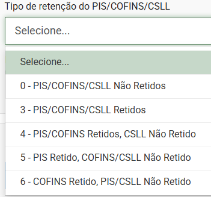

*Figura 4.1.3-24 – Lista de tipos de retenção de PIS/COFINS/CSLL.*

**Outros tributos federais**

| Campo | Descrição | Tipo | Ocorrência | Ação |
|---|---|---|---|---|
| IRRF | Valor do IRRF retido, conforme legislação própria | Valor | Opcional | Incluir o valor do IRRF, se aplicável |
| Contribuições Sociais - Retidas | Valor de PIS/COFINS e CSLL retidos, conforme legislação própria | Valor | Opcional | Incluir o valor de PIS/COFINS e CSLL retidos, se aplicável |
| Contribuição Previdenciária - Retida | Valor da Contribuição Previdenciária Patronal retida, conforme legislação própria | Valor | Opcional | Incluir o valor da Contribuição Previdenciária Patronal, se aplicável |

<!-- p.79 -->

## IBS/CBS

**IBS/CBS** – Campos para preenchimento do Código de Situação Tributária – CST e do Código de Classificação Tributária – cClassTrib aplicáveis ao serviço/fornecimento.

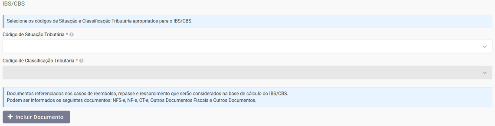

*Figura 4.1.3-25 – Seção IBS/CBS, com os campos de CST e cClassTrib.*

| Campo | Descrição | Tipo | Ocorrência | Ação |
|---|---|---|---|---|
| Código de Situação Tributária – CST | Informação sobre o código de situação tributária aplicável ao serviço/fornecimento | Combo | Obrigatório | Selecionar o CST aplicável ao serviço/fornecimento |

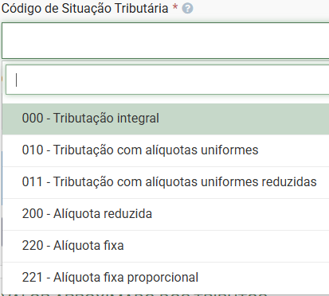

*Figura 4.1.3-26 – Lista de Códigos de Situação Tributária (CST) do IBS/CBS.*

| Campo | Descrição | Tipo | Ocorrência | Ação |
|---|---|---|---|---|
| Código de Classificação Tributária – cClassTrib | Informação sobre o código de classificação aplicável ao serviço/fornecimento | Combo | Obrigatório | Selecionar o cClassTrib aplicável ao serviço/fornecimento. Obs.: a lista de cClassTrib exibida dependerá do CST selecionado previamente |

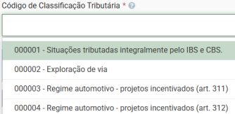

*Figura 4.1.3-27 – Lista de códigos de classificação tributária (cClassTrib).*

Nesse grupo também poderão ser incluídos os documentos referenciados nos casos de reembolso, repasse e ressarcimento, a serem considerados na apuração da base de cálculo do IBS/CBS.

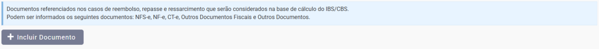

*Figura 4.1.3-28 – Documentos referenciados nos casos de reembolso, repasse e ressarcimento.*

Para incluir o documento, selecione **+ Incluir Documento**.

Em seguida, o painel exibirá a tela para inclusão das informações referentes ao documento vinculado ao reembolso, repasse ou ressarcimento. Após o preenchimento dos campos, selecionar **Incluir**.

<!-- p.80 -->

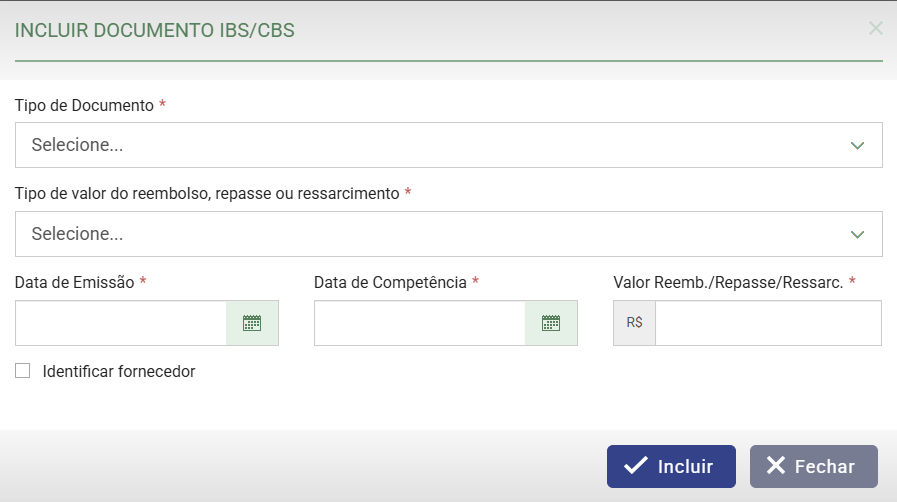

*Figura 4.1.3-29 – Tela “Incluir documento IBS/CBS” para reembolso, repasse ou ressarcimento.*

| Campo | Descrição | Tipo | Ocorrência | Ação |
|---|---|---|---|---|
| Tipo de documento  | Informação do tipo de documento a ser incluído | Combo | Obrigatório | Selecionar uma das opções da lista: ○ NF-e ○ NFS-e ○ CT-e ○ Outro. Obs.: A depender do tipo de documento informado, o painel exibirá campos específicos com as informações a serem preenchidas. Abaixo, trataremos dos tipos NF-e e NFS-e. |
| Chave de Acesso da NFS-e ou Chave de acesso da NF-e | Informação sobre a chave de acesso da NF-e ou NFS-e a ser vinculada ao reembolso, repasse ou ressarcimento | Valor | Obrigatório | Informar o número da chave de acesso do documento: Se NF-e deve conter 44 caracteres alfanuméricos; Se NFS-e deve conter 50 caracteres alfanuméricos; O sistema fará a busca do respectivo documento na <!-- p.81 -->base de dados e confirmará a existência dele. Caso o documento não exista será exibida a mensagem: “Informe uma chave de NF-e ou NFS-e válida.” |
| Identificação do reembolso, repasse ou ressarcimento | Informação sobre a identificação do reembolso, repasse ou ressarcimento | Combo | Obrigatório | Selecionar uma das opções disponíveis, por exemplo: Repasse de remuneração por intermediação... |
| Data de Emissão | Informação sobre a data de emissão do documento | Data | Obrigatório | Informar a data de emissão do documento |
| Data de Competência | Informação sobre a data de competência do documento | Data | Obrigatório | Informar a data de competência do documento |
| Valor Reemb./ Repasse / Ressarc. | Informação sobre o valor do reembolso, repasse ou ressarcimento | Valor | Obrigatório | Informar o valor do documento objeto de reembolso, repasse ou ressarcimento e que serão considerados na base de cálculo do IBS/CBS |
| Identificar fornecedor  | Informação sobre o fornecedor na operação do documento informado | Checkbox | Opcional | Informar os dados do fornecedor na operação do documento informado. Selecionar entre as opções: ○ Brasil ○ Exterior. Preencher os campos exibidos, conforme obrigatoriedade e seguindo as orientações já indicadas no passo <!-- p.82 -->Pessoas. |

*Figura 4.1.3-30 – Lista de tipos de valor de reembolso, repasse ou ressarcimento.*

Após a inclusão, os documentos serão listados na tela, podendo-se editá-los ou excluí-los:

*Figura 4.1.3-31 – Lista de documentos de reembolso, repasse ou ressarcimento incluídos.*

| Campo | Descrição | Tipo | Ocorrência | Ação |
|---|---|---|---|---|
| Valor do reembolso, repasse ou ressarcimento – edição 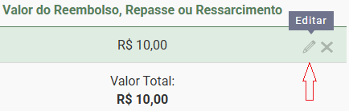 | Opção de edição do documento informado para reembolso, repasse ou ressarcimento | Opção | Opcional | Selecionar “Editar” e editar os campos necessários |
| Valor do reembolso, repasse ou ressarcimento – exclusão  | Opção de exclusão do documento informado para reembolso, repasse ou ressarcimento | Opção | Opcional | Selecionar “Excluir” e confirmar a mensagem do sistema:  |

## Valor aproximado dos tributos

As informações dos valores aproximados dos tributos podem ser pré-configuradas, agilizando a emissão da NFS-e. Para isto, acesse a opção "Configurações" no menu principal.

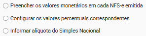

*Figura 4.1.3-32 – Opções para informar os valores aproximados dos tributos.*

Deve-se selecionar uma das opções e preencher os campos exibidos.

A opção “Informar alíquota do Simples Nacional” será exibida somente para os optantes desse regime. Nesse caso, a ME/EPP informará a alíquota nominal a qual está sujeita nos termos do referido regime, conforme o art. 9º, do Decreto 8.264/2014, que regulamenta a Lei 12.741/2012.

### Valores monetários totais para os tributos Federal, Estadual e Municipal

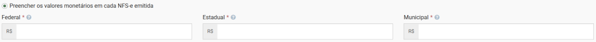

*Figura 4.1.3-33 – Campos de valores monetários totais dos tributos Federal, Estadual e Municipal.*

| Campo | Descrição | Tipo | Ocorrência | Ação |
|---|---|---|---|---|
| Federal | Informação sobre o valor monetário total para os tributos Federais da NFS-e em relação ao valor <!-- p.83 -->do serviço. | Valor | Obrigatório | Preencher com o valor monetário total para os tributos Federais da NFS-e em relação ao valor do serviço. |
| Estadual | Informação sobre o valor monetário total para os tributos Estaduais da NFS-e em relação ao valor do serviço. | Valor | Obrigatório | Preencher com o valor monetário total para os tributos estaduais da NFS-e em relação ao valor do serviço. |
| Municipal | Informação sobre o valor monetário total para o imposto municipal da NFS-e em relação ao valor do serviço. | Valor | Obrigatório | Preencher com o valor monetário total para o imposto municipal da NFS-e em relação ao valor do serviço. |

### Valores percentuais totais para os tributos Federal, Estadual e Municipal

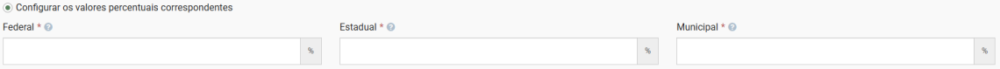

*Figura 4.1.3-34 – Campos de valores percentuais totais dos tributos Federal, Estadual e Municipal.*

| Campo | Descrição | Tipo | Ocorrência | Ação |
|---|---|---|---|---|
| Federal | Informação dos valores percentuais totais para os tributos Federais. | Valor | Obrigatório | Informar o valor percentual total de impostos federais da NFS-e em relação ao valor total do serviço. |
| Estadual | Informação dos valores percentuais totais para os tributos estaduais. | Valor | Obrigatório | Informar o valor percentual total de impostos estaduais da NFS-e em relação ao valor total do serviço. |
| Municipal | Informação dos valores percentuais totais para o imposto municipal. | Valor | Obrigatório | Informar o valor percentual total do imposto municipal da NFS-e em relação ao valor total do serviço. |

### Valor da alíquota para o regime do Simples Nacional

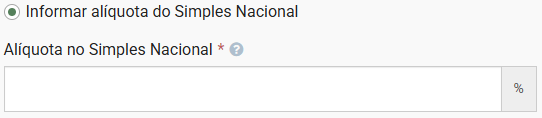

*Figura 4.1.3-35 – Campo “Alíquota no Simples Nacional”.*

| Campo | Descrição | Tipo | Ocorrência | Ação |
|---|---|---|---|---|
| <!-- p.84 -->Alíquota no Simples Nacional | Informação da alíquota nominal do Simples Nacional | Valor | Obrigatório | Informar o valor da alíquota nominal do Simples Nacional aplicável ao emitente |

Após o preenchimento dos campos da etapa “Valores”, clicar em **Avançar**.
