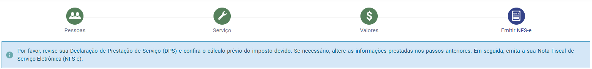
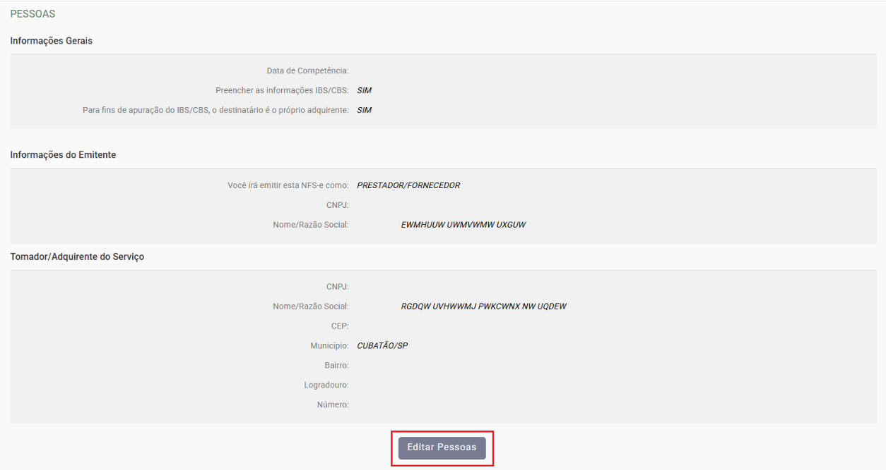
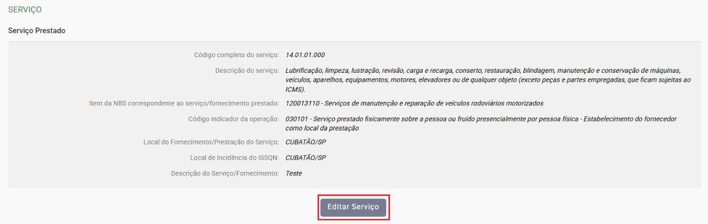
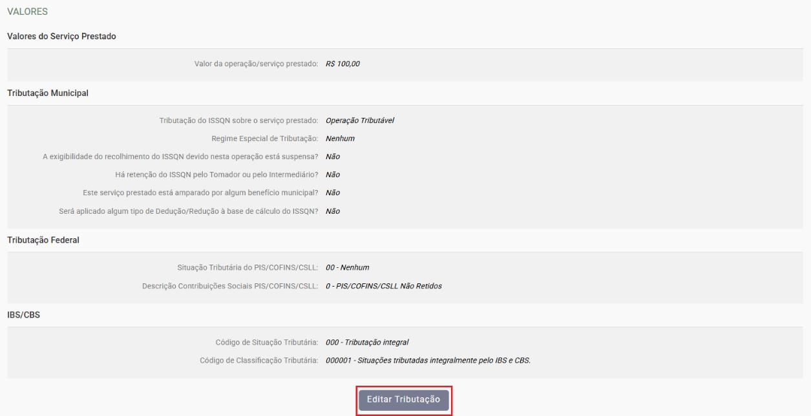
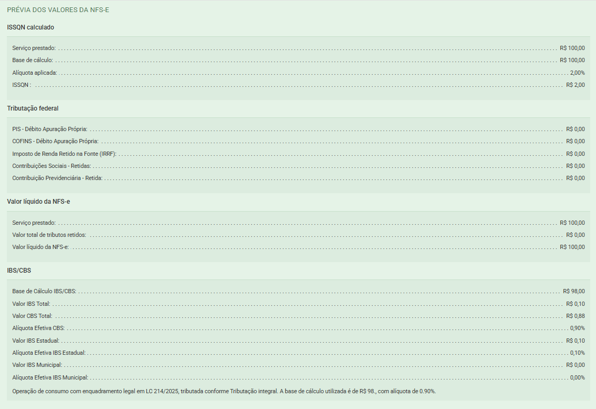

<!-- p.84 -->

# 4.1.4 PASSO 4 – Emitir NFS-e

*Figura 4.1.4-1 – Etapas do fluxo, com o PASSO 4 – Emitir NFS-e em destaque.*

Será apresentado um resumo dos itens informados em cada um dos passos de preenchimento da NFS-e. Neste momento o usuário tem a possibilidade de retornar e alterar as informações prestadas antes de solicitar a emissão da NFS-e.

Neste passo é importante que se revise a Declaração de Prestação de Serviço (DPS) e confira o cálculo prévio dos tributos devidos. Se necessário, é possível a alteração das informações prestadas nos passos anteriores.

O acionamento do comando “Emitir NFS-e” da tela envia o XML da DPS que foi formado pelo preenchimento das informações nos passos anteriores para o Serviço de Geração de NFS-e da Sefin Nacional NFS-e. Este serviço valida a DPS conforme regras do `ANEXO_I-SEFIN_ADN-DPS_NFSe-SNNFSe` e retorna o XML da NFS-e gerada.

## 4.1.4.1 Editar Pessoas

O usuário deve conferir os dados das pessoas envolvidas na emissão do documento. Caso alguma informação não esteja correta, deve clicar em “Editar Pessoas”, fazer as alterações necessárias e clicar em “Avançar”.

<!-- p.85 -->

*Figura 4.1.4-2 – Resumo da etapa Pessoas, com o botão “Editar Pessoas”.*

## 4.1.4.2 Editar Serviço

O usuário deve conferir os dados do serviço informado na emissão do documento. Caso alguma informação não esteja correta, deve clicar em “Editar Serviço”, fazer as alterações necessárias e clicar em “Avançar”.

*Figura 4.1.4-3 – Resumo da etapa Serviço, com o botão “Editar Serviço”.*

## 4.1.4.3 Editar Valores

Os valores serão recuperados conforme os dados preenchidos nas etapas anteriores; e o usuário deve conferir os valores retornados para a emissão do documento. Caso alguma informação não esteja correta, deve clicar em “Editar Tributação”, fazer as alterações necessárias e clicar em “Avançar”.

Para conferência, é exibida a tela dos valores da NFS-e:

<!-- p.86 -->

*Figura 4.1.4-4 – Resumo da etapa Valores, com o botão “Editar Tributação”.*

*Figura 4.1.4-5 – Prévia dos valores da NFS-e.*
