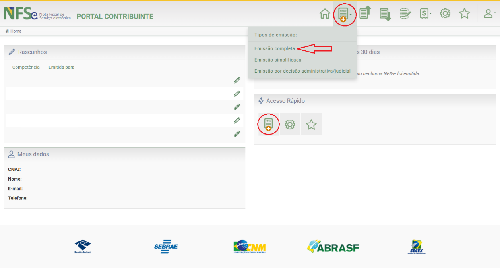

<!-- p.20 -->

# 4.1 Emissão de NFS-e Completa (Todos Contribuintes)

A Emissão Completa é obrigatória para alguns tipos de prestação de serviço, como exportação e serviços cujo ISSQN é devido no local do tomador/adquirente.

Para emitir a nota fiscal de modo completo pelo portal web, basta clicar no ícone marcado na imagem abaixo e selecionar a opção “Emissão Completa”; ou no painel de “Acesso Rápido”:

*Figura 28 – Menu de tipos de emissão e painel de Acesso Rápido.*

Para preencher e emitir uma NFS-e serão consideradas regras de acordo com as opções de cada conjunto de informações solicitadas como Pessoas, Serviço, Valores e Emitir NFS-e.

Na tabela abaixo estão explicitadas a maioria das informações que poderão ser necessárias.

A obrigatoriedade dos campos, bem como as regras de negócio aplicadas para cada um deles, estão dispostas nas planilhas de leiaute DPS e RN DPS (ANEXO_I-SEFIN_ADN-DPS_NFSe-SNNFSe).
