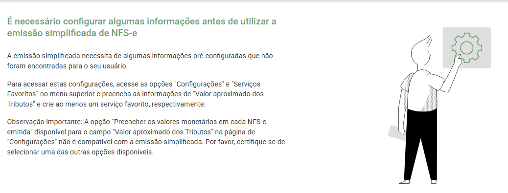

<!-- p.88 -->

# 4.2.1 Configuração do sistema para emissão da NFS-e simplificada

Para a emissão da NFS-e simplificada, é necessário realizar algumas configurações no sistema. Acesse as opções “Configurações” e “Serviços Favoritos” no menu superior, preencha as informações de “Valor aproximado dos Tributos” e crie os serviços favoritos, respectivamente.

Se o usuário acessar a “Emissão Simplificada” e não tiver feito as configurações previamente, o sistema exibirá a seguinte tela:

*Figura 4.2.1-1 – Tela exibida ao acessar a Emissão Simplificada sem as configurações prévias.*
