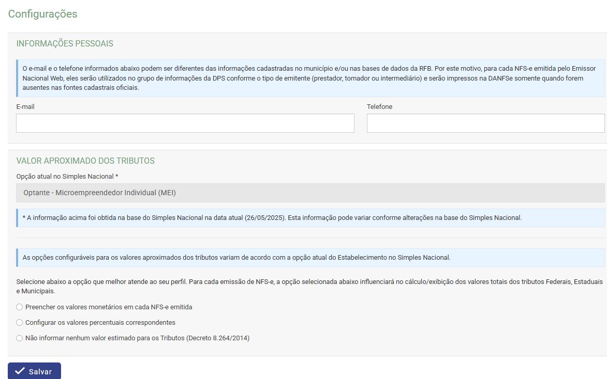

# 4.2.2 Configurações no menu principal

O sistema exibirá a seguinte tela:

*Figura 4.2.2-1 – Ícone “Configurações” no menu superior.*

*Figura 4.2.2-2 – Tela de Configurações, com informações pessoais e valor aproximado dos tributos.*

Informar o e-mail e telefone e marcar a opção para os cálculos/exibição dos valores totais dos tributos Federais, Estaduais e Municipais.

Clicar em “Salvar” e voltar para a emissão simplificada.
