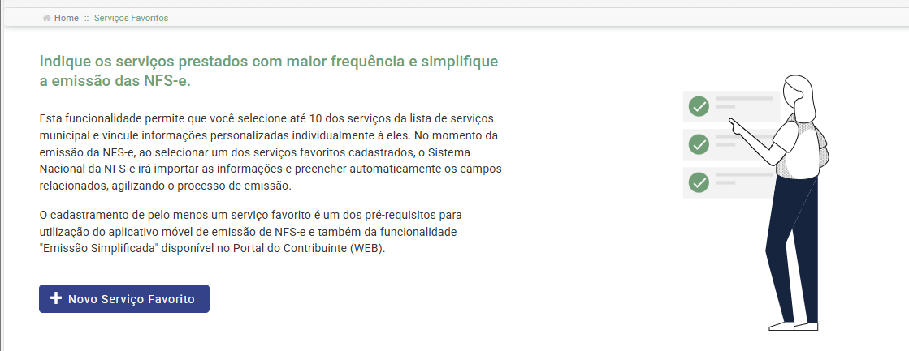
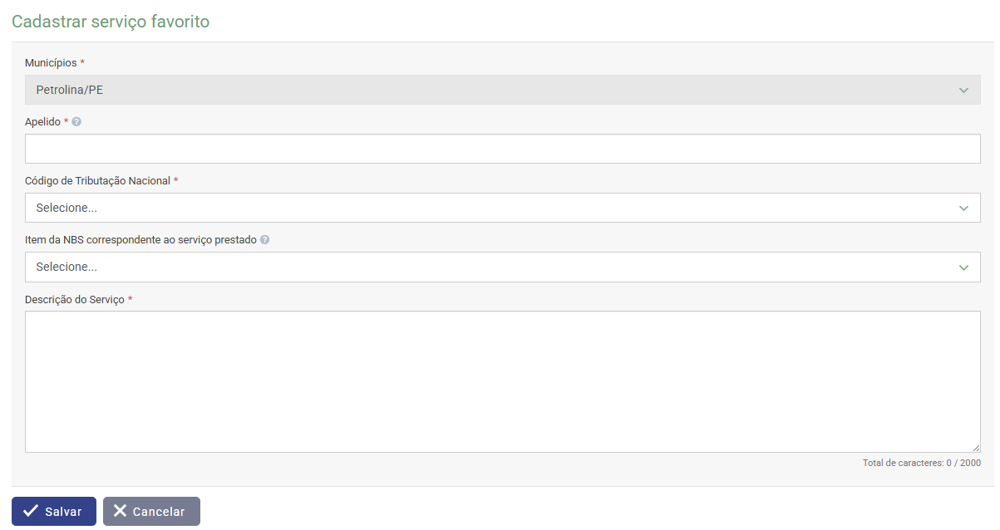
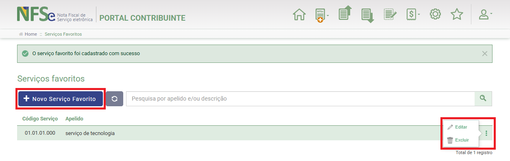

<!-- p.89 -->

# 4.2.3 Criando serviços favoritos

O sistema exibirá a tela abaixo para inclusão de “Novo Serviço Favorito”:

*Figura 4.2.3-1 – Tela inicial de Serviços Favoritos.*

*Figura 4.2.3-2 – Tela de cadastro de serviço favorito.*

Preencher os campos:

1. **Apelido** (termo que ajudará o emissor, posteriormente, a identificar o serviço pré-configurado dentro do Sistema Nacional da NFS-e. Deve ter no máximo 50 caracteres);
2. **Código de Tributação Nacional** – selecionar dentre os códigos da lista;
3. **Item da NBS** correspondente ao serviço prestado. A Nomenclatura Brasileira de Serviços Intangíveis e Outras Operações que Produzam Variações no Patrimônio (NBS) é o classificador nacional para a identificação dos serviços e viabiliza adequadamente a elaboração fiscalização e avaliação de políticas públicas de forma integrada. Selecionar dentre os valores cadastrados;
4. **Descrição do serviço**.

Após o preenchimento de todos os campos, clicar em “Salvar”.

<!-- p.90 -->

O serviço cadastrado será exibido na tela inicial, onde será possível editá-lo ou excluí-lo; ou, ainda, cadastrar um novo serviço favorito.

*Figura 4.2.3-3 – Lista de serviços favoritos cadastrados, com as ações de editar e excluir.*
